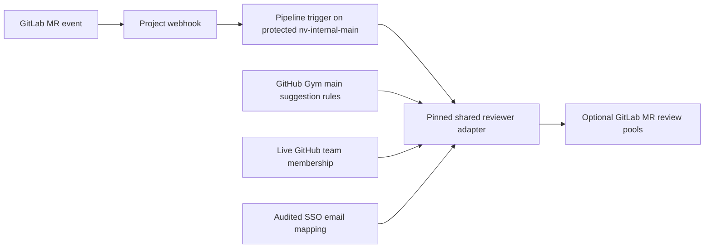

# Internal GitLab report adapter

`collect_downstream_junit.py` is the GitLab-specific final report hop for Gym CPU CI. The required
`gym-cpu-ci` bridge remains the authoritative NeMo CI verdict. After it reaches a terminal state,
the report job downloads the receipt-bound Generic Package written by the trusted NeMo parent
collector and republishes its XML with `artifacts:reports:junit`.

The package coordinate is unique to the originating pipeline and source:

```text
nemo-gym-ci-junit / pipeline-<CI_PIPELINE_ID>-<CI_COMMIT_SHA> / reports.zip
```

The ZIP contains `receipt.json` plus only `junit/**/*.xml`. The receipt binds the exact Gym
project, pipeline, MR, and source SHA to the NeMo parent, collector job, and selected child pipeline.
It also declares the sorted path, size, and SHA-256 of every report. The receiver rejects stale or
mismatched identities, extra or duplicate archive members, unsafe paths, non-regular files,
oversized content, hash/size mismatches, malformed XML, and DTD/entity declarations before it
atomically publishes any output. A valid zero-report receipt represents a downstream failure that
occurred before pytest; the separately required bridge still carries that failure.

The receiver uses only the current Gym `CI_JOB_TOKEN` to read Gym's own package registry. It does
not query NeMo pipeline metadata and never accepts `RO_API_TOKEN`, `GITLAB_API_TOKEN`, or another
persistent credential. The trusted NeMo job uploads with its ephemeral job token after an explicit
owner-approved NeMo-to-Gym job-token allowlist entry. Successful mailbox cleanup must occur only
after GitLab has uploaded the Gym JUnit artifact; until that post-artifact behavior is live-proven,
an age-bounded package retention policy owns cleanup.

Focused validation runs with:

```bash
uv run pytest tests/unit_tests/tooling/test_collect_downstream_junit.py
```

## Advisory review pools

After this configuration merges into GitHub Gym `main`, reaches protected GitLab
`nv-internal-main`, and the project webhook is enabled, MR events will run
`gym-review-pools` on that protected branch. The job will reuse the pinned
FW-CI-templates adapter to attach optional approval rules named
`github-review-pool: @nvidia-nemo/<team>` with zero required approvals.



GitHub Gym's `.github/CODEOWNERS` `# suggest:` entries and live GitHub teams remain
the routing and membership sources. The shared adapter will resolve audited NVIDIA
email account names to exact GitLab usernames, require active Developer-or-higher
project membership, and exclude the MR author. Missing identities will block all
writes. Existing MR-local required approval rules and native CODEOWNERS remain
intact. The adapter will refuse to create pools if switching from inherited
project rules would discard a required rule.

GitLab switches to MR-local approval rules when the first optional pool is
created. Future project-level regular or any-approver rules will not automatically
apply to those MRs. This is an accepted limitation of advisory pools. Today Gym
has no project-level approval rules. Before introducing or changing project
approval requirements, maintainers must migrate the rules on existing MRs as
part of that policy change; the event-driven adapter does not perform that migration.

The job reads the webhook from GitLab's `TRIGGER_PAYLOAD` file and accepts only
open, reopen, or update events for non-draft MRs targeting `nv-internal-main` in
project `191584`. It re-reads the current MR diff, checks the head before each
write, and serializes updates through `resource_group: gym-review-pools`. Approval
events are ignored. Failures are advisory through `allow_failure: true`.

The job does not check out or execute MR source code. Both credentials must be
protected, masked, hidden, raw CI variables scoped to environment `review-pools`:

| Variable | Source and purpose |
| --- | --- |
| `GH_SSO_MANAGMENT_PAT` | Existing `nemo-ci-ops` audited SSO credential; reads the roster, GitHub rules, and GitHub teams. The spelling matches the shared downloader. |
| `GITLAB_REVIEW_POOLS_TOKEN` | Dedicated project access token with `api` scope and Maintainer role; reads MR/member data and manages optional rules. |

The `review-pools` environment is protected. Its only allowed deployer is the
dedicated project bot (user `160783`), which also owns pipeline trigger `3236`.
This protects jobs declaring this environment, including `action: access`, from
other pipeline users. Variable protection alone would also expose credentials to
jobs on the protected GitHub mirror branch if they declared this environment.
Project Maintainers can change environment protection and remain trusted operators.

The webhook uses a pipeline trigger owned by the dedicated project bot. Its URL
targets `/api/v4/projects/191584/ref/nv-internal-main/trigger/pipeline`; the trigger
token remains in GitLab webhook settings. Webhook `283184` is staged with every
event disabled. The existing CPU CI jobs continue to select MR pipelines only.

The GitHub reviewer workflow and GitLab job pin FW-CI-templates commit
`6433b3b14022abe1a72da8baac638944b36e3099`, the merged revision of PR #627
on shared `main`.

Activate in this order:

1. Merge this configuration into GitHub Gym `main` after validation and bot review.
2. Bring the mirrored changes into protected GitLab `nv-internal-main` and verify
   that `gym-review-pools` is present on that branch.
3. Verify both variable scopes, environment protection for bot `160783`, and
   trigger ownership. Enable only merge request events on webhook `283184`.
   Do not enable pipeline, job, or push events.

Validate the shared adapter with its unit tests, run Gym's pre-commit hooks, and
submit the expanded YAML to the project CI lint API. Once enabled, verify a
trigger pipeline runs only `gym-review-pools`, inspect its resolved pool plan,
and repeat reconciliation to confirm an empty change plan.
