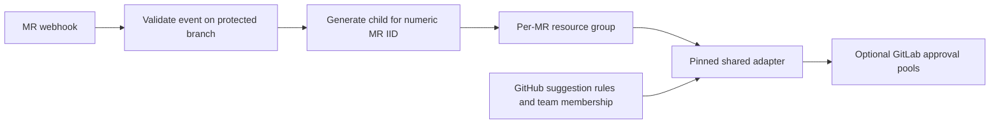

# Internal GitLab report adapter

`collect_downstream_junit.py` is the GitLab-specific final report hop for Gym CPU CI. The required
`gym-cpu-ci` bridge remains the authoritative NeMo CI verdict. After it reaches a terminal state,
the report job downloads the receipt-bound Generic Package written by the trusted NeMo parent
collector and republishes its XML with `artifacts:reports:junit`.

The package coordinate is unique to the originating pipeline and source:

```text
nemo-gym-ci-junit / pipeline-<CI_PIPELINE_ID>-<CI_COMMIT_SHA> / reports.zip
```

The ZIP contains `receipt.json` plus only `junit/**/*.xml`. The receipt binds the exact Gym
project, pipeline, MR, and source SHA to the NeMo parent, collector job, and selected child pipeline.
It also declares the sorted path, size, and SHA-256 of every report. The receiver rejects stale or
mismatched identities, extra or duplicate archive members, unsafe paths, non-regular files,
oversized content, hash/size mismatches, malformed XML, and DTD/entity declarations before it
atomically publishes any output. A valid zero-report receipt represents a downstream failure that
occurred before pytest; the separately required bridge still carries that failure.

The receiver uses only the current Gym `CI_JOB_TOKEN` to read Gym's own package registry. It does
not query NeMo pipeline metadata and never accepts `RO_API_TOKEN`, `GITLAB_API_TOKEN`, or another
persistent credential. The trusted NeMo job uploads with its ephemeral job token after an explicit
owner-approved NeMo-to-Gym job-token allowlist entry. Successful mailbox cleanup must occur only
after GitLab has uploaded the Gym JUnit artifact; until that post-artifact behavior is live-proven,
an age-bounded package retention policy owns cleanup.

Focused validation runs with:

```bash
uv run pytest tests/unit_tests/tooling/test_collect_downstream_junit.py
```

## EKS staging runner opt-in

For an internal merge request targeting `nv-internal-main`, add the exact MR
label `ci::eks-staging` and start a new merge request pipeline. The rule applies
to any source branch. Removing the label and starting another pipeline restores
the normal corpnet runner path. Existing pipelines retain their selected route;
retrying a job does not re-evaluate the MR label.

The label selects `GYM_CI_BACKEND=eks-staging` through the existing
`main-mirror` NeMo CI bridge. Gym lint, core, and server checks use the isolated
`nemo-gitlab-ci-stg` runner tag, a dedicated ECR executor image, and 24 CPUs /
128Gi RAM per job. The experimental fleet accepts up to 256 concurrent jobs,
subject to AWS quota and available capacity. Canary pipelines have a separate
resource group. Source preparation, image resolution, and JUnit collection keep
their existing control-job routing.

Unlabeled MRs keep the existing default refs, runner tags, resources, and image
selection. Branches created before this rule was introduced must first merge or
rebase onto the updated `nv-internal-main` so their CI configuration contains it.

## Advisory review pools

Today MR webhooks run the shared adapter on protected `nv-internal-main` and
create optional approval rules with zero required approvals. These rules expose
eligible approvers; they do not assign the MR's Reviewers field.

From deployment of this configuration, a lightweight preparation job will validate
`TRIGGER_PAYLOAD` and generate a child pipeline. Each child will lock only
`gym-review-pools-191584-<MR IID>`. Updates to one MR will remain serialized while
different MRs can run concurrently. Irrelevant events will generate a no-op child
without credentials or dependency installation.



The GitLab adapter pin will move to
`f6e8ed5837b263566534bf0dff0d83a7c653ca8b`
([FW-CI-templates PR 631](https://github.com/NVIDIA-NeMo/FW-CI-templates/pull/631)).
The adapter will skip mapped users without active Developer-or-higher project
membership and report them in `warnings`. Missing identity mappings, empty pools,
and attempts to replace required approval rules will still block writes. The MR
author is excluded. The adapter will always reconcile the optional approval pools.
When the MR has no reviewers, the adapter will additionally assign eligible pool
members as reviewers. If reviewers already exist, their list will stay unchanged.
The adapter rechecks the reviewer list immediately before assignment and checks
the current MR state and head before writes. GitLab has no atomic assign-if-empty
operation, so a manual assignment in the remaining read/write window can race.

The dispatcher accepts only open, reopen, or update events for non-draft MRs in
project `191584` targeting `nv-internal-main`. Only a positive integer MR IID is
inserted into the child configuration. The child uses a local trusted job template
from the protected pipeline commit; webhook content cannot supply job code.
The preparation job checks out the protected branch, never MR source code. The
credentialed child uses `GIT_STRATEGY: empty` and fetches only the pinned adapter.

Both credentials are protected, masked, hidden, raw CI variables scoped to the
`review-pools` environment:

| Variable | Purpose |
| --- | --- |
| `GH_SSO_MANAGMENT_PAT` | Read audited SSO identities, GitHub rules, and team membership. |
| `GITLAB_REVIEW_POOLS_TOKEN` | Read project members and manage optional MR approval rules. |

The protected environment permits dedicated project bot `160783`, which owns
trigger `3236`. Webhook `283184` sends merge request events to that trigger on
protected `nv-internal-main`. The child inherits the triggering identity and reads
the project variables in its own `review-pools` environment; the bridge forwards
neither pipeline nor YAML variables. CPU CI continues to select MR pipelines only.

Failures remain advisory through `allow_failure: true`; inspect the child job
status and trace rather than relying on the parent pipeline's success status.

GitLab switches to MR-local approval rules when the first optional pool is
created. Future project-level regular or any-approver rules will not automatically
apply to those MRs. Before introducing or changing project approval requirements,
maintainers must migrate rules on existing MRs as part of that policy change.

Validate the dispatcher tests, shared adapter tests, pre-commit hooks, and expanded
parent/child configurations with GitLab CI lint. After deployment, trigger two
different MRs and verify different resource-group keys, inspect missing-member
warnings, and repeat reconciliation to confirm an empty change plan.
