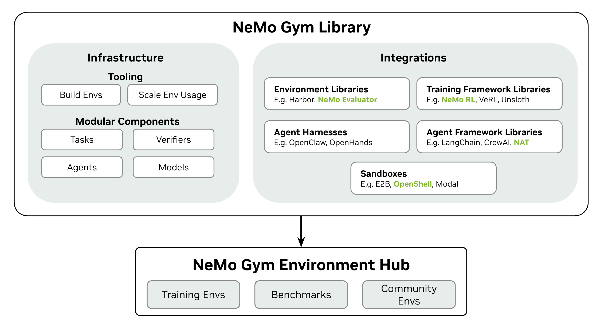

# NeMo Gym

[](https://pypi.org/project/nemo-gym/)
[](https://pypi.org/project/nemo-gym/)
[](https://opensource.org/licenses/Apache-2.0)
[](https://github.com/NVIDIA-NeMo/Gym/actions/workflows/unit-tests.yml)
[](https://docs.nvidia.com/nemo/gym/main/about/)

**[Requirements](#-requirements)** • **[Quick Start](#-quick-start)** • **[Environment Tutorials](#-environment-tutorials)** • **[Available Environments](#-available-environments)** • **[Documentation & Resources](#-documentation--resources)** • **[Community & Support](#-community--support)** • **[Citations](#-citations)**

NeMo Gym is a library for evaluating and improving models and agents using environments. NeMo Gym provides infrastructure to develop environments, scalably run evaluation and training, and a collection of popular benchmarks and training environments.

An environment is the complete system an agent interacts with to complete a task. It consists of a dataset (tasks to solve), an agent harness (how the model interacts with the world), a verifier (task completion scoring), and state (per-task execution context).

## 🎯 When to Use NeMo Gym

- You need to **evaluate models or agents** in stateful environments (e.g. code execution, tool calling, sandboxes)
- You want **reproducible evaluation** across teams using shared environments and verifiers
- You need to use environments **at scale** — multiple repeats per task, or thousands of concurrent requests for training
- You want to **seamlessly transition** between evaluation, agent optimization, and training

If you're scoring model outputs with a stateless check and don't need scale or training, a script is probably sufficient.

## 🏆 What NeMo Gym Provides

- Modular, extensible interfaces for agents, environments, tasks, and verifiers
- Environment hub of popular benchmarks and training environments
- Use your own agents or choose from built-in harnesses
- Scale to thousands of concurrent environments
- Train with the RL framework of your choice
- Optional OpenTelemetry tracing across the agent, model, and resources servers
- Battle-tested in production Nemotron training



## 🌎 Ecosystem

NeMo Gym is a component of [NVIDIA NeMo](https://docs.nvidia.com/nemo/gym/main/about/ecosystem#related-nemo-libraries), a GPU-accelerated platform for training generative AI models and optimizing AI agents. NeMo Gym is integrated with the broader agentic ecosystem - see the [Ecosystem](https://docs.nvidia.com/nemo/gym/main/about/ecosystem) page for more details.

**Environment Libraries:** Seamlessly combine environments and benchmarks from other libraries alongside NeMo Gym environments. Examples:
[Aviary](https://github.com/NVIDIA-NeMo/Gym/tree/main/resources_servers/aviary) • [Harbor](https://github.com/NVIDIA-NeMo/Gym/tree/main/responses_api_agents/harbor_agent) • [OpenEnv](https://github.com/NVIDIA-NeMo/Gym/tree/main/resources_servers/openenv) • [Reasoning Gym](https://github.com/NVIDIA-NeMo/Gym/tree/main/resources_servers/reasoning_gym) • [Verifiers](https://github.com/NVIDIA-NeMo/Gym/tree/main/responses_api_agents/verifiers_agent)

**Training Framework Libraries:** Use environments for SFT and RL training.
[NeMo RL](https://docs.nvidia.com/nemo/gym/tutorials/training-tutorials/nemo-rl-grpo) • [Unsloth](https://docs.nvidia.com/nemo/gym/tutorials/training-tutorials/unsloth) • [VeRL](https://docs.nvidia.com/nemo/gym/tutorials/training-tutorials)

**Agent Harnesses:** Agent harnesses for evaluation and training available out of the box. Examples:
[OpenHands](https://github.com/NVIDIA-NeMo/Gym/tree/main/responses_api_agents/swe_agents) • [Mini SWE Agent](https://github.com/NVIDIA-NeMo/Gym/tree/main/responses_api_agents/mini_swe_agent) • [LangGraph](https://github.com/NVIDIA-NeMo/Gym/tree/main/responses_api_agents/langgraph_agent)

## 📣 News

* **[10/06/2026]** [Release v0.7.0](https://github.com/NVIDIA-NeMo/Gym/releases/tag/v0.7.0):
  Highlights:
  - Define reusable agent-environment interactions with Environment Servers that manage sessions, verification, cleanup, and failures
  - Reuse compatible agent harnesses across tasks and environments through common sandbox and verification infrastructure
  - Finish large evaluations reliably with job-time-aware scheduling, predictable memory use, and automatic Slurm resume after timeout or preemption
  - Preserve token-level training trajectories with durable worker-side capture for vLLM and Megatron
  - Run multi-service OpenSandbox workloads from Compose files and pause or resume sandboxes without losing task state

<details>
<summary>Previous News</summary>

* **[09/03/2026]** [Release v0.6.0](https://github.com/NVIDIA-NeMo/Gym/releases/tag/v0.6.0):
  Highlights:
  - Use supported external agent harnesses during RL training while preserving exact token IDs across multi-step runs
  - Compare fixed and routed model strategies on the same benchmark with Switchyard
  - Validate and debug rollouts with automatic health checks, traces, and token, tool-call, turn, and latency diagnostics
  - Evaluate multiple agents and datasets in one run with task-level harness routing
  - Scale vLLM evaluation jobs across GPUs or Slurm nodes for higher rollout concurrency

* **[08/06/2026]** [Release v0.5.0](https://github.com/NVIDIA-NeMo/Gym/releases#release-v0.5.0):
  Highlights:
  - Seven sandbox providers: Docker, Daytona, ECS Fargate, Enroot, and OpenShell join OpenSandbox and Apptainer; large-scale OpenSandbox reliability significantly improved
  - Four new agent harnesses: Codex CLI, KiloCode, RemoteAgent, and anyswe_agent
  - Recompute rewards from stored rollouts without re-running inference with `gym eval reverify`
  - Rollout observability joined end-to-end: model-call capture, agent observations, and a standardized `ng_trajectory` schema
  - 21 new environments across six domains: Agentic, Knowledge and instruction following, Long context, Science and coding, Translation and multilingual, and Reasoning

* **[07/01/2026]** [Release v0.4.0](https://github.com/NVIDIA-NeMo/Gym/releases/tag/v0.4.0): Unified `gym` CLI, BLADE diagnostics, agent skill evaluation, pluggable sandboxes, more agent harnesses (OpenCode, OpenClaw, Pi), hosted inference providers, and new benchmarks.

* **[06/04/2026]** [Release v0.3.0](https://github.com/NVIDIA-NeMo/Gym/releases/tag/v0.3.0): 70+ new environments, Nemotron 3 Ultra training datasets, VeRL integration, and out-of-the-box harnesses including Claude Code and Hermes.

</details>

## 📋 Requirements

NeMo Gym is designed to run on standard development machines:

| Hardware Requirements | Software Requirements |
| --------------------- | --------------------- |
| **GPU**: Not required for NeMo Gym library operation<br>• GPU may be needed for specific resources servers or model inference (see individual server documentation) | **Operating System**:<br>• Linux (Ubuntu 20.04+, or equivalent)<br>• macOS (11.0+ for x86_64, 12.0+ for Apple Silicon)<br>• Windows (via WSL2) |
| **CPU**: Any modern x86_64 or ARM64 processor (e.g., Intel, AMD, Apple Silicon) | **Python**: 3.13.14 or higher |
| **RAM**: Minimum 8 GB (16 GB+ recommended for larger environments) | **Git**: For cloning the repository |
| **Storage**: Minimum 5 GB free disk space for installation and basic usage | **Internet Connection**: Required for downloading dependencies and API access |

**Additional Requirements**

- **API Keys**: OpenAI API key with available credits (for the quickstart examples)
  - Other model providers supported (Azure OpenAI, self-hosted models via vLLM)
- **Ray**: Automatically installed as a dependency (no separate setup required)

## 🚀 Quick Start

Requires Python 3.13.14+ on x86_64 or ARM64 (Linux, macOS, Windows via WSL2). No GPU required. See the [Getting Started](https://docs.nvidia.com/nemo/gym/main/get-started) docs for a more comprehensive walkthrough.

**Install NeMo Gym:**

Requires [uv](https://docs.astral.sh/uv/getting-started/installation/) and Python 3.13.14+.

```bash
git clone https://github.com/NVIDIA-NeMo/Gym.git
cd Gym
uv venv --python 3.13.14 && source .venv/bin/activate
uv sync
```

**Configure your model:**

This quickstart uses OpenAI. NeMo Gym supports local and hosted inference — see [Configure Model](https://docs.nvidia.com/nemo/gym/main/model-server) for vLLM, Fireworks, OpenRouter, and others.

Create `env.yaml` in the project root:
```yaml
policy_base_url: https://api.openai.com/v1
policy_api_key: <your-openai-api-key>
policy_model_name: gpt-4.1-2025-04-14
```

### Run Evaluation

Run your agent on a set of tasks and score the results. This example uses a simple tool calling agent [`simple_agent`](responses_api_agents/simple_agent/README.md) with the [`mcqa`](resources_servers/mcqa/README.md) (multiple-choice Q&A) environment and its included example data.

**1. Start servers**

NeMo Gym uses local servers to coordinate your model, agent, and task verification. Start them first:

```bash
gym env start \
    --resources-server mcqa \
    --model-type openai_model
```

You should see three server instances starting:

```text
[1] mcqa (resources_servers/mcqa)
[2] mcqa_simple_agent (responses_api_agents/simple_agent)
[3] policy_model (responses_api_models/openai_model)
```

**2. Evaluate your agent**

In a new terminal, run your agent on a single task to verify everything works:

```bash
source .venv/bin/activate

gym eval run --no-serve \
    --agent mcqa_simple_agent \
    --input resources_servers/mcqa/data/example.jsonl \
    --output results/mcqa_rollouts.jsonl \
    --limit 5 \
    --num-repeats 1
```

You should see a progress bar followed by aggregate metrics:

```text
Collecting rollouts: 100%|██████| 5/5 [01:22<00:00, 16.44s/it]

Key metrics for mcqa_simple_agent:
{
    "mean/reward": 0.8,
    "pass@1[avg-of-1]/accuracy": 80.0,
    "pass@1/accuracy": 80.0
}
Finished rollout collection! View results at:
Fully materialized inputs: results/mcqa_rollouts_materialized_inputs.jsonl
Rollouts: results/mcqa_rollouts.jsonl
Aggregate metrics: results/mcqa_rollouts_aggregate_metrics.json
```

For per-task pass rates, see the [`gym eval profile`](https://docs.nvidia.com/nemo/gym/main/reference/cli-commands) command.

### Using the NeMo-Gym Container with VLM or Audio/Video Benchmarks

The NeMo-Gym container omits packages with bundled codec libraries
(`opencv-python-headless`, `torchvision`, `torchaudio`) to avoid shipping
royalty-bearing binaries. If you are running VLM or audio/video benchmarks
inside the container, restore them first:

```bash
bash docker/install_excluded_deps.sh
```

This installs the packages at the same versions used during the container
build. It is safe to run multiple times.

### Next Steps

- **[Browse Environments](#-available-environments)** — Browse available environments for evaluation and training.
- **[Agents](https://docs.nvidia.com/nemo/gym/main/agent-server)** — Explore available agent harnesses and learn how to integrate your own.
- **[Training](https://docs.nvidia.com/nemo/gym/tutorials/training-tutorials)** — Improve your agent or model with RL or fine-tuning.
- **[Build Custom Environments](https://docs.nvidia.com/nemo/gym/main/environment-tutorials)** — Create your own evaluation or training environments.

## 🧭 Environment Tutorials

Learn how to build custom environments through hands-on tutorials. Here are popular starting points:

| Name | Demonstrates |
| ---- | ------------ |
| [Single Step](https://docs.nvidia.com/nemo/gym/main/environment-tutorials/single-step-environment) | Basic single-step tool calling |
| [Multi Step](https://docs.nvidia.com/nemo/gym/main/environment-tutorials/multi-step-environment) | Multi-step tool calling |
| [Session State](https://docs.nvidia.com/nemo/gym/main/environment-tutorials/stateful-environment) | Session state management (in-memory) |
| [Multi Reward](https://docs.nvidia.com/nemo/gym/main/build-verifiers/multi-reward-verification) | Multiple reward components for evaluation and multi-objective RL (e.g. GDPO) |

See all [environment tutorials](https://docs.nvidia.com/nemo/gym/main/environment-tutorials) for additional patterns and advanced topics.

## 📦 Available Environments

Environments for training and evaluation.

Each resources server includes example data, configuration files, and tests. See each server's README for details.

The Dataset column links to publicly available datasets (e.g., on HuggingFace). A `-` means the train/validation data has not been publicly released yet, or that it is procedurally generated using a provided script. If no data is released yet, new data can be generated, or the environment can be used as a reference. Each server includes 5 example tasks in `data/example.jsonl`.

<!-- START_TRAINING_SERVERS_TABLE -->
| Environment                        | Domain                | Description                                                                                                                                                                           | Value                                                                                                       | Train | Validation | License                                        | Config                                                                                                                                                                  | Dataset                                                                                                                          |
| ---------------------------------- | --------------------- | ------------------------------------------------------------------------------------------------------------------------------------------------------------------------------------- | ----------------------------------------------------------------------------------------------------------- | ----- | ---------- | ---------------------------------------------- | ----------------------------------------------------------------------------------------------------------------------------------------------------------------------- | -------------------------------------------------------------------------------------------------------------------------------- |
| Abstention                         | rlhf                  | Train models to abstain when unsure using three-tier reward on Nemotron-RL-QA-Abstention-v1 with LLM judge                                                                            | Improve calibration by rewarding abstention over incorrect answers                                          | ✓     | -          | Creative Commons Attribution 4.0 International | <a href='resources_servers/abstention/configs/abstention.yaml'>abstention.yaml</a>                                                                                      | <a href='https://huggingface.co/datasets/nvidia/Nemotron-RL-QA-Abstention-v1'>Nemotron-RL-QA-Abstention-v1</a>                   |
| Aegis V4 Safety                    | safety                | Multimodal response-safety evaluation with NVIDIA Nemotron 3 Content Safety (Aegis v4)                                                                                                | Classify target-model prompts and responses as safe or unsafe and report safety categories                  | -     | -          | -                                              | <a href='resources_servers/aegis_v4_safety/configs/aegis_v4_safety.yaml'>aegis_v4_safety.yaml</a>                                                                       | -                                                                                                                                |
| Agentic Turn Simulation            | agent                 | Whole-turn simulation for agent harnesses. The policy plays one agent turn inside an agent-harness conversation against simulated tools; an LLM judge plus code gates score the turn. | Improve whole agent turns in agent-harness conversations (instruction following, tool use, honest reports). | -     | -          | -                                              | <a href='resources_servers/agentic_turn_simulation/configs/agentic_turn_simulation.yaml'>agentic_turn_simulation.yaml</a>                                               | -                                                                                                                                |
| Anyswe Agent                       | coding                | SWE-bench run by a NeMo Fabric-selected harness inside each task environment.                                                                                                         | Evaluate software-engineering agents with a harness-neutral Fabric lifecycle.                               | -     | -          | -                                              | <a href='responses_api_agents/anyswe_agent/configs/anyswe_nemo_fabric.yaml'>anyswe_nemo_fabric.yaml</a>                                                                 | -                                                                                                                                |
| Anyswe Agent                       | coding                | SWE-bench run by Claude Code natively inside the task container.                                                                                                                      | Eval software engineering capabilities on SWE-bench with any Gym agent.                                     | -     | -          | -                                              | <a href='responses_api_agents/anyswe_agent/configs/anyswe_claude_code.yaml'>anyswe_claude_code.yaml</a>                                                                 | -                                                                                                                                |
| Anyswe Agent                       | coding                | SWE-bench run by Hermes Agent natively inside the task container.                                                                                                                     | Eval software engineering capabilities on SWE-bench with any Gym agent.                                     | -     | -          | -                                              | <a href='responses_api_agents/anyswe_agent/configs/anyswe_hermes.yaml'>anyswe_hermes.yaml</a>                                                                           | -                                                                                                                                |
| Anyswe Agent                       | coding                | SWE-bench run by OpenClaw natively inside the task container.                                                                                                                         | Eval software engineering capabilities on SWE-bench with any Gym agent.                                     | -     | -          | -                                              | <a href='responses_api_agents/anyswe_agent/configs/anyswe_openclaw.yaml'>anyswe_openclaw.yaml</a>                                                                       | -                                                                                                                                |
| Anyswe Agent                       | coding                | SWE-bench run by OpenCode inside the task container.                                                                                                                                  | Eval software engineering capabilities on SWE-bench with any Gym agent.                                     | -     | -          | -                                              | <a href='responses_api_agents/anyswe_agent/configs/anyswe_opencode.yaml'>anyswe_opencode.yaml</a>                                                                       | -                                                                                                                                |
| Anyswe Agent                       | coding                | SWE-bench run by Pi inside the task container.                                                                                                                                        | Eval software engineering capabilities on SWE-bench with any Gym agent.                                     | -     | -          | -                                              | <a href='responses_api_agents/anyswe_agent/configs/anyswe_pi.yaml'>anyswe_pi.yaml</a>                                                                                   | -                                                                                                                                |
| Anyswe Agent                       | coding                | SWE-bench run by the Cline CLI natively inside the task container.                                                                                                                    | Eval software engineering capabilities on SWE-bench with any Gym agent.                                     | -     | -          | -                                              | <a href='responses_api_agents/anyswe_agent/configs/anyswe_cline.yaml'>anyswe_cline.yaml</a>                                                                             | -                                                                                                                                |
| Anyterminal Agent                  | coding                | Terminal Bench run by a NeMo Fabric harness inside the task sandbox.                                                                                                                  | Evaluate terminal-task agents through a harness-neutral Fabric lifecycle.                                   | -     | -          | -                                              | <a href='responses_api_agents/anyterminal_agent/configs/anyterminal_nemo_fabric.yaml'>anyterminal_nemo_fabric.yaml</a>                                                  | -                                                                                                                                |
| Anyterminal Agent                  | coding                | Terminal Bench run by claude-code natively inside the task container.                                                                                                                 | Evaluate terminal-task capabilities on Terminal Bench with any Gym agent.                                   | -     | -          | -                                              | <a href='responses_api_agents/anyterminal_agent/configs/anyterminal_claude_code.yaml'>anyterminal_claude_code.yaml</a>                                                  | -                                                                                                                                |
| Anyterminal Agent                  | coding                | Terminal Bench run by OpenClaw natively inside the task container.                                                                                                                    | Evaluate terminal-task capabilities on Terminal Bench with any Gym agent.                                   | -     | -          | -                                              | <a href='responses_api_agents/anyterminal_agent/configs/anyterminal_openclaw.yaml'>anyterminal_openclaw.yaml</a>                                                        | -                                                                                                                                |
| Anyterminal Agent                  | coding                | Terminal Bench run by Terminus-2 natively inside the task container.                                                                                                                  | Evaluate terminal-task capabilities on Terminal Bench with any Gym agent.                                   | -     | -          | -                                              | <a href='responses_api_agents/anyterminal_agent/configs/anyterminal_terminus_2.yaml'>anyterminal_terminus_2.yaml</a>                                                    | -                                                                                                                                |
| Anyterminal Agent                  | coding                | Terminal Bench run by the Hermes agent inside the task container.                                                                                                                     | Evaluate terminal-task capabilities on Terminal Bench with any Gym agent.                                   | -     | -          | -                                              | <a href='responses_api_agents/anyterminal_agent/configs/anyterminal_hermes.yaml'>anyterminal_hermes.yaml</a>                                                            | -                                                                                                                                |
| Arena                              | rlhf                  | LMArena proxy v2 chat evaluation benchmark                                                                                                                                            | Measure general chat quality via win rate against baseline responses                                        | -     | ✓          | -                                              | <a href='resources_servers/arena/configs/lmarena_v2.yaml'>lmarena_v2.yaml</a>                                                                                           | -                                                                                                                                |
| Conversational Tool Use Simulation | agent                 | Conversational tool-use simulation environment.                                                                                                                                       | -                                                                                                           | -     | -          | -                                              | <a href='resources_servers/conversational_tool_use_simulation/configs/conversational_tool_use_simulation.yaml'>conversational_tool_use_simulation.yaml</a>              | -                                                                                                                                |
| Equivalence Llm Judge              | agent                 | Short bash command generation questions with LLM-as-a-judge                                                                                                                           | Improve foundational bash and IF capabilities                                                               | ✓     | ✓          | GNU General Public License v3.0                | <a href='resources_servers/equivalence_llm_judge/configs/nl2bash-equivalency.yaml'>nl2bash-equivalency.yaml</a>                                                         | -                                                                                                                                |
| Equivalence Llm Judge              | knowledge             | Short answer questions with LLM-as-a-judge                                                                                                                                            | Improve knowledge-related benchmarks like GPQA / HLE                                                        | -     | -          | -                                              | <a href='resources_servers/equivalence_llm_judge/configs/equivalence_llm_judge.yaml'>equivalence_llm_judge.yaml</a>                                                     | -                                                                                                                                |
| Format Verification                | instruction_following | Verify freeform text formatting (bullets, headings, tables, etc.) via regex patterns                                                                                                  | Improve instruction following for text formatting constraints                                               | ✓     | -          | Apache 2.0                                     | <a href='resources_servers/format_verification/configs/freeform_formatting.yaml'>freeform_formatting.yaml</a>                                                           | -                                                                                                                                |
| Harbor Agent                       | agent                 | Fast local smoketest task (trivial 1-turn task, no LLM judge) for iterating on the Gym<->Harbor bridge.                                                                               | -                                                                                                           | ✓     | -          | -                                              | <a href='responses_api_agents/harbor_agent/configs/harbor_agent_smoketest_docker.yaml'>harbor_agent_smoketest_docker.yaml</a>                                           | -                                                                                                                                |
| Harbor Agent                       | agent                 | Harbor integration for agent harnesses and environments.                                                                                                                              | Improve models in popular agentic environments supported by Harbor such as Terminus2.                       | -     | -          | -                                              | <a href='responses_api_agents/harbor_agent/configs/harbor_agent_opensandbox.yaml'>harbor_agent_opensandbox.yaml</a>                                                     | -                                                                                                                                |
| Harbor Agent                       | agent                 | Harbor integration for agent harnesses and environments.                                                                                                                              | Improve models in popular agentic environments supported by Harbor such as Terminus2.                       | ✓     | -          | -                                              | <a href='responses_api_agents/harbor_agent/configs/harbor_agent.yaml'>harbor_agent.yaml</a>                                                                             | -                                                                                                                                |
| Harbor Agent                       | agent                 | Harbor integration for agent harnesses and environments.                                                                                                                              | Improve models in popular agentic environments supported by Harbor such as Terminus2.                       | ✓     | -          | -                                              | <a href='responses_api_agents/harbor_agent/configs/harbor_agent_daytona.yaml'>harbor_agent_daytona.yaml</a>                                                             | -                                                                                                                                |
| Image Tools Agent                  |                       | -                                                                                                                                                                                     | -                                                                                                           | ✓     | ✓          | NVIDIA Internal Use Only, Do Not Distribute    | <a href='responses_api_agents/image_tools_agent/configs/image_tools_agent.yaml'>image_tools_agent.yaml</a>                                                              | -                                                                                                                                |
| Indirect Prompt Injection          | safety                | Indirect prompt injection resistance for multi-domain tool-use agents                                                                                                                 | Improve agentic security by teaching robustness against tool outputs containing malicious instructions      | ✓     | ✓          | Apache 2.0                                     | <a href='resources_servers/indirect_prompt_injection/configs/indirect_prompt_injection.yaml'>indirect_prompt_injection.yaml</a>                                         | -                                                                                                                                |
| Jailbreak Detection                | safety                | Jailbreak detection with Nemotron judge + combined reward                                                                                                                             | Improve Jailbreak Robustness and Safety/Security Behavior Guide Enforcement                                 | -     | -          | -                                              | <a href='resources_servers/jailbreak_detection/configs/jailbreak_detection_nemotron_combined_reward_tp8.yaml'>jailbreak_detection_nemotron_combined_reward_tp8.yaml</a> | -                                                                                                                                |
| Math With Judge                    | math                  | DAPO17k math dataset with math-verify                                                                                                                                                 | Improve math capabilities including AIME 24 / 25                                                            | ✓     | ✓          | Apache 2.0                                     | <a href='resources_servers/math_with_judge/configs/dapo17k.yaml'>dapo17k.yaml</a>                                                                                       | -                                                                                                                                |
| Mcqa                               | knowledge             | Multi-choice question answering problems                                                                                                                                              | Improve benchmarks like MMLU / GPQA / HLE                                                                   | ✓     | ✓          | Apache 2.0                                     | <a href='resources_servers/mcqa/configs/mcqa.yaml'>mcqa.yaml</a>                                                                                                        | <a href='https://huggingface.co/datasets/nvidia/Nemotron-RL-knowledge-mcqa'>Nemotron-RL-knowledge-mcqa</a>                       |
| Mini Swe Agent                     | coding                | Software engineering tasks driven by mini-swe agent harness.                                                                                                                          | Improve agentic software engineering capabilities.                                                          | ✓     | ✓          | MIT                                            | <a href='responses_api_agents/mini_swe_agent/configs/mini_swe_agent.yaml'>mini_swe_agent.yaml</a>                                                                       | <a href='https://huggingface.co/datasets/SWE-Gym/SWE-Gym'>SWE-Gym</a>                                                            |
| Osworld Agent                      | agent                 | Real desktop-computer tasks driven by the OSWorld harness (DesktopEnv + inline evaluator).                                                                                            | Improve agentic computer-use capabilities (GUI navigation, multi-app workflows, OS-level operations).       | ✓     | ✓          | Apache 2.0                                     | <a href='benchmarks/osworld/config.yaml'>config.yaml</a>                                                                                                                | <a href='https://huggingface.co/datasets/xlangai/osworld'>osworld</a>                                                            |
| Over Refusal Detection             |                       | -                                                                                                                                                                                     | -                                                                                                           | ✓     | -          | TBD                                            | <a href='resources_servers/over_refusal_detection/configs/over_refusal_detection.yaml'>over_refusal_detection.yaml</a>                                                  | -                                                                                                                                |
| Pinchbench                         | agent                 | PinchBench benchmark integration                                                                                                                                                      | Evaluate a model as the brain of an OpenClaw agent on real-world tasks.                                     | -     | -          | -                                              | <a href='responses_api_agents/pinchbench/configs/pinchbench.yaml'>pinchbench.yaml</a>                                                                                   | -                                                                                                                                |
| String Match                       | knowledge             | General-purpose string matching verifier for free-form text answers                                                                                                                   | Verify answers via case-insensitive string matching with multiple extraction strategies                     | -     | -          | -                                              | <a href='resources_servers/string_match/configs/string_match.yaml'>string_match.yaml</a>                                                                                | -                                                                                                                                |
| Swe Agents                         |                       | -                                                                                                                                                                                     | -                                                                                                           | ✓     | ✓          | Apache 2.0                                     | <a href='responses_api_agents/swe_agents/configs/swebench_multi_tools.yaml'>swebench_multi_tools.yaml</a>                                                               | -                                                                                                                                |
| Swe Agents                         |                       | -                                                                                                                                                                                     | -                                                                                                           | ✓     | ✓          | Apache 2.0                                     | <a href='responses_api_agents/swe_agents/configs/swebench_openhands.yaml'>swebench_openhands.yaml</a>                                                                   | -                                                                                                                                |
| Swe Agents                         |                       | -                                                                                                                                                                                     | -                                                                                                           | ✓     | ✓          | Apache 2.0                                     | <a href='responses_api_agents/swe_agents/configs/swebench_openhands_training.yaml'>swebench_openhands_training.yaml</a>                                                 | -                                                                                                                                |
| Swe Agents                         | coding                | SWE-bench driven by the opencode agent framework for RL training.                                                                                                                     | Train software engineering capabilities on SWE tasks using opencode rollouts.                               | ✓     | -          | Apache 2.0                                     | <a href='responses_api_agents/swe_agents/configs/swebench_opencode_training.yaml'>swebench_opencode_training.yaml</a>                                                   | -                                                                                                                                |
| Swe Agents                         | coding                | SWE-bench driven by the opencode agent framework.                                                                                                                                     | Eval software engineering capabilities on SWE-bench using opencode.                                         | ✓     | ✓          | Apache 2.0                                     | <a href='responses_api_agents/swe_agents/configs/swebench_opencode.yaml'>swebench_opencode.yaml</a>                                                                     | -                                                                                                                                |
| Tau2                               | agent                 | Tau2 benchmark integration                                                                                                                                                            | Evaluate multi-turn agentic capability with user simulation.                                                | -     | -          | -                                              | <a href='responses_api_agents/tau2/configs/tau2.yaml'>tau2.yaml</a>                                                                                                     | -                                                                                                                                |
| Tau2                               | agent                 | Tau2 benchmark integration with a 10-agent-step limit                                                                                                                                 | Evaluate multi-turn agentic capability with user simulation and a turn limit.                               | -     | -          | -                                              | <a href='responses_api_agents/tau2/configs/tau2_agent_turn_limit.yaml'>tau2_agent_turn_limit.yaml</a>                                                                   | -                                                                                                                                |
| Terminus Judge                     | agent                 | single-step terminal based task (rubrics v4 judge prompt)                                                                                                                             | Improve on terminal-style tasks                                                                             | ✓     | ✓          | Apache 2.0                                     | <a href='resources_servers/terminus_judge/configs/terminus_judge.yaml'>terminus_judge.yaml</a>                                                                          | -                                                                                                                                |
| Terminus Judge                     | agent                 | single-step terminal based task (simple judge prompt)                                                                                                                                 | Improve on terminal-style tasks                                                                             | ✓     | ✓          | Apache 2.0                                     | <a href='resources_servers/terminus_judge/configs/terminus_judge_simple.yaml'>terminus_judge_simple.yaml</a>                                                            | -                                                                                                                                |
| Terminus Judge                     | agent                 | single-step terminal based task (string similarity only)                                                                                                                              | Improve on terminal-style tasks                                                                             | ✓     | ✓          | Apache 2.0                                     | <a href='resources_servers/terminus_judge/configs/terminus_judge_string_only.yaml'>terminus_judge_string_only.yaml</a>                                                  | -                                                                                                                                |
| Toolsandbox                        | agent                 | ToolSandbox multi-turn tool-use benchmark; reward is the milestone similarity in [0, 1] (0 if a minefield is hit).                                                                    | Improve stateful, multi-turn tool-calling and user-interaction capability.                                  | -     | ✓          | -                                              | <a href='resources_servers/toolsandbox/configs/toolsandbox.yaml'>toolsandbox.yaml</a>                                                                                   | -                                                                                                                                |
| Vcqa Agent                         | coding                | Verified Code QA - investigate a per-task repo snapshot or git bundle, then answer against a must-have rubric graded by an LLM judge.                                                 | Code investigation across fileset and git-history tasks.                                                    | ✓     | ✓          | Apache 2.0                                     | <a href='responses_api_agents/vcqa_agent/configs/vcqa_agent.yaml'>vcqa_agent.yaml</a>                                                                                   | <a href='https://huggingface.co/datasets/appliedcompute/vcqa-v1'>vcqa-v1</a>                                                     |
| Verifiers Agent                    | math                  | Prime intellect verifiers and environments hub integration, ace-reason math environment example.                                                                                      | Improve math reasoning capabilities.                                                                        | ✓     | -          | -                                              | <a href='responses_api_agents/verifiers_agent/configs/verifiers_agent.yaml'>verifiers_agent.yaml</a>                                                                    | -                                                                                                                                |
| Workplace Assistant                | agent                 | Workplace assistant multi-step tool-using environment                                                                                                                                 | Improve multi-step tool use capability                                                                      | ✓     | ✓          | Apache 2.0                                     | <a href='resources_servers/workplace_assistant/configs/workplace_assistant.yaml'>workplace_assistant.yaml</a>                                                           | <a href='https://huggingface.co/datasets/nvidia/Nemotron-RL-agent-workplace_assistant'>Nemotron-RL-agent-workplace_assistant</a> |
| Xstest                             | safety                | XSTest safety benchmark - exaggerated safety (over-refusal) evaluation                                                                                                                | Evaluate model safety calibration between helpfulness and harmlessness                                      | -     | -          | -                                              | <a href='resources_servers/xstest/configs/xstest.yaml'>xstest.yaml</a>                                                                                                  | -                                                                                                                                |
<!-- END_TRAINING_SERVERS_TABLE -->

## 📖 Documentation & Resources

- **[Documentation](https://docs.nvidia.com/nemo/gym/main)** - Technical reference docs
- **[Environment Tutorials](https://docs.nvidia.com/nemo/gym/main/environment-tutorials)** - Build custom environments
- **[Training Tutorials](https://docs.nvidia.com/nemo/gym/tutorials/training-tutorials)** - Train with NeMo Gym environments
- **[API Reference](https://docs.nvidia.com/nemo/gym/main/api/reference/api-reference)** - Complete class and function reference
- **[Observability](https://docs.nvidia.com/nemo/gym/main/observability)** - OpenTelemetry traces, metrics, and distributed tracing


## 🤝 Community & Support

We'd love your contributions! Here's how to get involved:

- **[Report Issues](https://github.com/NVIDIA-NeMo/Gym/issues)** - Bug reports and feature requests
- **[Contributing Guide](https://docs.nvidia.com/nemo/gym/main/contribute)** - How to contribute code, docs, new environments, or training framework integrations

## 📚 Citations

If you use NeMo Gym in your research, please cite it using the following BibTeX entry:

```bibtex
@misc{nemo-gym,
  title = {NeMo Gym: An Open Source Library for Scaling Reinforcement Learning Environments for LLM},
  howpublished = {\url{https://github.com/NVIDIA-NeMo/Gym}},
  author={NVIDIA},
  year = {2025},
  note = {GitHub repository},
}
```

## ⚠️ Notice and Disclaimer

This software automatically retrieves, accesses or interacts with external materials. Those retrieved materials are not distributed with this software and are governed solely by separate terms, conditions and licenses. You are solely responsible for finding, reviewing and complying with all applicable terms, conditions, and licenses, and for verifying the security, integrity and suitability of any retrieved materials for your specific use case. This software is provided "AS IS", without warranty of any kind. The author makes no representations or warranties regarding any retrieved materials, and assumes no liability for any losses, damages, liabilities or legal consequences from your use or inability to use this software or any retrieved materials. Use this software and the retrieved materials at your own risk.
