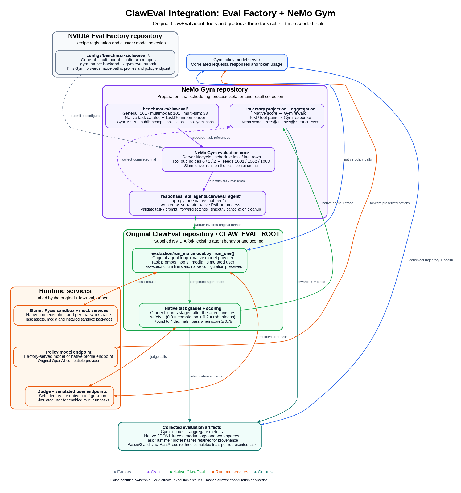

# Claw-Eval in NeMo Gym

Gym schedules one native Claw-Eval trial per `/run`, collects its trajectory and
native reward, and aggregates the results. The local Claw-Eval runner owns the
agent loop, multimodal inputs, simulated user, tools, Pyxis sandbox, mock services,
and task-specific grader. Grader fixtures are staged only after the agent finishes.



Color identifies source ownership. Factory registers recipes and selects the
cluster and policy endpoint; Gym prepares task references and schedules trials;
the original ClawEval runner owns agent execution and grading. Native traces
remain available alongside Gym rewards and aggregate metrics.
The editable [Graphviz source](../../responses_api_agents/claweval_agent/assets/claweval-integration.dot)
and [SVG](../../responses_api_agents/claweval_agent/assets/claweval-integration.svg)
are included with the figure.

| Benchmark | Tasks | Default trials per task |
| --- | ---: | ---: |
| `claweval/general` | 161 | 3 |
| `claweval/multimodal` | 101 | 3 |
| `claweval/multi_turn` | 38 | 3 |

This integration launches the original runner in the supplied
[NVIDIA Claw-Eval fork](https://gitlab-master.nvidia.com/ehosseiniasl/claw-eval).
The upstream [Claw-Eval license](https://github.com/claw-eval/claw-eval/blob/main/LICENSE)
is MIT; the supplied fork retains the same license. The fork was inspected at revision `0e272107a96c2af54b6191c6b09cd534d7368d0d` with local
modifications. It requires that fork's `evaluation/task_catalog.py` and
`evaluation/run_multimodal.py`. It reads public prompts through the native
`TaskDefinition` loader; no separate Gym exporter or changes to the native agent
and grading code are required. The adapter does not install or edit Claw-Eval. Its worker observes the native
sandbox context manager to report outcomes while retaining its lifecycle.

## Setup

Install this Gym checkout with its usual development environment. Choose a
separate Python environment with the local Claw-Eval dependencies installed;
the worker needs Python 3.11 or newer and the fork's mock/web dependencies.
Gym and Claw-Eval need not use the same Python version.

From the Gym repository root:

```bash
export CLAW_EVAL_ROOT=/path/to/claw-eval
export CLAW_EVAL_PYTHON=/path/to/claweval-environment/bin/python
export CLAW_EVAL_SANDBOX_IMAGE=/path/to/claw-eval-agent.sqsh
export CLAW_EVAL_SANDBOX_DEPS=/path/to/installed-sandbox-python-packages
export CLAW_EVAL_FIXTURE_ROOT=/path/to/claw_eval_multimodal_fixtures

# Existing model/judge profiles, relative to CLAW_EVAL_ROOT or absolute.
export CLAW_EVAL_GENERAL_CONFIG=evaluation/configs/nano_omni_general.yaml
export CLAW_EVAL_MULTIMODAL_CONFIG=evaluation/configs/nano_omni.yaml
export CLAW_EVAL_MULTI_TURN_CONFIG=evaluation/configs/nano_omni_multi_turn.yaml

# Policy endpoint consumed by Gym's capture proxy (must match the native profile).
export POLICY_URL=http://127.0.0.1:12500/v1
export POLICY_MODEL=Nemotron-3-Nano-Omni-30B-A3B-Reasoning-BF16
```

Use the existing fork's `evaluation/CLUSTER_SETUP.md` to prepare its image,
installed sandbox Python packages, media fixtures, model endpoint, judge, and
search credentials. `CLAW_EVAL_SANDBOX_DEPS` is the installed package directory
mounted as `/opt/sandbox-deps`, not a wheel archive. Run evaluation inside a Slurm
allocation with Pyxis and `srun` available. The native sandbox launcher currently
requests 16 CPUs for each sandbox. The default Gym agent concurrency is one.

The Claw-Eval profiles configure the model's streaming OpenAI-compatible endpoint,
generation settings, judge, and simulated-user model. Gym does not launch the
policy model here. Set credentials through the environment variables referenced
by those profiles. Native mock-service dependencies must be available to
`CLAW_EVAL_PYTHON` as well as the sandbox's separate package directory.

## Prepare and run

Prepare all 300 task references, or prepare one split with its `--benchmark` name:

```bash
gym eval prepare --config benchmarks/claweval/config.yaml
# Equivalent single-split entry point:
gym eval prepare --benchmark claweval/multimodal
```

Each JSONL row contains the task's public prompt, agent reference, task ID, split,
and SHA-256 of `task.yaml`. Solutions, rubrics, and grader fixtures stay in the
native checkout. A changed task definition requires preparing the rows again.
Preparation reads task definitions only; it does not require model calls or launch
sandboxes. The Gym config still requires the sandbox environment variables above
to resolve; the Python preparation entry point below only needs the source and
worker Python variables.

Start with one trial of a representative video task:

```bash
python -m benchmarks.claweval.prepare --split multimodal \
  --task-id M027_video_food_memo --agent-name claweval_agent \
  --output outputs/claweval_smoke/input.jsonl

# Run this server in one terminal inside the allocation.
export CLAW_EVAL_CONFIG="$CLAW_EVAL_MULTIMODAL_CONFIG"
gym env start --config responses_api_agents/claweval_agent/configs/claweval_agent.yaml \
  --model-url "$POLICY_URL" --model "$POLICY_MODEL" --model-api-key unused \
  +observability_enabled=true

# In a second terminal with the same Gym environment:
gym eval run --no-serve --agent claweval_agent \
  --input outputs/claweval_smoke/input.jsonl \
  --output outputs/claweval_smoke/rollouts.jsonl --num-repeats 1
```

After stopping the smoke server, run any full split:

```bash
gym eval run --benchmark claweval/multimodal --split benchmark \
  --output outputs/claweval_multimodal/rollouts.jsonl \
  --model-url "$POLICY_URL" --model "$POLICY_MODEL" --model-api-key unused

# All three splits, 900 trials total with the default configs:
gym eval run --config benchmarks/claweval/config.yaml --split benchmark \
  --output outputs/claweval_all/rollouts.jsonl \
  --model-url "$POLICY_URL" --model "$POLICY_MODEL" --model-api-key unused
```

Gym's `--temperature`, `--top-p`, and `--max-output-tokens` overrides are forwarded
to the native provider. Otherwise its configured generation parameters are retained.
Gym's `--model-url`, `--model`, and `--model-api-key` configure the Gym
policy server. Set these to the endpoint and model from the native profile.
The original native provider calls that server through a rollout-correlated URL;
its request options, media, reasoning, and native retry policy are preserved.
The proxy forwards one upstream attempt per request and synthesizes the native
client's streaming response from the upstream completion. Factory injects these
settings and uses `driver.policy_model_type: openai_model`.

`model_overrides` retains additional native provider settings; `judge_overrides`
and `user_agent_model_overrides` configure the judge and simulated user separately.
Nested overrides merge recursively. Keep `observability_enabled: true` for evaluation.
Each dataset is prepared once; `--num-repeats` controls trial expansion (default 3).
For separate server-seed jobs, set `--num-repeats 1` and the agent's `seed_base`
to 1001, 1002, or 1003, then compare the union by task ID and seed.

For Slurm submissions, use `driver.container: null` and `driver.mounts: []`.
The Gym driver runs on the allocated host so the original runner can launch its
own Pyxis steps. Source, Python environment, fixtures, sandbox packages, and
output must be host paths accessible from the allocation. Set `workspace_root`
to a persistent result directory, because `gym_install` uses a temporary checkout.
Container drivers keep their existing behavior when a container is configured.

## Results and limitations

Gym reward is the native task score:
`safety * (0.80 * completion + 0.20 * robustness)`, rounded to four decimals.
A trial passes at `reward >= 0.75`. Gym rollout indices 0, 1, and 2 select seeds
1001, 1002, and 1003. Each rollout has its own output directory and worker process.
Timeout and cancellation request native cleanup before killing remaining children.
Execution/worker failures return `mask_sample: true` and a structured failure
kind and reason. Masked trials are excluded from native score metrics and prevent
three-trial metrics from being reported as complete. Cancellation still propagates.

The aggregate metrics include `claweval/mean_task_score`, `claweval/pass_at_1`,
`claweval/pass_at_3` (any of three passes), and `claweval/strict_pass_3` (all three
pass). The two three-trial metrics are emitted only when every represented task
has exactly the three distinct indices 0, 1, 2. Task and trial counts are always
reported. Metrics describe the selected data; a subset is not a full benchmark
result. The all-split suite reports each split under its own agent.

`native_result` points to the native trace and workspace and retains dimension
scores, timing, token counts, seed, task/fixture fingerprints, source revision,
runtime source hash, and native config hash. Output directories persist under
`outputs/claweval_agent` (override with `CLAW_EVAL_GYM_OUTPUT`). `worker.log` is
kept there for diagnosis.

Gym's canonical trajectory uses captured model requests and responses, including
inline media, reasoning, token usage, and explicit invocation joins. Native tool
timings and model-visible results are joined by tool call ID; native sandbox
outcomes are retained separately. The Responses API output is a text projection;
full media remain in native traces and model-call captures. Token IDs
and logprobs are not provided. This is an evaluation adapter for the fork's
native harness and Pyxis runtime; it does not add a Docker launcher or replace
the native agent with OpenCode. `no_judge: true` is available for debugging, but
those scores are not comparable to evaluations that use the configured judge.

## Validation

```bash
PYTHONDONTWRITEBYTECODE=1 python -m pytest responses_api_agents/claweval_agent/tests -q
ruff check responses_api_agents/claweval_agent benchmarks/claweval
ruff format --check responses_api_agents/claweval_agent benchmarks/claweval
```

With `CLAW_EVAL_ROOT` set, tests cover all 300 exported references and execute the
native agent loop and grader using a stub model and sandbox. They check grader
fixture isolation, reward/trace conversion, repeat indices, configuration parsing,
incomplete aggregation, and worker failure/cleanup.

For baselining, prepare each task once and collect exactly three distinct trials
per task with seeds 1001, 1002, and 1003. Retain `resolved-config.yaml`, native
profiles and source fingerprints, rollout JSONL, model captures, native traces,
aggregate metrics, and `quality_summary.json`. Compare each Gym reward with its
native grading event before aggregating. Incomplete or masked trials prevent
full-run Pass@3 and Pass³ reporting; a smoke subset is not a benchmark baseline.

Run `python scripts/inspect_harness_conformance.py --bundle <rollouts.jsonl>
--output <evidence-dir>` and inspect every P0 failure, including direct-answer
rollouts with no tool requests. Keep the original inspector verdict. Native
parity, harness capability qualification, Frontier Eval review, SWQA score bands,
and Evergreen certification are separate requirements.

Baseline numbers, exact evaluated revisions, scheduler overrides, and retained
artifact locations live in [Gym PR #3997](https://github.com/NVIDIA-NeMo/Gym/pull/3997)
and its linked Factory MR. These records distinguish historical compatibility
checks, fresh smoke results, incomplete evaluations, and accepted full runs.
