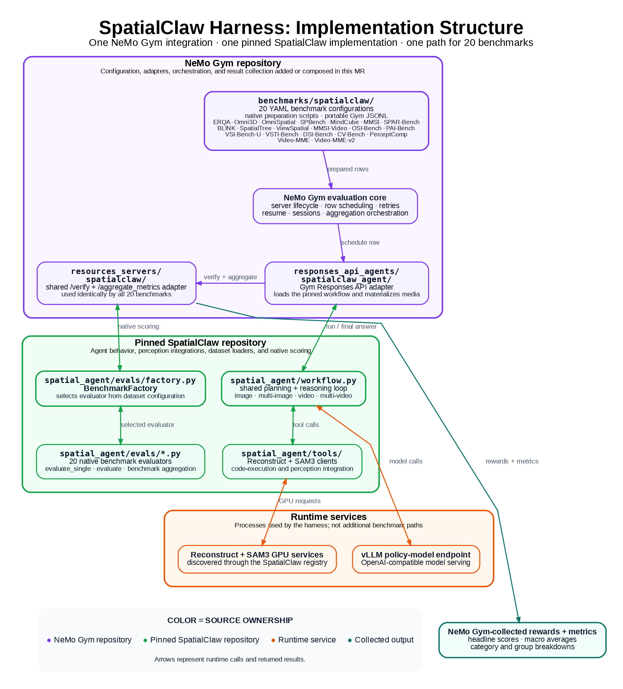

# SpatialClaw evaluation harness

**Internal-only experimental integration.** The pinned SpatialClaw source is hosted
on NVIDIA GitLab and requires authorized repository access. Its `LICENSE` §3.3
restricts use to non-commercial scientific research. Gym's Apache-2.0 license
does not change those external terms. No native source is vendored here. Public
availability and compatible licensing require a maintainer/licensor decision;
this integration is not a publicly reproducible or certified benchmark.

SpatialClaw is a reusable evaluation harness for spatial reasoning, not a
Video-MME variant. The NeMo Gym integration runs the pinned SpatialClaw agent
and perception-tool loop while Gym owns serving, row scheduling, retry/resume,
verification, and metric aggregation.

The suite entry point is `benchmarks/spatialclaw/config.yaml`. It composes all
20 benchmark presets represented by the pinned SpatialClaw source revision.
Each preset can also be prepared and run independently.

This is the direct port of [GitLab Gym MR !471](https://gitlab-master.nvidia.com/dl/nemo/gym/-/merge_requests/471)
at `229815ecfddab961dc36806bad73fa2159df0462`. It retains that MR's external
SpatialClaw pin, native workflow, dataset configurations, and evaluators.
The pinned source is hosted on NVIDIA GitLab and requires access; it is not
vendored into Gym.



Current Gym compatibility changes add environment-server routing, worker
entrypoint discovery, Python 3.13 dependencies, and a persistent HTTP loop for
native Jupyter visual queries. The Video-MME preset retains 256 key frames at
up to 2 FPS, one repeat, and the original Nano role configuration.

## Architecture

A preset binds three benchmark-specific pieces to one shared agent:

1. A SpatialClaw dataset configuration selects the loader, prompt, frame
   sampling policy, and tools.
2. A preparation script converts the native samples to portable Gym JSONL
   rows. Images and videos remain paths; preparation does not pre-decode video.
3. A resource server scores predictions with the native SpatialClaw evaluator
   and reports its aggregate protocol.

The shared agent lives in
`responses_api_agents/spatialclaw_agent`. It supports single-image,
multi-image, single-video, multi-video, grouped-frame, and reference-image
samples. Relative media paths are resolved from `SPATIALCLAW_DATA_ROOT`.

All 20 configurations use `resources_servers/spatialclaw`, which calls the
evaluator selected by the pinned SpatialClaw dataset configuration.
Video-MME-v2 therefore retains SpatialClaw's native group-aware aggregation
without introducing a separate Gym execution or verification path. CV-Bench
here is SpatialClaw's multi-video CVBench dataset; it is distinct from Gym's
existing single-image `benchmarks/cvbench` integration.

## Included benchmarks

| Category | Benchmark | Preset | SpatialClaw dataset config | Scorer |
|---|---|---|---|---|
| Single-image spatial | ERQA | `erqa.yaml` | `erqa_spatialclaw` | Native |
| Single-image spatial | Omni3D | `omni3d.yaml` | `omni3d_spatialclaw` | Native |
| Single-image spatial | OmniSpatial | `omnispatial.yaml` | `omnispatial_spatialclaw_256f` | Native |
| Single-image spatial | SPBench | `spbench.yaml` | `spbench_spatialclaw_256f` | Native |
| Multi-view spatial | MindCube | `mindcube.yaml` | `mindcube_spatialclaw_256f` | Native |
| Multi-view spatial | MMSI | `mmsi.yaml` | `mmsi_spatialclaw_256f` | Native |
| Multi-view spatial | SPAR-Bench | `sparbench.yaml` | `sparbench_spatialclaw_256f` | Native |
| General spatial | BLINK | `blink.yaml` | `blink_spatialclaw_256f` | Native |
| General spatial | SpatialTree | `spatialtree.yaml` | `spatialtree_spatialclaw_256f` | Native |
| General spatial | ViewSpatial | `viewspatial.yaml` | `viewspatial_spatialclaw_256f` | Native |
| Video spatial / 4D | MMSI-Video | `mmsivideo.yaml` | `mmsivideo_spatialclaw_256f` | Native |
| Video spatial / 4D | OSI-Bench | `osibench.yaml` | `osibench_spatialclaw_256f` | Native |
| Video spatial / 4D | PAI-Bench | `paibench.yaml` | `paibench_spatialclaw_256f` | Native |
| Video spatial / 4D | VSI-Bench-U | `vsibench_unbiased.yaml` | `vsibench_unbiased_spatialclaw_256f` | Native |
| Video spatial / 4D | VSTI-Bench | `vstibench.yaml` | `vstibench_spatialclaw_256f` | Native |
| Video spatial / 4D | DSI-Bench | `dsibench.yaml` | `dsibench_spatialclaw_256f` | Native |
| General video | CV-Bench | `cvbench.yaml` | `cvbench_spatialclaw_256f` | Native |
| General video | PerceptComp | `perceptioncomp.yaml` | `perceptioncomp_spatialclaw_256f` | Native |
| General video | Video-MME | `videomme.yaml` | `videomme_spatialclaw` | Native |
| General video | Video-MME-v2 | `videomme2.yaml` | `videommev2_spatialclaw_256f` | Native |

The `_256f` configurations use the frame and FPS limits encoded in the
SpatialClaw source configuration. The preset does not independently redefine
those sampling rules.

## Source and data setup

The agent and native scorer require the same pinned SpatialClaw checkout. Set
these variables before preparing or running a preset:

```bash
export SPATIALCLAW_ROOT=/path/to/spatial_claw
export SPATIALCLAW_DATA_ROOT=/path/to/spatial_claw/data
```

`SPATIALCLAW_ROOT` must be a Git worktree at the commit pinned in
`responses_api_agents/spatialclaw_agent/app.py`. If it is not set, the agent
and resource server clone that revision into their component-local source
cache. `SPATIALCLAW_DATA_ROOT` is required because prepared rows deliberately
store media paths relative to the shared `data/` directory.

The expected directory names are defined by
`spatial_agent/evals/factory.py` in the pinned checkout, including
`ERQA/`, `Omni3D-Bench/`, `MMSI-Video-Bench/`, `Video-MME/`, and
`Video-MME-v2/`. Dataset download and license requirements remain those of
the upstream benchmark and SpatialClaw repository.

Reconstruct and SAM3 are external SpatialClaw GPU services. Start them from the
same checkout or set `SPATIALCLAW_GPU_SERVER_REGISTRY` to a live
`spatial_agent/logs/gpu_server.json`. See
`responses_api_agents/spatialclaw_agent/README.md` for the runtime contract.

## Prepare a benchmark

For example, prepare ERQA with the native loader:

```bash
gym eval prepare --config benchmarks/spatialclaw/erqa.yaml
```

This writes
`benchmarks/spatialclaw/data/erqa_benchmark.jsonl`. All other configurations
follow the same naming convention and native preparation path. The first
preparation creates the SpatialClaw resource-server environment; later
configurations reuse it.

Preparing `benchmarks/spatialclaw/config.yaml` prepares the entire suite and
can be expensive. Prefer an individual preset unless all datasets are already
staged.

## Run a benchmark

Compose the benchmark preset with a policy-model server. For example:

```bash
gym eval run \
  --config benchmarks/spatialclaw/erqa.yaml \
  --config responses_api_models/vllm_model/configs/vllm_model.yaml
```

Replace `erqa.yaml` with any preset from the table. Model endpoint,
checkpoint, GPU allocation, and model-specific vLLM overrides belong in the
policy-model configuration, not in the benchmark preset.

To make all benchmark definitions available in one resolved configuration, use:

```bash
gym eval run \
  --config benchmarks/spatialclaw/config.yaml \
  --config responses_api_models/vllm_model/configs/vllm_model.yaml
```

That command schedules every composed benchmark. Use an individual YAML for
normal development and smoke tests.

## Metrics

Each native verifier returns the row's SpatialClaw `evaluate_single` score
when that benchmark supports per-sample scoring. At aggregation time the
resource server calls the benchmark's full `evaluate` method on the evaluated
rows, preserving benchmark-specific macro averages, mean-relative-accuracy
calculations, category breakdowns, and other native headline metrics. A native
evaluator may mark a row unscored; such a row remains visible and is not
silently converted into a successful result.

## Interchangeable harnesses through agent sessions

The session migration is a follow-up to Gym PR #3996. All 20 presets now use
`single_agent_turn`, with typed taskset routing. Resources owns the dataset,
canonical question, native media sampling, persistent Python kernel, tool state,
answer submission and native scoring. The Environment Server seeds Resources,
seeds the selected agent, activates it once, closes the agent, verifies, and
finally closes Resources. It does not invoke the agent's compatibility `/run`.

| Harness | Preset | Tool transport | Runtime |
| --- | --- | --- | --- |
| Native SpatialClaw | `videomme.yaml` (or another original preset) | Direct HTTP connection to the resource-owned kernel | Original SpatialClaw `946ac114dfcabf9df997629bfa8b6f2f66da1425` |
| OpenCode | `opencode/videomme.yaml` (or the matching `opencode/` preset) | Required authenticated MCP `get_context` and `execute` | OpenCode 1.18.34 from the integration branch below |

Both presets load exactly the same Resources configuration, preparation script,
tasks, media policy, and scorer. The OpenCode preset changes agent configuration
and tool-transport wiring. It uses the existing generic `opencode_agent`, not a
benchmark-specific OpenCode adapter. `opencode/config.yaml` composes the whole
suite for that harness.

Prepared rows now have `task_id` and `task_input` envelopes. Media references are
in verifier-owned `task_input.task_data.media`, and Responses input contains the
unchanged question text. **Re-run preparation for existing datasets**; older
flat rows with video/image metadata in Responses are incompatible with the
OpenCode session request contract. Old retained rollout fixtures remain historical
provenance and do not validate this migration.

OpenCode's original integration is
[`ehosseiniasl/opencode:spatialclaw-integration`](https://gitlab-master.nvidia.com/ehosseiniasl/opencode/-/tree/spatialclaw-integration)
at `a2acc05f2aab51e574c46fecbe09c4b7e97a6c8d`. The profile pins its 1.18.34 binary
by SHA-256 (`9ca0b9953d49997601655e54f846a3efa464f237e47c6f1b04716d0f2e64c4c2`).
The external Python `OpenCodeWorkflow` is not copied into Gym or launched by the
adapter: its benchmark-specific bridge is replaced by the shared Resources tool
contract. The external runtime's non-commercial SpatialClaw license restrictions
still apply. A different build needs an explicit reviewed digest/version update.

For example, after staging the native source/data and the pinned OpenCode binary:

```bash
export SPATIALCLAW_OPENCODE_BIN=/absolute/path/to/opencode

gym eval prepare --config benchmarks/spatialclaw/videomme.yaml

gym eval run \
  --config benchmarks/spatialclaw/opencode/videomme.yaml \
  --config responses_api_models/openai_model/configs/openai_model.yaml
```

The supplied OpenCode profile uses a resource-owned lent Local sandbox for the
CLI and the native task kernel executes on the Resources host. These are trusted internal
development paths with shared filesystem access, **without filesystem or network
isolation**. The profile denies OpenCode's built-in host tools and grants only the
benchmark's MCP tools; that permission map does not turn Local execution into a
container. Production isolation and an isolated native kernel deployment are not
claimed. Both agent and Resources session workers use `num_workers: 1`. Resources stages
only selected media and an answer-free task manifest in the lent CLI workspace,
then destroys that workspace on close. The native reference harness uses the
resource kernel directly and does not request a CLI sandbox.

Native SpatialClaw keeps its planner, reflection, formatting and fallback policy.
OpenCode drives its own loop and submits through the benchmark kernel's
`ReturnAnswer`; plain assistant prose does not replace an explicit submission.
These harness behaviors, OpenCode's generic prompt/compaction behavior and its
model sampling defaults can differ from the historical standalone integration.
No score parity is claimed. Auxiliary VLM calls from the task kernel still use
the rollout-prefixed Gym model route; when they occur, a partial OpenCode-only
usage total is replaced with unknown usage and marked in response metadata.
Full invocation/turn ownership reconciliation and P0 qualification remain pending.

The native reference is an Evaluation-level pairing. Native SpatialClaw does not advertise a
function-calling shell tool, so the shell conformance probes do not apply to it.
The OpenCode pairing deliberately disables its shell tools and grants benchmark
Python execution instead; the shell probe suite is not a behavioral certificate
for this configuration. Real model smokes for both harnesses, health/evidence
inspection and full benchmark parity are required before certification.


## Multi-harness training configuration

This migration includes the pending core dependencies named in the November 9
multi-harness runbook: Gym [#5719](https://github.com/NVIDIA-NeMo/Gym/pull/5719)
(images in tool replies, lent sandboxes and OpenCode training controls) and
[#5833](https://github.com/NVIDIA-NeMo/Gym/pull/5833) (capture chains across the
step-limit note and tool-name repair). Their commits must land before the
migration can merge into main; the PR records their exact revisions. The shared
`tool_output_images` wire contract is used directly; this environment does not
carry a separate MCP image conversion implementation.

OpenCode is the training path. Its profile disables automatic compaction, sets
an outer 30-step budget, returns its session trajectory, and caps each model call
at `SPATIALCLAW_MAX_OUTPUT_TOKENS` (default 16,384). Set the RL request budget at
least that high, or lower the configured limit explicitly for your experiment.
Request temperature/top-p support remains version-qualified by the generic
adapter. This profile's external fork version must be qualified before comparing
sampling behavior with another version. Answers at the outer step limit score
zero by default (`score_step_limit_answer: false`). The shared resource Python
step budget remains independently enforced for both harnesses.

MCP calls are allowed up to 1,800 seconds at the adapter level so GPU tools are
not cut off by the short connection default. OpenCode/Bun can still impose a
roughly 300-second fetch timeout; the configured MCP bound does not prove that a
long-running transport stays alive. Long-tool liveness must be checked against
the actual deployment.

This setup enables the Environment Server/session and capture interfaces used by
RL; it is not evidence of a completed RL run. Fresh real-model inference,
training smoke, zero-poisoned capture-chain checks and health/P0 inspection are
still pending cluster availability. Native SpatialClaw's own per-turn training
adapter and multimodal token-history contract remain outside this change.
