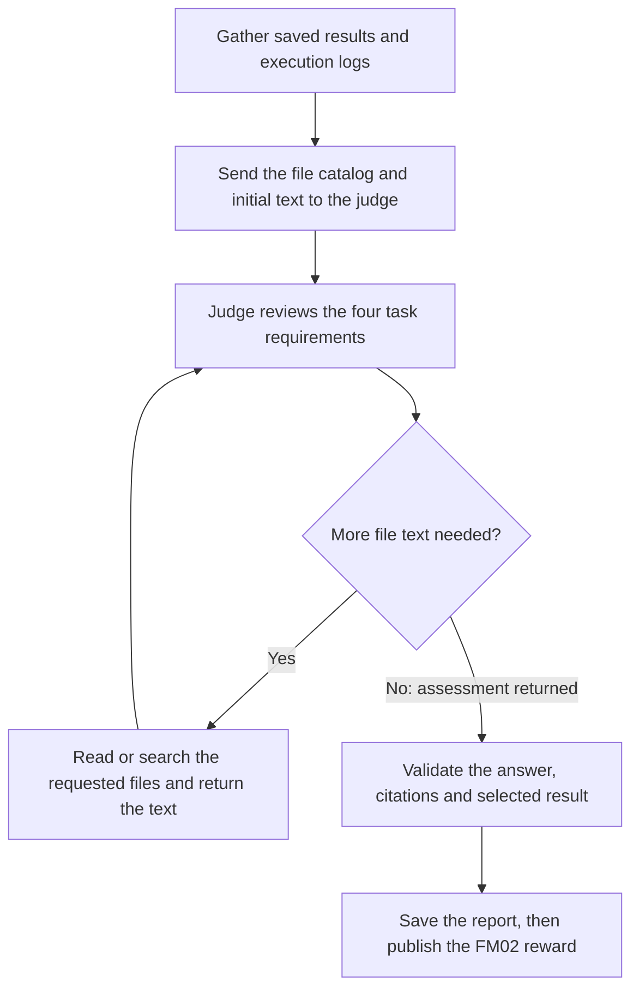

# Run the PARE tasks in NeMo Gym

Run these commands from the Gym repository root. Each command below runs one
attempt of one task through Gym, using Docker for the task environment.

| Task | What the coding agent is asked to do | Verification |
| --- | --- | --- |
| [FM01](gym-fm-01/instruction.md) | Install Gym in an empty workspace and confirm its CLI runs. | The installed package is inspected and its CLI is run independently. No judge is used. |
| [FM02](gym-fm-02/instruction.md) | Use the installed Gym to evaluate the Workplace Assistant's Carlos email request with a selected agent and save the scored result. | A judge reviews the saved result and execution logs against the four task requirements. |

Both tasks represent an agent builder with no post-training experience
(P3-Agent). FM01 tests getting the framework installed and ready to use; FM02
tests configuring an agent, model and environment to run together.

The links above contain the instructions given to the coding agent. Each task's
`task.toml` defines its environment and time limits, and its `tests/` files define
verification. This guide covers setup, operation and how the results are checked.

## Before running

Use Python 3.13.14 or later and `uv` 0.13.4 or later, as required by this checkout.
Install the host dependencies if they are not already installed:

```bash
uv sync
```

Docker must be running and available to your user. Task containers need public
network access for package downloads, documentation and model requests. No GPU
is required.

Create or update the Git-ignored `env.yaml` at the repository root. Keep real
credentials in this local file. For the Inference Hub connection used by these
presets, the required settings are:

```yaml
policy_base_url: https://inference-api.nvidia.com/v1
policy_api_key: <your-api-key>
policy_model_name: <outer-coding-agent-model>

builds:
  tool: docker
```

Choose an outer model that supports the Responses API and the preset's high
reasoning setting. `--model-type vllm_model` selects Gym's model-server adapter;
the adapter connects to `policy_base_url`. It does not start a local vLLM server
in these runs.

FM01 uses a privileged container to run a private Docker daemon for optional
container installations. Its Docker data lives inside the disposable task
container. No host Docker socket is mounted. Privileged execution conflicts with
Gym's Docker-provider isolation guidance; the existing task retains that requirement.
Live web search is disabled in the current outer-Codex configuration for both tasks.

## Select a run configuration

Pass a preset with `--config`:

| Task / inner agent | Preset | Inner model |
| --- | --- | --- |
| FM01 | [config/gym-fm-01.yaml](config/gym-fm-01.yaml) | None; FM01 only installs Gym. |
| FM02 / Codex | [config/gym-fm-02-codex.yaml](config/gym-fm-02-codex.yaml) | `openai/openai/gpt-5.4-mini` |
| FM02 / Claude Code | [config/gym-fm-02-claude.yaml](config/gym-fm-02-claude.yaml) | `aws/anthropic/bedrock-claude-haiku-5-5` |

Both FM02 presets import [config/gym-fm-02.yaml](config/gym-fm-02.yaml). Select
one of the two presets; the shared file supplies no default inner agent or model.
To change the inner model, update `fm02_inner_model` in the selected preset.
The outer model is selected separately by `policy_model_name` in `env.yaml`.

### FM02's three model roles

| Role | What it does | Where it is configured |
| --- | --- | --- |
| Outer coding agent | Configures and runs the example inside the task container. The live commands below use Codex. | `--agent codex_agent`, the shared preset's `codex_agent` block, and root `policy_model_name`. |
| Inner agent | Performs the Carlos email task in the evaluation that the coding agent starts. It can be Codex or Claude Code. | `fm02_inner_agent` and `fm02_inner_model` in the selected preset. |
| Verifier judge | Decides whether the requested FM02 workflow happened. | `fm02_judge_*` in the shared preset, with optional root `env.yaml` overrides. |

The shared preset passes these settings into the task container:

| Container variable | Configuration value | Used for |
| --- | --- | --- |
| `GYM_AGENT` | `fm02_inner_agent` | The requested inner harness. |
| `GYM_MODEL` | `fm02_inner_model` | The requested inner model. |
| `GYM_API_KEY` | `policy_api_key` | Authentication for the inner evaluation. |
| `OPENAI_BASE_URL` | `policy_base_url` | The inner evaluation's endpoint. |

These values are available to the coding agent, supplied solution and verifier.
They are passed through the existing Docker `run_args` configuration. Keep them
in the run presets rather than adding duplicate defaults to `task.toml`.
Outer Codex uses `OPENAI_API_KEY` for Gym's model proxy, so the inner key uses the
separate name `GYM_API_KEY`. Changing `policy_base_url` in root `env.yaml` updates
the inner endpoint on the next run.

In the supplied solution, both inner harnesses use Gym's model server. Claude
Code uses Gym's Messages adapter to reach the configured Responses backend; no
separate Anthropic key is needed for that path.

### FM02's judge connection

The shared preset selects GPT-6.1 Terra on Inference Hub with high reasoning.
Its API key references `policy_api_key`. To use separate judge credentials or
change its connection, override these settings in root `env.yaml`:

```yaml
fm02_judge_base_url: https://inference-api.nvidia.com/v1
fm02_judge_api_key: <judge-api-key>
fm02_judge_model: azure/openai/gpt-6.1-terra
fm02_judge_reasoning_effort: high
```

Gym passes these values through the environment server's `secrets` mapping into
FM02's `[verifier.env]` templates when verification starts. Supplying the inner
key alone does not configure a separate judge connection.

The verifier timeout is 120 seconds. Within it, the judge has an 80-second review
budget, including retries, with 15 seconds reserved for its final assessment.
Those budgets are set in [gym-fm-02/task.toml](gym-fm-02/task.toml).

## Run FM01

Run the live coding agent:

```bash
uv run gym eval run environments/pare/gym-fm-01 \
  --agent codex_agent --model-type vllm_model --sandbox docker \
  --config environments/pare/config/gym-fm-01.yaml \
  --concurrency 1 --num-repeats 1
```

To check the task setup and verifier using the supplied `solution/solve.sh`
instead of a live coding agent:

```bash
uv run gym dataset validate environments/pare/gym-fm-01 \
  --sandbox docker \
  --config environments/pare/config/gym-fm-01.yaml \
  --concurrency 1
```

FM01 allows 30 minutes for the agent and five minutes for verification. The task
does not prescribe a Gym release or installation route. The verifier locates the
installation from recorded version/Python output, checks package provenance and
runs the installed CLI's `--version` independently. PyPI, official Git and
documented container installations remain accepted routes. Full installation
from the published Gym container image has not been validated in this checkout.

### What FM01 checks

Completed terminal output must provide a Gym version and Python path. The
verifier uses them to locate the installation, then checks:

- The installed `nemo-gym` package matches the recorded version.
- Its `gym` entrypoint, script and module exist, and the script matches its
  installation hash when one is recorded.
- Package/source metadata meets the existing PyPI, Git or container provenance
  checks. An image tag alone does not establish provenance.
- A fresh `gym --version` invocation exits zero within 30 seconds and reports
  the same Gym version.

The original terminal request's overall exit code is recorded for context rather
than scored. There is no required installation directory, wrapper, receipt or
Python version. Reusing the outer Gym installation does not satisfy the task.
Follow-on evaluation or training activity is outside FM01's grading scope.

A matching installation that passes these checks receives reward `1`. A completed
verification without a passing installation receives `0`. Unusable execution
records or inspection infrastructure produce a verifier error without an agent
score. The implementation is in
[gym-fm-01/tests/verify.py](gym-fm-01/tests/verify.py) and
[gym-fm-01/tests/inspect_installation.py](gym-fm-01/tests/inspect_installation.py).

## Run FM02

### Prepare a fresh fingerprint volume

Before **each** FM02 command below, choose a fresh volume name in the same shell:

```bash
export PARE_FM02_FIXTURE_VOLUME="pare-fm02-$(cat /proc/sys/kernel/random/uuid)"
printf 'FM02 volume: %s\n' "$PARE_FM02_FIXTURE_VOLUME"
```

Docker creates the named volume when the task starts, copies the image's sample
fingerprints into it and mounts it read-only at `/opt/gym-fixture`. The verifier
compares new outputs with those fingerprints to identify copied sample results.
The coding agent can read the baseline but cannot overwrite it through this mount.

Use one attempt at a time: keep `--concurrency 1` and `--num-repeats 1` for live
runs. Remove the volume after the command finishes, using the cleanup command
below, before preparing the next attempt. Do not reuse a volume between attempts.
This is a run-configuration limitation; it does not add a grading requirement.

### Run a live coding agent

For inner Codex:

```bash
uv run gym eval run environments/pare/gym-fm-02 \
  --agent codex_agent --model-type vllm_model --sandbox docker \
  --config environments/pare/config/gym-fm-02-codex.yaml \
  --concurrency 1 --num-repeats 1 \
  --output results/harbor/gym-fm-02/rollouts.jsonl
```

For inner Claude Code, prepare another fresh volume and run:

```bash
uv run gym eval run environments/pare/gym-fm-02 \
  --agent codex_agent --model-type vllm_model --sandbox docker \
  --config environments/pare/config/gym-fm-02-claude.yaml \
  --concurrency 1 --num-repeats 1 \
  --output results/harbor/gym-fm-02-claude/rollouts.jsonl
```

Both commands use outer Codex. The YAML selects the inner agent. Separate output
paths keep the two presets' rollout files apart. FM02 allows 20 minutes for the
outer agent and two minutes for verification.

### Run the supplied solution

`gym dataset validate` runs [gym-fm-02/solution/solve.sh](gym-fm-02/solution/solve.sh)
instead of the outer coding agent. The script still runs a real inner agent and
calls the verifier judge. Prepare a fresh volume for each command.

For inner Codex:

```bash
uv run gym dataset validate environments/pare/gym-fm-02 \
  --sandbox docker \
  --config environments/pare/config/gym-fm-02-codex.yaml \
  --concurrency 1 \
  --output results/harbor/validation/gym-fm-02/rollouts.jsonl
```

For inner Claude Code:

```bash
uv run gym dataset validate environments/pare/gym-fm-02 \
  --sandbox docker \
  --config environments/pare/config/gym-fm-02-claude.yaml \
  --concurrency 1 \
  --output results/harbor/validation/gym-fm-02-claude/rollouts.jsonl
```

The supplied solution pins Codex `0.162.1` or Claude Code `2.1.293`. The live coding
agent chooses its own configuration and harness version. The Claude supplied
solution has a known failure: Bedrock rejected MCP tool names longer than 64
characters. That investigation is deferred. A live outer-Codex run with inner
Claude Code has passed; that does not resolve the supplied-solution failure.

### Remove the attempt's volume

After the Gym command finishes and results have been collected:

```bash
docker volume rm "${PARE_FM02_FIXTURE_VOLUME:?Volume name is not set}"
unset PARE_FM02_FIXTURE_VOLUME
```

Named volumes are not removed with their containers. Gym does not manage this
volume's cleanup in the current configuration. No additional setup or cleanup
script is required.

## Inspect results

Gym prints the rollout and run-summary paths when it finishes. For the commands
above, results are written under:

| Run | Rollout directory |
| --- | --- |
| FM01 live | `results/harbor/gym-fm-01/` |
| FM01 supplied solution | `results/harbor/validation/gym-fm-01/` |
| FM02 live / Codex | `results/harbor/gym-fm-02/` |
| FM02 live / Claude Code | `results/harbor/gym-fm-02-claude/` |
| FM02 supplied solution / Codex | `results/harbor/validation/gym-fm-02/` |
| FM02 supplied solution / Claude Code | `results/harbor/validation/gym-fm-02-claude/` |

`results/harbor/` is Gym's output directory name for this task format. All commands
in this guide use Gym.

Start with `rollouts_run_summary.json` and `rollouts.jsonl` in the relevant
directory. Check the task reward, verifier return code and whether the rollout
was scored or marked as a collection failure. A finished command or the summary
label `oracle solved` alone does not establish a passing reward.

The result's `verifier_logs_dir` points to the attempt's collected verifier files.
For FM02, these are under `results/harbor/gym-fm-02/verifier/session-<id>/` for
live runs and `results/harbor/validation/gym-fm-02/verifier/session-<id>/` for
supplied-solution runs. **Changing `--output` does not move that verifier folder**;
Claude and Codex runs share this parent but have separate session directories.
Use the path recorded in the result to find the matching attempt.

For FM01, inspect `evidence.json` and `gym-version.txt` in the verifier directory.
They record installation checks and the independently executed CLI's output.

For FM02, inspect these files in the verifier directory:

| File | What it contains |
| --- | --- |
| `report.json` | The assessment or verifier error, requested inner agent/model, discovered result scores and selected result. |
| `reward.txt` | FM02's 0 or 1 reward, written only for a completed assessment. |
| `trajectory.json` | The exported outer-agent or supplied-solution record. |
| `test-stdout.txt` | Verifier output. |
| `hybrid/evidence.json` | The file catalog and initial text supplied to the judge. |
| `hybrid/contract.json` and `hybrid/rubric.txt` | Requirement IDs, version metadata, judge prompt and grading criteria used for the review. |
| `hybrid/file-access.json` | Additional file text requested by the judge. |
| `hybrid/answer.txt` and `hybrid/report.json` | The judge's assessment, citations and diagnostics. |
| `hybrid/request-attempts.json` | Judge-request timing, HTTP status and provider error details. |

Some files are absent if verification stops before reaching that step. For a
judge HTTP error, `request-attempts.json` retains up to 16,000 bytes of the server's
error response and marks longer responses as truncated.

## How FM02's judge works

After the coding agent or supplied solution finishes, Gym runs the task verifier.
The inner Gym evaluation has already scored the email task. The verifier judge
reviews whether the requested workflow happened, using two kinds of files:

- **Saved rollout:** the Carlos request, model response and inner Gym score.
- **Execution logs:** commands, their output, harness activity and evaluation completion.



The judge checks four requirements:

1. The exact Carlos request was evaluated and real model output was recorded.
2. Gym's CLI or Python API actually ran the evaluation successfully.
3. That evaluation used the requested inner harness, `GYM_AGENT`.
4. A genuine, fresh scored result from that same evaluation was saved under `/workspace`.

Configuration files and a saved rollout alone do not establish that the requested
harness ran or that evaluation completed. The judge connects the selected result
to commands and runtime logs. For a supplied-solution run, the real script output
and reference script can supply those execution records.

The verifier also supplies eight saved-result checks: exactly one Carlos row;
a finite numeric reward from 0 to 1; verification not skipped; no collection
failure or scoring exclusion; recorded model interaction fields; output different
from bundled samples; timing consistent with the attempt; and paired results for
recorded tool calls. These checks describe the saved file's structure and
consistency. The judge still checks that a real evaluation produced it. An API
error saved as assistant text does not establish a real model response.

One valid selected result is enough. Failed retries do not invalidate a separate
valid run. Tool errors are allowed and tool use is not mandatory. No particular
result filename, launcher, shell syntax or configuration layout is required.
The full unchanged contract is in
[gym-fm-02/tests/grading-criteria.md](gym-fm-02/tests/grading-criteria.md).
The requested model supplies connection context; independent upstream-model
identity is outside this verifier's scope.

### File access and citations

In `hybrid/evidence.json`, `files` lists what the judge can request and `contents`
contains text delivered immediately. Complete result and execution files are
included when they fit the initial size budget. The judge can then list, read or
search more files. Those later responses are saved in `hybrid/file-access.json`;
they are not added back to the initial evidence bundle.

Each delivered nonblank text section has an `excerpt_id`. The judge returns a
status, explanation and excerpt references for every requirement, plus a selected
file and row. Python validates the answer and accepts only citations to text
actually delivered. The report's `citations` map retains the source path,
character offsets and exact text in `quote`. The judge decides whether that text
supports its finding; a valid citation alone does not establish success.

### FM02 reward and inner Gym score

| Result | Meaning |
| --- | --- |
| FM02 reward `1` | A completed assessment supports all four workflow requirements. |
| FM02 reward `0` | A completed assessment does not support all four requirements. |
| Inner Gym score | The email task's score from the selected saved rollout. A valid `0` can accompany FM02 reward `1`. |
| Verifier error | No task reward is published. Inspect the report and Gym's failure details. |

A judge API error, invalid answer or exhausted budget that prevents a completed
assessment leaves no reward file and exits unsuccessfully. Previous reward files
are cleared before verification. The report is saved before the final reward is
published. The report's top-level `gym_reward` belongs to the selected result;
it is `null` if none was selected. Other discovered scores remain in `saved_results`.

### Verifier files

| File under `gym-fm-02/` | Responsibility |
| --- | --- |
| `environment/generate_sample_hashes.py` | Capture installed sample-output fingerprints during the image build. |
| `tests/test.sh` and `tests/verify.py` | Start verification, load reference data and fingerprints, collect files, save the report and publish the completed reward. |
| `tests/read_execution.py` | Find saved results and execution records, calculate saved-result checks and serve requested file text. |
| `tests/hybrid.py` | Call the judge, handle file requests, validate the answer and save diagnostics. |
| `tests/judge-prompt.md` | Define how the judge reads files, connects execution records, handles uncertainty and returns its assessment. |
| `tests/grading-criteria.md` | Define the four requirements and saved-result conditions. |
| `tests/reference.json` | Store the exact Carlos request, supported harnesses, requirement IDs and version metadata. |

## Fixture versions

FM01 deliberately leaves the installed Gym version unpinned. FM02 starts with
Gym v0.7.0, commit `1f8afc71d45fac14872d86fe300374afa2001e7a`, and Python 3.13.14,
defined in [gym-fm-02/environment/Dockerfile](gym-fm-02/environment/Dockerfile).
These are separate from the host checkout and Python used to run the commands.

Changing FM02's fixture requires updating its Dockerfile build settings and
revalidating the supplied solution and verifier. Selecting a different inner
agent or model through a preset does not change the fixture version. The image
build captures fingerprints from the installed samples; missing, empty or
malformed samples stop that build.

## Validation and local checks

FM01 has passed supplied-solution validation and a live Codex run. FM02 has passed
supplied-solution validation with inner Codex and live outer-Codex runs with both
inner presets. The Claude supplied-solution issue described above remains deferred.
Fresh FM02 volume naming and removal remain manual.

To check the task-local evidence readers without model calls or Docker:

```bash
uv run --extra dev pytest environments/pare/tests -q
```

These tests check evidence handling, including the supplied-solution format and
recorded Codex commands. They do not measure judge accuracy, prove live endpoint
compatibility or replace the evaluation commands above.
