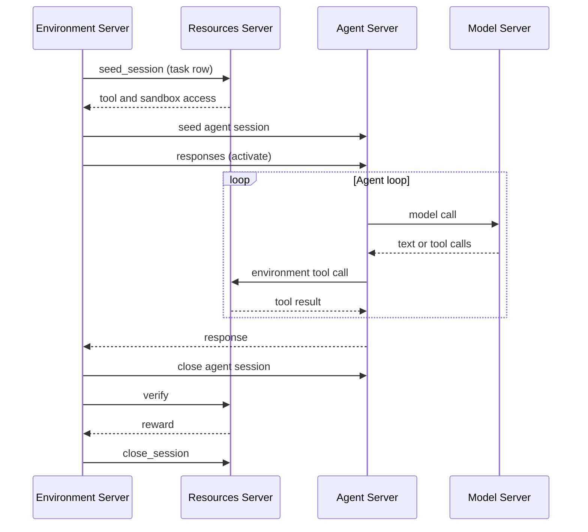

<Info>

**Goal**: Understand how NeMo Gym implements environments as composable server components.

**Read first**: [Environments](/about/concepts/environments) — what an environment is and how it decomposes into dataset, agent harness, verifier, and state.

</Info>

## How NeMo Gym Implements Environments

NeMo Gym implements environments as composable FastAPI servers that communicate over async HTTP:

| Concept | NeMo Gym Component Implementation |
|---------|---------------|
| Dataset | JSONL: Responses API input — each row is a task (a single problem or challenge) for the agent to solve |
| Agent Harness | FastAPI Agent Server |
| Verifier + State | FastAPI Resources Server |
| Model | FastAPI Model Server or managed by your own agent harness |
| Episode orchestration | FastAPI Environment Server, which receives each episode and either decides the order of its calls or relays it to the agent |

All components are composable. Use different datasets with the same resources server, the same resources server with different models, or the same model with different agent harnesses.

This gives you flexibility to integrate with your existing models and agents:

- **Bring your own agent** — Integrate your existing agent to use it with any Gym environment components.
- **Use a built-in agent** — NeMo Gym includes some native agents, e.g. general-purpose multi-step tool calling, as well as built-in integrations with external harnesses like OpenHands.
- **Train with any model endpoint** — The Model Server standardizes different LLM endpoints behind the Responses API and provides token IDs and log probabilities needed for RL training.

## How an Agent Runs a Task in NeMo Gym Environments

Each task attempt is an *episode*. Rollout collection sends every episode to an Environment Server. An Environment Server that drives agent sessions, such as `single_agent_turn`, runs it in this order, and the resulting trajectory is called a *rollout*:

1. **Seed** — The Environment Server receives a task row from the dataset and seeds a session on the Resources Server, which sets up isolated state for this task. It then seeds a session on the Agent Server, passing along any tool and sandbox access that the Resources Server returned.
2. **Agent Loop** — The Environment Server activates the agent session. The agent calls a model for inference, then routes tool calls to either its own tools or the Resources Server. This repeats until the agent decides the task is complete.
3. **Close and Verify** — The Environment Server closes the agent session, then asks the Resources Server to score the attempt. The verifier inspects the final state and returns a reward signal.
4. **Clean up** — The Environment Server closes the Resources Server session, which releases per-task state such as sandboxes.

When an Environment Server drives agent sessions, the Agent Server does not decide when to verify. The Environment Server orders the calls, so a different benchmark, or any agent that implements agent sessions, can be swapped in through configuration, with no pair-specific launcher. The built-in `single_agent_turn` Environment Server runs one agent turn against one Resources Server. Other interaction patterns, such as a simulated user, define their own Environment Server.

Most shipped configurations still use the `legacy_agent` Environment Server, which Gym also generates by default for any agent that no Environment Server names. It relays `/run` to the agent, and the agent runs the whole episode itself, including any `seed_session` and `verify` calls. Cleanup then depends on the agent, so Resources Servers on this path usually release per-task state in `verify()` (see [Session Cleanup](/main/environment-tutorials/resources-server-apis#session-cleanup)). For that request flow, see [System Design](/main/infrastructure/engineering-notes/system-design).

## Server Types

### Environment Server

Receives each episode: rollout collection submits tasks to its `/run` endpoint. An Environment Server that drives agent sessions, such as `single_agent_turn`, binds an agent and a Resources Server by reference and decides the order of calls: it seeds the Resources Server and Agent Server sessions, activates the agent, closes the agent session, verifies, and cleans up, including on failure. `legacy_agent` binds only an agent and relays `/run` to it. An Environment Server does not implement tools, agent logic, or scoring.

### Agent Server

Hosts agent harnesses, which call the model and route tool calls. Use your own harness, or use built-in harnesses such as OpenHands or NeMo Gym's native harnesses such as Simple Agent.

### Model Server

A stateless LLM inference endpoint that standardizes different model providers behind the Responses API. Supports local inference and inference providers.

### Resources Server

Manages environment-specific tools, per-task state isolation, and verification:

- **Environment-Specific Tools** — capabilities the environment provides to any agent (e.g., code execution, database queries, API calls)
- **State Isolation** — each rollout gets its own session, so attempts never interfere with each other. Environments range from lightweight (verify a math answer, no setup needed) to heavyweight (provision a Docker container with a specific repo checkout for SWE-Bench-style tasks).
- **Verification** — scoring logic that evaluates the agent's output and returns a reward
- **Sandbox ownership** — when a task needs an isolated runtime, the Resources Server usually creates the sandbox and passes the agent a handle to it. When an Environment Server drives agent sessions, the agent borrows the sandbox and never destroys it; some agents behind `legacy_agent` still stop it themselves. The Resources Server decides whether to verify in the same sandbox or in a fresh one, and destroys each sandbox it owns. This keeps the benchmark's verification policy the same no matter which agent runs the task.

## Where Tools Live

Tools exist on a spectrum — some belong to the agent and can be used with any environment, some belong to the environment and can be used with any agent:

- **Agent-specific tools** are part of the agent harness. They're capabilities the agent brings regardless of which environment it runs in (e.g., OpenHands brings file editing and terminal tools).
- **Environment-specific tools** are part of the Resources Server. They're capabilities the environment provides to any agent that connects (e.g., a `run_tests` endpoint, a database query tool, a sandbox execution API).

An agent can use both simultaneously — its own tools and the environment's tools in the same task. NeMo Gym's server split reflects this: agent-specific logic in the harness, environment-specific logic in the Resources Server.

## Communication

Gym servers communicate over async HTTP (aiohttp) with:
- **Session cookies** propagated through the call stack for stateful environments
- **Retry logic** with exponential backoff (3 attempts)
- **Connection pooling** via a singleton aiohttp client for high-concurrency workloads

Sandbox execution and file transfer are not Gym HTTP calls. They use the configured sandbox provider's transport, such as HTTP, gRPC, a Docker CLI, or a local subprocess.

## Next Steps

<Cards>

<Card title="Concepts" href="/about/concepts">
Understand environments, evaluation, and training before diving into implementation.
</Card>

<Card title="Browse Environments" href="https://github.com/NVIDIA-NeMo/Gym#-available-environments">
Browse available environments for evaluation and training.
</Card>

<Card title="Agents" href="/agent-server">
Explore available agent harnesses and learn how to integrate your own agent.
</Card>

<Card title="Training" href="/tutorials/training-tutorials">
Improve your agent or model with RL or fine-tuning.
</Card>

<Card title="Build Custom Environments" href="/environment-tutorials">
Create your own evaluation or training environments.
</Card>

</Cards>
