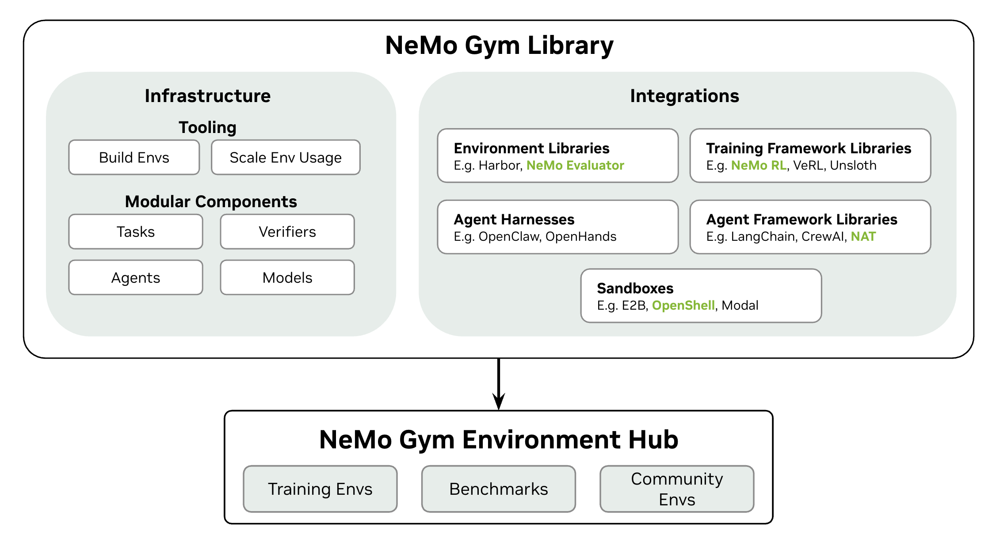

NeMo Gym is an open-source library for evaluating and improving AI agents: run agents on tasks, score every attempt, and use the results to optimize the agent or train the model.

## When to Use NeMo Gym

- Improve an agent by measuring each change to its prompts, tools, or model, so you know which ones made it better.
- Evaluate agents on hundreds of benchmarks, including the recipes behind NVIDIA's published Nemotron scores.
- Train a model to do better at agentic tasks with training data at scale: rollouts collected offline for SFT or generated online during RL.
- Share the same agents, tools, and verifiers across evaluation, agent optimization, and model training.
- Build your own tasks, or use existing ones written for Harbor, Verifiers, OpenEnv, and other environment libraries.

## Used in Production

Some public examples:

- **NVIDIA Nemotron:** NVIDIA evaluates the Nemotron model family with NeMo Gym and generates the rollouts it is trained on. The benchmarks, training environments, and [evaluation recipes](https://github.com/NVIDIA-NeMo/Gym/tree/main/nemotron_recipes) are in the NeMo Gym repository, and the training cookbooks are public. [Read more](https://github.com/NVIDIA-NeMo/Nemotron)
- **Improving an agent:** Siemens EDA optimized its Fuse EDA AI Agent for chip design with NeMo Gym: the composite verification score rose from about 55% to about 95%, with about 66% fewer agent turns. [Read more](https://developer.nvidia.com/blog/optimizing-agent-reliability-and-tool-calling-efficiency-for-chip-design-using-nvidia-nemo-gym)
- **Training a model:** Salesforce post-trained Koa, its first CRM reasoning model, with NeMo Gym and NeMo RL. Salesforce reports that Koa matches or exceeds leading models on CRM actions with 3x fewer errors. [Read more](https://investor.salesforce.com/news/news-details/2026/Announcing-Koa-Salesforces-First-CRM-Reasoning-Model-Built-on-NVIDIA-Nemotron/default.aspx)

## What NeMo Gym Provides

NeMo Gym is built around environments. An environment is everything an agent needs to attempt a task and be scored: a dataset of tasks, an agent harness, a verifier, and per-task state. See [Environments](/about/concepts/environments).

- Environment hub: hundreds of benchmarks and training environments, including those built for Nemotron development
- Built-in agent harnesses: dozens ready to use, including Claude Code, Codex, Hermes, and OpenClaw, or use NeMo Gym with your own agent
- Trustworthy evaluation: repeats per task and run comparisons with confidence intervals tell a real change from noise
- RL-ready agent harnesses: token IDs captured for every model call, including sub-agents and context compaction
- RL ecosystem: integrations with training frameworks including Miles, NeMo RL, Unsloth, and VeRL
- High concurrency: scale to thousands of tasks running at the same time, with runs that resume after a Slurm timeout or preemption
- Sandbox isolation: tasks that execute code run each attempt in its own sandbox, with providers including Apptainer, Daytona, Docker, and OpenShell, or add your own

## Integrations

NeMo Gym integrates with the broader agentic ecosystem:

- **Environment libraries**: Seamlessly combine environments and benchmarks from other libraries alongside NeMo Gym environments. Task folders in the Harbor format run on the `harbor` Environment Server; see [Author Task Folders](/main/data/task-folders/harbor-tasks).
- **Training framework libraries**: Use environments for SFT and RL training.
- **Agent harnesses**: Popular agent harnesses for evaluation and training available out of the box.
- **Agent framework libraries**: Use your custom agent built with agent frameworks in NeMo Gym environments.
- **Sandboxes**: Isolate agent runtime execution.

## Next Steps

<Cards>

<Card title="Get Started" href="/get-started/installation">
Install NeMo Gym and run your first evaluation.
</Card>

<Card title="Browse Environments" href="https://github.com/NVIDIA-NeMo/Gym#-available-environments">
Browse available environments for evaluation and training.
</Card>

<Card title="Agents" href="/agent-server">
Explore available agent harnesses and learn how to integrate your own agent.
</Card>

<Card title="Training" href="/tutorials/training-tutorials">
Improve your agent or model with RL or fine-tuning.
</Card>

<Card title="Build Custom Environments" href="/environment-tutorials">
Create your own evaluation or training environments.
</Card>

</Cards>
