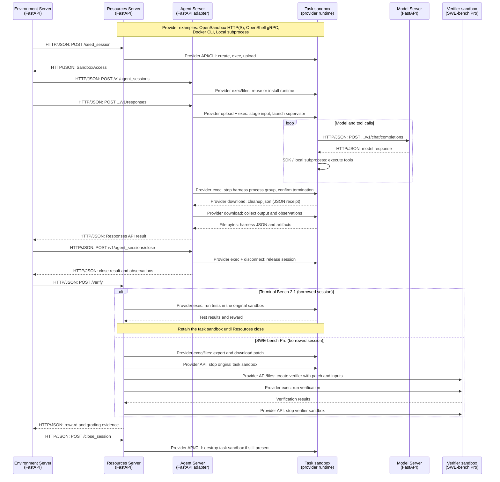
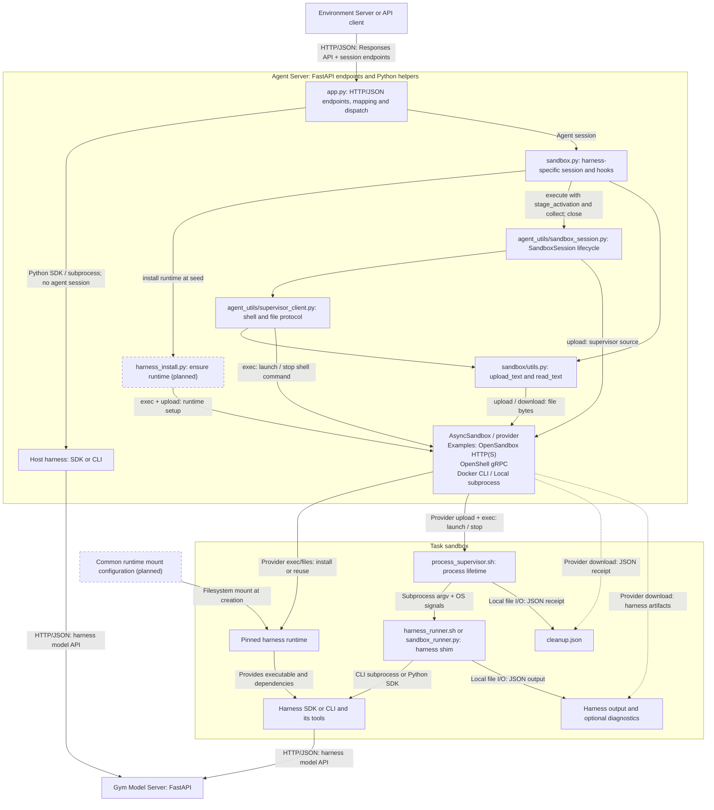

# Add or Update a Harness

A *harness* is an agent runtime, such as Hermes, Pi, or Codex, that runs the model and tool loop. A Gym *adapter* is the Agent Server that wraps the harness. This page explains how to integrate a harness that runs inside a task sandbox, and how to validate a new harness or an upgrade. The same contracts apply to an adapter for an agent framework, such as [LangChain DeepAgents](https://github.com/NVIDIA-NeMo/Gym/tree/main/responses_api_agents/langchain_deepagents_agent); that adapter loads the user's agent instead of installing a CLI.

In sandbox execution, the adapter stays outside the sandbox, and the harness and its tools run inside it. If an adapter also supports host execution, keep that path working and test it separately.

<Note>
Session support varies by adapter. Check the adapter's README for supported features and limitations.
</Note>

To run an agent that Gym already integrates, see [Integrate Existing Agents](/main/agent-server/integrate-existing-agents).

## Terminology

| Term | Meaning on this page |
| --- | --- |
| Harness | The agent runtime (SDK or CLI) that runs the model and tool loop. |
| Adapter | The Gym Agent Server under `responses_api_agents/<harness>/` that maps Gym requests to the harness. It runs outside the task sandbox. |
| [Environment Server](/main/about/architecture#environment-server) | The Gym server that runs one episode in order: Resources Server seed, agent session, verification, and cleanup. The examples use `single_agent_turn`. |
| Resources Server | The benchmark server. It prepares tasks, owns task sandboxes, verifies results, and can expose tools. |
| Task sandbox | The isolated environment that contains the task repository. The harness and its tools run here. |
| Borrowed or owned sandbox | A sandbox is *borrowed* when the Resources Server creates it and passes it to the agent, and *owned* when the agent creates it. Only the owner destroys a sandbox. |
| Task service | A background process that a completed tool call leaves running, such as a server that the verifier queries. It can outlive the harness. |

## Plan the adapter

This page covers building and updating an adapter. To choose between Remote Agent, an adapter, and a custom Environment Server first, see [Choose a Path](/main/agent-server#choose-a-path).

### Choose the capabilities you need

An adapter can stop at any level below. Each level adds work and enables a specific Gym capability. State the supported level in the adapter's README, and reject or document anything it does not support.

| Capability | What it enables | What the adapter must do | How to check it |
| --- | --- | --- | --- |
| Evaluation | Rewards from the benchmark's verifier. | Implement the [session contract](#agent-server-and-environment-server), return a `NeMoGymResponse`, and route model calls through a Gym Model Server so that the later levels need no rework. | A real model and task with verification. |
| Observability | Trajectories for debugging, with tool timing and usage. | Keep the rollout prefix on model calls, and return an `AgentObservationBundle` that records missing evidence as gaps. See [Preserve inputs, outputs, and errors](#preserve-inputs-outputs-and-errors). | [Harness Conformance](/main/observability/harness-conformance) and inspection of saved rollouts. |
| Environment tools and task sandboxes | The same agent runs against environment-provided tools and sandboxes, across benchmarks. | Map tool grants and `SandboxAccess` into the harness's configuration. See [Integration contracts](#integration-contracts). | A second pairing that works through configuration changes alone. |
| Training | Exact token IDs and log probabilities for policy optimization. | Send every model call that can return policy-generated text through the training-capture route. See [Route every model call through the Model Server](#route-every-model-call-through-the-model-server). | `_ng_token_capture` metrics on the collected rollouts, with `mask_sample` absent or `false`. |

An adapter that stops at Evaluation returns no invocation or turn records, so its rollouts are `unobserved` in [rollout health](/main/evaluation/rollout-health) and fail the evidence check. That is expected at that level. Its close still returns an `AgentObservationBundle` whose gaps name the missing evidence.

### What you write

An adapter supplies the knowledge that is specific to the harness or framework:

1. **Install or load the agent.** For example, a framework adapter lists the framework in its `requirements.txt`, while Pi and Codex install a pinned runtime into the task sandbox at seed.
2. **Configure and invoke it.** Build the harness configuration from the adapter configuration and the request, then call the SDK or start the CLI. For example, Hermes writes a `config.yaml`, Pi starts its CLI through the shared `harness_runner.sh`, and Codex starts its CLI from its own `sandbox_runner.py`, which also runs a sandbox-local retry proxy for model requests.
3. **Map the harness's inputs, results, and traces to Gym.** Convert the request into the harness's input, the harness's output into a `NeMoGymResponse`, and its model and tool activity into an `AgentObservationBundle`.
4. **Map Gym connections into the harness's own configuration.** Set the rollout-prefixed Model Server URL as the harness's model base URL, add tool grants to its tool configuration, and run it in `SandboxAccess.workdir`. For example, Hermes adds each MCP grant to the `mcp_servers` section of its configuration.

### What Gym provides

| Component | What it handles |
| --- | --- |
| Environment Server (`single_agent_turn`) | The episode order: Resources Server seed, agent session, activation, agent close, verification, and cleanup. |
| `SimpleResponsesAPIAgent` | The HTTP endpoints, the [agent-session contract](#agent-server-and-environment-server), rollout URL helpers such as `base_url_for_run()`, `resolve_model_base_url()`, and `model_endpoint()`, and the partial-rollout checkpoint hooks. An adapter that does not declare `checkpoint_mode = "exported"` restarts unfinished rollouts from their input, and its checkpoint status reports `mode: restart_only` so a training framework can tell before any checkpoint. |
| Model Server | Provider normalization, rollout-prefixed routing, [model-call capture](/main/model-server/model-call-capture), and [training-token capture](/main/tutorials/training-tutorials/external-agent-harnesses). |
| `nemo_gym.sandbox` | Sandbox providers, `AsyncSandbox`, and text file transfer. |
| `nemo_gym.agent_utils` | Supervised harness execution in a task sandbox: launch, termination, artifact capture, and release. See the `agent_utils` section below. |
| `nemo_gym.trajectory.trajectory_record` | The observation schemas. Rollout collection joins agent observations with captured model calls. |
| Harness Conformance | Scripted probes and an evidence checker for trajectory evidence. |

Gym does not provide adapter scaffolding or default conversion and usage accounting; each adapter implements them.

## Architecture and ownership

### Keep the benchmark and the harness independent

Keep task data, preparation, verification, and sandbox requirements in the benchmark's Resources Server. Keep the execution loop, runtime, and harness settings in the adapter. Configure and launch each one independently.

An [Environment Server](https://github.com/NVIDIA-NeMo/Gym/tree/main/environment_servers/single_agent_turn) binds the two by reference, and episodes are submitted to its `/run` endpoint. To pair a compatible benchmark and harness, you should only need to change the configuration. You should not need a launcher, adapter, or preset written for that specific pair.

### Episode lifecycle

[Architecture](/main/about/architecture#how-an-agent-runs-a-task-in-nemo-gym-environments) gives the general episode flow. The following diagram adds the sandbox and adapter details for one episode in which the Resources Server supplies the task sandbox. All Gym servers are FastAPI applications that exchange JSON over HTTP. Sandbox execution and file transfer use the configured provider's transport. The model calls shown are those of Hermes, which uses Chat Completions.



<Warning>
The agent session must close successfully before verification starts. Agent close stops harness work and disconnects from the sandbox. It does not destroy a borrowed sandbox.
</Warning>

- The Environment Server orders the session calls and the final cleanup. The Resources Server implements the benchmark's sandbox lifetime policy. It decides which sandbox to reuse, when to create a verifier sandbox, and when to stop each sandbox it owns.
- In agent and model routes, `...` stands for Gym's rollout prefix and the optional token-capture segment, `/ng-rollout/<capture_key>[/training-token-capture]`. Preserve this prefix when you forward requests.
- If an episode is interrupted, close joins or retries finalization. It confirms harness termination, captures the available artifacts, and then releases resources. Finish collecting output before you delete session files or stop an agent-owned sandbox.

### Sandbox lifetime policies

The two Resources Servers below implement different lifetime policies. Both descriptions cover the normal borrowed-session path with golden-patch mode disabled. The diagram above shows one verification attempt and leaves out validation, retries, and error handling.

**Terminal Bench 2.1** ([#3902 at `8bd25f372`](https://github.com/NVIDIA-NeMo/Gym/blob/8bd25f372f3117a7a24433adfdcb2f250e5063d2/resources_servers/terminal_bench_2_1/app.py#L483-L521))

- *Where verification runs:* in the sandbox the agent used. Verification runs `bash /tests/test.sh` there, so task services that the agent started remain available to the tests. The first verification result is cached for the session: an identical retry replays it instead of grading the already-modified task again.
- *When the sandbox stops:* verification keeps the sandbox. The Environment Server's final `/close_session` call reaches [`close_resources_session()`](https://github.com/NVIDIA-NeMo/Gym/blob/8bd25f372f3117a7a24433adfdcb2f250e5063d2/resources_servers/terminal_bench_2_1/app.py#L264-L281), which stops the sandbox and keeps the close response for `session_close_retry_window_seconds`. If stopping fails, the Resources Server keeps ownership so that close can retry. Close also fences a setup that is still in progress, so a setup that finishes after a timed-out close tries to stop its own sandbox. If that stop fails after the Environment Server has cancelled its final close callback, nothing retries it automatically: the Resources Server keeps the fence and the sandbox handle for an explicit close retry or shutdown. The provider TTL can stop the abandoned sandbox, but it does not clear the Resources Server's in-memory record.

**SWE-bench Pro** ([revision `7f16ec541`](https://github.com/NVIDIA-NeMo/Gym/blob/7f16ec541534b95dde258c449be09a461b33e8d4/resources_servers/swebench_pro/app.py#L464-L560))

- *Where verification runs:* in a fresh verifier sandbox. Verification exports and downloads the patch from the task sandbox, then creates a verifier sandbox that receives the patch and the verification inputs.
- *When the sandboxes stop:* `_extract_model_patch()` stops the original sandbox in its `finally` block. Each verification attempt stops its own verifier sandbox in `finally`. The final `/close_session` call releases any remaining session resources.
- *What it relies on:* patch extraction runs in the task sandbox after agent close, so the harness and its tool commands must have stopped. A build or watcher that is still writing can change the patch or hold `.git/index.lock`. See [Harness termination](#harness-termination) for the cases that the supervisor cannot stop.

The Terminal Bench 2.1 behavior and the process-group termination policy described in [Harness termination](#harness-termination) landed in [#3902](https://github.com/NVIDIA-NeMo/Gym/pull/3902), merge commit `8bd25f372`, which the source links on this page pin. Checkouts from before that merge keep the earlier policy.

Neither policy changes the Resources Server's session API or the `SandboxAccess` contract that the agent receives. Keep the choice between reusing the task sandbox and creating a verifier sandbox in the Resources Server, so that swapping the agent cannot change the benchmark's ownership or verification policy. The final `/close_session` call is still required when verification has already stopped the original sandbox.

To choose a policy, first preserve the verification protocol of an existing benchmark. For a new benchmark, reuse the task sandbox when scoring depends on its final state, including changes that an exported artifact would not capture. Use a fresh verifier sandbox when the contract is to apply an exported artifact, such as a patch, to a clean baseline and score it there.

## Integration contracts

An adapter implements three contracts: one with the Environment Server, one with the task sandbox, and one for tools. Settle all three before you write harness-specific code.

### Agent Server and Environment Server

The Environment Server drives an agent session through three HTTP endpoints. `SimpleResponsesAPIAgent` registers all three; the adapter implements the hooks listed in the last column.

| Call | Request body | Response | Adapter hook |
| --- | --- | --- | --- |
| `POST /v1/agent_sessions` | `AgentSeedSessionRequest` | `AgentSeedSessionResponse` and an `agent_session_id` session cookie | `_seed_agent_session_state()` |
| `POST /ng-rollout/<capture_key>[/training-token-capture]/v1/responses` | The task's `responses_create_params` | `NeMoGymResponse` | Session branch of `responses()` |
| `POST /v1/agent_sessions/close` | `AgentCloseSessionRequest` | `AgentCloseSessionResponse` | `_close_agent_session_state()` |

`AgentSeedSessionRequest` carries `agent_session_id`, `episode_id`, `task_id`, `tool_accesses`, and an optional `sandbox_access`. `AgentCloseSessionResponse` returns `agent_observations`, an optional `trajectory` (the harness's own turns, which the Environment Server forwards as `ng_trajectory` on the result and on a failure row alike), and an optional `resources_cookies` jar.

The base class in [`nemo_gym/base_responses_api_agent.py`](https://github.com/NVIDIA-NeMo/Gym/blob/main/nemo_gym/base_responses_api_agent.py) enforces the seed, cookie, and close rules below. The adapter implements the activation rules in `responses()`, as Hermes, Pi, Codex, OpenCode, and OpenClaw do. Every adapter must preserve all of them:

- **Idempotent seed.** A repeated seed with the same ID and an identical body returns the existing session. A different body for the same ID returns HTTP 409. Agent sessions require `num_workers: 1`, because session state lives in one process.
- **Cookie binding.** Seed stores `agent_session_id` in the Agent Server's signed session cookie. Activation and close requests with a mismatched cookie return HTTP 409. After close, the cookie stays set, so a stale activation cannot fall back to the sessionless host path.
- **Single activation.** Bind the first activation request before the first `await`. Identical retries join the same invocation, and a different request returns HTTP 409. Shield the shared task so that a disconnected HTTP client cannot cancel the harness; only close cancels it. In `responses()`, call `_require_agent_session()` to reject incomplete or closing sessions before execution.
- **Activation identity.** Reject an activation whose rollout path does not match the seeded `episode_id.capture_key`.
- **Retained close.** A successful close response, including its observations, is replayed for `session_close_retry_window_seconds` (default 300). If harness termination cannot be confirmed yet, the session state is kept so that close can retry. A final termination failure is released instead; see [Harness termination](#harness-termination).
- **Setup failure.** If seed fails and its cleanup cannot finish, raise `AgentSessionSetupError(state, error=...)`. The base class keeps the partial state for close and never activates it.
- **Deterministic errors.** For a seed the agent cannot serve, such as an unsupported sandbox connection or an unusable required tool grant, raise `AgentSeedRejectedError(reason)` from `_seed_agent_session_state()`. The seed returns HTTP 422 with a string `detail` and binds no session, so the episode fails once with the refusal reason. Test each refusal with `nemo_gym.testing.agent_session_conformance.check_agent_seed_rejected`. For other errors that a retry cannot fix, such as an invalid request, raise an `HTTPException` with a 4xx status; it keeps its explicit status. Any other, unexpected exception answers HTTP 500. The Environment Server treats 5xx responses as retryable, so a deterministic 500 seeds the episode again, including a new sandbox, on every attempt.

Close must return `agent_observations` even when activation failed, and the `trajectory` of the turns taken before the failure when the harness keeps one. When no observations were captured, return a bundle with an `ObservationGap` such as `observation_capture_failed`. Return `resources_cookies` only if the harness changed the Resources Server's cookie jar through tool calls. `None` or an empty jar keeps the cookies from the Resources Server's seed.

### Agent Server and task sandbox

The Resources Server returns a `SandboxAccess` from its seed, and the Environment Server forwards it unchanged in `AgentSeedSessionRequest.sandbox_access`:

```python
class SandboxAccess(BaseModel):
    connection: DirectSandboxConnection  # kind="direct", provider_config_ref, descriptor
    workdir: str  # task repository inside the sandbox
```

`provider_config_ref` names a top-level sandbox provider block in the merged Gym configuration, such as the `sandbox` block from `opensandbox.yaml`. `descriptor` identifies the running sandbox. Connect to the sandbox as a borrower:

```python
from nemo_gym.sandbox import AsyncSandbox, create_provider
from nemo_gym.sandbox import resolve_provider_config
from nemo_gym.server_utils import get_global_config_dict

connection = body.sandbox_access.connection
provider = create_provider(resolve_provider_config(connection.provider_config_ref, get_global_config_dict()))
try:
    sandbox = await AsyncSandbox.connect(connection.descriptor, provider=provider)
except BaseException:
    await provider.aclose()  # no sandbox owns the provider yet
    raise
```

Follow these rules for a borrowed sandbox:

- Reject connection kinds that the adapter cannot use. Hermes, Pi, Codex, OpenCode, and OpenClaw accept only `direct`.
- Require an absolute `workdir`. Keep runtime files, session files, harness configuration, and caches outside it. For example, Pi and Codex keep session files under `/tmp/nemo-gym-<harness>-sessions/<id>`.
- Isolate harness state with harness-specific variables, such as `CODEX_HOME` or `PI_CODING_AGENT_DIR`, instead of overriding `HOME`. Tool shells must keep the task's `HOME` and `XDG_*` directories, because verification runs with the task's home and agent close deletes the session directory. Otherwise, the effects of commands such as `git config --global` or `pip install --user`, and files written under `~`, land in a throwaway home and can silently lower scores.
- If correctness depends on a harness plugin or hook, make it fail closed. For example, OpenCode logs a plugin that fails to load and still exits 0, so the OpenCode adapter's task-environment plugin writes `task-environment.ready` after validating the task directory settings and initializing the hook that restores them for each shell call. The adapter refuses to return a gradable result without that receipt.
- Install only the harness runtime. The Resources Server has already prepared the task repository and its dependencies.
- If connection or setup fails, propagate the error. Never fall back to the host or to a different sandbox.
- On close, remove only adapter-owned files and disconnect. The Resources Server destroys the sandbox.

The adapter reaches the sandbox only through `AsyncSandbox`. The harness reaches Gym only through the Model Server and any granted tool endpoints. Each connection has its own protocol:

| Connection | Protocol and responsibility |
| --- | --- |
| Environment Server to Agent Server or Resources Server | HTTP/JSON endpoints implemented with FastAPI: seed and close, the agent's Responses API contract, and Resources Server verification. |
| Agent Server to task sandbox | `AsyncSandbox.exec()`, `upload()`, and `download()` delegate to the configured provider. For command execution, OpenSandbox uses HTTP(S) with SSE or background polling, OpenShell uses streaming gRPC, Docker invokes its CLI, and Local uses a subprocess. File transfer follows each provider's implementation. The supervisor client builds a shell-and-file protocol on top of these calls; it does not expose a Responses API endpoint. |
| Process supervisor to harness | The supervisor starts the harness in a new process group, enforces its deadline, signals and reaps that group, and writes `cleanup.json`. It does not send model requests or parse model responses. |
| Harness to Model Server | The harness's own model HTTP protocol, such as Chat Completions for Hermes and Pi or Responses for Codex. Preserve the rollout-qualified base URL that Gym passes in. |
| Harness to granted tools | HTTP or MCP, as described in the tool grant. See [Tools](#tools). |

### Tools

A harness can get tools from two sources:

1. **Built-in harness tools.** These run inside the task sandbox as part of the harness, such as a shell or a file editor. The adapter enables them through harness settings.
2. **Tool grants from the Resources Server.** These arrive in `AgentSeedSessionRequest.tool_accesses`. The Environment Server's `resources_tool_transports` setting selects which grants it creates:

| Transport | Grant type | What the adapter receives |
| --- | --- | --- |
| `direct_http` | `DirectHTTPToolAccess` | The Resources Server base URL and session cookies, for trusted Python agents that call typed tool routes. The cookies identify the episode's Resources Server session, so they also reach its routes other than tools. |
| `mcp` | `MCPToolAccess` | A streamable-HTTP MCP endpoint, usually the Resources Server's `/mcp`, with the headers returned by the Resources Server's seed. |

Grants in the agent configuration's `tool_accesses` are merged with the episode's grants by name. Call `effective_tool_accesses(body)` to get the merged list. The grant types are defined in [`nemo_gym/tool_access.py`](https://github.com/NVIDIA-NeMo/Gym/blob/main/nemo_gym/tool_access.py).

An adapter must handle grants as follows:

- At seed, reject any **required** grant that the harness cannot use, with HTTP 422. An optional grant can be skipped. Never silently ignore a required grant.
- Reject grant names that collide with the names of built-in tools or toolsets.
- Fail before the first model call if a required MCP server does not connect. The sandbox must be able to reach the granted URL.
- Return grant tool results to the model as tool output. Tool routes return JSON values, often objects: serialize any value the harness cannot take directly instead of validating it as tool arguments, so that a call that succeeded is not reported to the model as a failure.
- On close, disconnect tool clients without stopping the remote server.
- Assume that grant headers and tokens are readable inside the sandbox. A grant must only give access to that episode's tools. When the harness runs inside the sandbox, keep `direct_http` session cookies out of files the model can read, for example by deleting the staged input once the runner has loaded it.

The current adapters support the following tool sources:

| Adapter | Built-in tools | Resources Server tool grants | Model API |
| --- | --- | --- | --- |
| Hermes | Hermes toolsets, selected with `enabled_toolsets` and `disabled_toolsets`, for example `[terminal]`. | `mcp` only. Each granted MCP server becomes a Hermes toolset with the same name. Required `direct_http` grants are rejected. | Chat Completions |
| Pi | Pi's built-in sandbox tools. `sandbox_bash_timeout_seconds` limits each bash call. | None in agent sessions. Required grants are rejected; keep `resources_tool_transports: []`. | Chat Completions |
| Codex | Codex's shell and file tools. Agent sessions require `sandbox_mode: danger-full-access`, because the task sandbox supplies isolation. | `mcp` only. Each granted MCP server becomes a Codex `mcp_servers` entry with the same name. Required `direct_http` grants are rejected. | Responses (streaming) |
| OpenCode | OpenCode's built-in tools. Session `opencode_config` permits only `permission` and `tools`. | None in agent sessions. Required HTTP and MCP grants are rejected; keep `resources_tool_transports: []`. | Chat Completions |
| OpenClaw | `read`, `write`, `edit`, `exec`, and `process`. | None in agent sessions. Required HTTP and MCP grants are rejected; keep `resources_tool_transports: []`. | Chat Completions |

When a tool belongs to the task, prefer a Resources Server tool grant over a built-in harness tool. Different agents can then share one implementation, and the adapter works across environments without benchmark-specific changes. Use built-in harness tools for behavior that belongs to the harness, such as its shell or file editor. See [Tools in Agent vs. Resources Server](/main/agent-server/integrate-existing-agents#tools-in-agent-vs-resources-server).

Document the supported tool sources, the model API, and the rejected options in the adapter's README.

#### MCP grant integration

With `resources_tool_transports: [mcp]`, an episode's `tool_accesses` can contain a grant like this:

```json
{
  "kind": "mcp",
  "name": "task_tools",
  "required": true,
  "connection": {
    "transport": "streamable_http",
    "url": "http://resources:8080/mcp",
    "headers": {"Authorization": "Bearer <episode-tool-token>"}
  }
}
```

Map the grant from `effective_tool_accesses(body)` into the pinned harness's remote MCP client configuration. Preserve the supplied URL and headers: they carry the episode's tool access, so a static URL or interactive login is not a substitute. Keep credentials out of diagnostics. Check server and tool names for collisions after any renaming the harness applies, including names from its static MCP configuration.

Accepting the seed or writing that configuration does not prove the harness consumes the grant. If the runtime has a required-server setting that stops the run before inference when a server does not connect, use it. If the runtime only logs an MCP failure and continues, add a bounded check that connects and lists the server's tools without inference, such as a preflight during seed. When enforcement depends on a plugin or hook that the runtime skips silently if it fails to load, have it write a record that it ran, and fail the activation when that record is missing. Some runtimes apply one MCP timeout to both connecting and each tool call; there, a timeout sized for connecting also cuts long tool calls short.

MCP access and sandbox access are separate capabilities. A Resources Server can grant MCP tools without returning `sandbox_access`. An adapter that needs a sandbox must then use a configured agent-owned provider or reject the unsupported seed explicitly. Adding a provider does not add MCP or `direct_http` support. Close disconnects MCP clients; it stops an agent-owned sandbox and leaves a borrowed sandbox to its owner.

Validate grant support with an authenticated MCP fixture and a real harness run: confirm tool discovery, an actual tool call, and the tool result reaching the model. Also test unavailable required servers (no inference or gradable answer), optional-server failure, name collisions, cleanup, and, when enforcement depends on a plugin or hook, a run where it does not load. For a sandboxed adapter, exercise both borrowed and agent-owned sandboxes when both are supported. State which transports the adapter consumes; a successful sandbox-only rollout with `resources_tool_transports: []` does not establish MCP support.

## Configure the adapter

### Adapter configuration

Adapter configurations extend `BaseResponsesAPIAgentConfig`. Adapters that implement agent sessions use the following fields:

| Field | Purpose |
| --- | --- |
| `entrypoint` | The adapter's server module, usually `app.py`. |
| `resources_server` | `null` for agent sessions, so that the Environment Server selects the benchmark. Set it only for the compatibility `/run` path. |
| `model_server` | The Gym Model Server reference, for example `{type: responses_api_models, name: policy_model}`. The sandbox must be able to reach it. |
| `model` | The model name that the harness sends. |
| `num_workers` | Must be `1` for agent sessions. |
| Version pin | The exact harness version, for example `pi_version: 0.80.2` or `codex_version: 0.144.4`. Pi, Codex, and OpenClaw reject a missing or inexact version. OpenCode defaults `opencode_version` to its pinned release and rejects an inexact value. Hermes has no version field; it pins `hermes-agent` in its `requirements.txt`. |
| `sandbox_provider`, `sandbox_config` | Used only for agent-owned sessions: a named provider block and the `SandboxSpec` fields. Leave `sandbox_provider` as `null` when the Resources Server supplies the sandbox. |
| Timeouts | Installation, execution, and per-phase close budgets, such as `sandbox_install_timeout_seconds` and `session_close_timeout_seconds`. Names differ by adapter; check its configuration class. |
| `session_close_retry_window_seconds` | How long a successful close response is replayed. Cover the caller's retry horizon. |
| `tool_accesses` | Static tool grants that are merged with each episode's grants. |
| `token_id_capture` | Enable for opaque external harnesses whose output has no token IDs, when collecting training data. |

The Environment Server (`single_agent_turn`) binds the pair with `resources_server`, `agent_server`, and `resources_tool_transports`. Its base configuration also sets `max_concurrent_episodes`, `queue_timeout_seconds`, and the episode and cleanup timeouts.

The episode timeout, `default_episode_timeout_seconds`, covers the whole episode: Resources Server seed, runtime installation, the harness run, agent close, and verification. Set it above the harness's own run timeout plus those budgets, or the deadline fires before verification. The task sandbox has its own lifetime: SWE-bench Pro and Terminal Bench 2.1 set `sandbox_config.ttl_s: 18000`, and OpenSandbox does not renew a sandbox by default. A harness that is still running when the sandbox expires fails the episode, so raise `ttl_s` in the benchmark declaration for runs that can last longer. Set `max_concurrent_episodes` and `queue_timeout_seconds` to admit episodes at the rate the agent can run them. Admission waits before the deadline starts; without it, every row starts its sandbox at once and waits inside its own deadline.

Since [#3902](https://github.com/NVIDIA-NeMo/Gym/pull/3902), `cleanup_timeout_seconds` bounds each cleanup callback, such as agent close or Resources Server close, rather than the whole final cleanup. Agent close bounds each of its sequential steps by `session_close_timeout_seconds`: cancelling staging, stopping the harness, collection, exec release, and session-file removal with disconnect (or the owned-sandbox stop). Keep about five times that value, plus any adapter-side wait, within `cleanup_timeout_seconds`. A close that the Environment Server cancels leaves the sandbox to its owner's teardown or the provider TTL.

To run an adapter on a benchmark with an Environment Server, see [Run an integrated agent on a benchmark](/main/agent-server/integrate-existing-agents#run-an-integrated-agent-on-a-benchmark).

### Select an execution mode

Use a borrowed sandbox by default. When the benchmark's Resources Server supplies `SandboxAccess`, the benchmark keeps ownership of task setup, verification, and teardown, so swapping the agent cannot change how the task is scored. Use an agent-owned sandbox only when the Resources Server does not supply one, or when you run without a shared sandbox service. In that case, start with the [Docker provider](/main/infrastructure/sandbox/docker). The Local provider and the host path both run commands on the Agent Server host without isolation, so use them only for development and smoke tests.

Hermes, Pi, Codex, OpenCode, and OpenClaw select one of the following execution paths for each request. Check the adapter's README and configuration before you rely on a path.

| Request path | Where the harness runs | Who cleans up | When to use |
| --- | --- | --- | --- |
| Agent session seeded with `SandboxAccess` | The supplied task sandbox. | The agent stops its harness work and disconnects. The Resources Server destroys the sandbox. | Recommended. Use it whenever the benchmark's Resources Server supplies a task sandbox. |
| Agent session without `SandboxAccess`, with `sandbox_provider` configured | A sandbox that the agent creates. Task requirements must be compatible with this mode. | The agent stops the sandbox it created. | The benchmark does not supply a task sandbox, or no shared sandbox service is available. Use a container provider such as Docker. |
| Agent session without `SandboxAccess` or `sandbox_provider` | Nowhere: seed rejects the request. | Not applicable. Gym never falls back to host execution or a replacement environment. | Never. This row is a configuration error. |
| `/v1/responses` with no agent-session binding | The Agent Server host, if the adapter supports it. | The adapter cleans up its local invocation and temporary files. | Development and smoke tests only. The task is not isolated from the host. |

The compatibility `/run` endpoint requires an explicit `resources_server` binding and uses the adapter's host path. Setting `resources_server: null` does not disable host execution through `/v1/responses`. Setting `sandbox_provider` enables agent-owned sessions, but it does not move sessionless calls into a sandbox. Reject a stale or invalid session binding instead of treating it as a host request.

When the Resources Server supplies a sandbox, propagate setup and connection failures. Never run the task on the host or in a different sandbox instead. Host execution is a separate mode that you select explicitly, and it does not isolate the task. Prepare the sandbox runtime during seed, and do not install an unused copy on the Agent Server host. An optional host path may install its runtime on first use instead of at server startup. If it does, document that first-call setup, share concurrent installation attempts, surface installation failures, and let a later call retry. Host tools that every path requires still install at server startup.

## Build the adapter with `agent_utils`

The [`nemo_gym/agent_utils`](https://github.com/NVIDIA-NeMo/Gym/tree/main/nemo_gym/agent_utils) package implements the sandbox execution lifecycle that Hermes, Pi, Codex, OpenCode, and OpenClaw share. The adapter provides the harness-specific parts: runtime installation, input staging, the harness command, and output parsing. `agent_utils` launches, supervises, stops, and cleans up the harness process.

### Code layout

Organize a new adapter under `responses_api_agents/<harness>/`. The adapter's `sandbox.py` runs on the Agent Server. Inside the sandbox, the shared `harness_runner.sh` starts the harness CLI. A harness that is itself a Python program runs an adapter-specific `sandbox_runner.py` shim with a Python runtime that does not come from the task image: a pinned standalone Python that the Agent Server verifies and uploads, as NOOA does, or a runtime prepared outside the task container and mounted read-only, as `hermes_sandboxed_agent` does. Three adapters still depend on Python or the network inside the sandbox, and these paths are being removed rather than copied: Codex runs its shim on the task image's Python 3.8 or newer, and Hermes and Stirrup build a `uv` virtual environment in the sandbox from the network.

| Adapter file | Responsibility |
| --- | --- |
| `app.py` | Gym endpoints and configuration; request validation and mapping; session hooks; response and observation conversion; dispatch to host or sandbox execution. |
| `sandbox.py` | A harness-specific session state class that composes `SandboxSession`. It installs the runtime at seed, stages input in `stage_activation()`, collects artifacts, and holds harness-specific state and diagnostics. |
| `sandbox_runner.py` (only when the shim needs Python) | Reads the staged input, invokes the harness SDK, writes the harness's output and optional process diagnostics, and keeps partial output where the harness supports it. Handles `SIGTERM` by stopping the harness and writing that partial output before it exits, because the supervisor sends `SIGTERM` at the deadline and on close. CLI harnesses use the shared `harness_runner.sh` instead, so the task image needs only bash. |
| `install_<harness>_runtime.sh` or an existing harness-specific installer | Installs the pinned harness and its private dependencies, then checks that they run. Keep installation out of the activation path. |
| `requirements.txt` | The adapter's isolated environment: `-e nemo-gym[dev,sandbox] @ ../../` plus packages that run on the Agent Server, such as a framework or SDK. Without the `sandbox` extra, an SDK-backed provider such as OpenSandbox cannot import its SDK, and the first sandbox session fails. |
| `tests/` | Host dispatch, session setup, request semantics, output parsing, installation, and lifecycle regressions. |

The shared modules have separate responsibilities. All of them run on the Agent Server, except `process_supervisor.sh` and `harness_runner.sh`, which are uploaded into the sandbox. Provider APIs and general file transfer stay in `nemo_gym/sandbox/`.

| Shared module | Responsibility |
| --- | --- |
| `agent_utils/sandbox_session.py` | `SandboxSession` owns the sandbox connection, the ownership flag, `workdir`, `session_dir`, the execution and finalization tasks, the termination receipt, artifacts, and retryable close state. It uploads the supervisor before launch. `SandboxCommand` carries the harness argv. `shell_assignments()` renders runner input as bash source. |
| `agent_utils/supervisor_client.py` | Builds the launch and stop shell commands, defines control-file names and timeout budgets, validates termination receipts, and retires session directories safely. |
| `agent_utils/process_supervisor.sh` | Runs inside the Linux sandbox and needs only bash, a readable `/proc`, a `sleep` that accepts fractions of a second, and `mv`. It leaves the provider's process group, enforces the harness deadline, stops the harness process group and, after a forced stop, the processes described under [Harness termination](#harness-termination), confirms that none still runs, and writes the termination receipt. The sandbox needs neither Gym nor Python. |
| `agent_utils/harness_runner.sh` | Runs inside the sandbox with bash (built with programmable completion, for `compgen`), `dirname`, `sleep`, and, on bash older than 4.2, `date`. It sources the input that `shell_assignments()` wrote, applies the harness environment, runs the CLI with file-backed stdio, and optionally records each JSON line of stdout with the time it was seen. It exits with the CLI's status, with 125 when it fails before starting the CLI (including an `exit` in its setup code), or with 126 or 127 when the CLI could not be started. |
| `agent_utils/uv_bootstrap.py` | `uv_for_sandbox()` chooses the `uv` binary to upload for sandboxed Python runtime installation. It reuses a compatible host binary or downloads the static musl build for the detected platform. If the platform probe fails, it warns and falls back to the host binary without confirming compatibility. Hermes and Stirrup use it to build their runtime inside the sandbox, a path that is being removed; do not use it in a new adapter. |
| `agent_utils/task_timeout.py` | `resolve_agent_timeout(metadata, ceiling=...)` returns the harness time budget: a task's positive `metadata.agent_timeout_sec`, which Harbor task rows carry, capped by the configured timeout. A missing or invalid value keeps the configured timeout. Hermes, Pi, Codex, OpenCode, and OpenClaw use it. |
| `sandbox/utils.py` | `upload_text()` and `read_text()` transfer UTF-8 text through `AsyncSandbox.upload()` and `download()`. Use those underlying APIs directly for binary files. |

In the following diagram, dashed boxes are planned helpers that do not exist yet. Edges inside the Agent Server are Python calls unless labeled otherwise. Edges between processes are labeled with their protocol: HTTP/JSON, provider transport, subprocess and signals, or file I/O. A request without an agent session takes the host path.



The supervisor's termination receipt and the harness's output come back through separate contracts. A valid output file does not replace confirmation that the harness stopped before verification.

### Wire an adapter to `SandboxSession`

Keep harness-specific response parsing and model and tool behavior in the adapter. The agent-session API in the base class owns session identity and retained close responses; the adapter owns activation retries. `SandboxSession` handles the execution lifecycle underneath that API.

**1. Define the session state.** Subclass `AgentSessionState` and compose a `SandboxSession`. Implement two hooks:

- `stage_activation` uploads the activation input and returns `SandboxCommand(argv=...)`. Install the runtime earlier, during seed. A CLI harness runs through the shared bash runner, whose name never mentions python. `stdlib_runner=True` exists only for Codex, whose standard-library runner still runs on the task image's Python: the runner then runs as `bin/gym-runner`, so a `pkill -f python3` in the task cannot stop it. Do not use it in a new adapter; it goes away once Codex no longer needs the task image's Python.
- `collect` copies artifacts to the Agent Server after harness termination is confirmed, including partial output from interrupted runs. It may run a bounded snapshot command, but it must not restart the harness. Bound the size of what it downloads: trim large logs inside the sandbox first and keep the tail with a truncation marker. For example, the older `hermes_sandboxed_agent`, which calls the process supervisor directly, keeps the last 1 MiB of its runner log; apply the same bound in `collect`.

```python
@dataclass
class MyHarnessSession(AgentSessionState):
    session: SandboxSession[str]
    task: asyncio.Task[NeMoGymResponse] | None = None
    activation_request: NeMoGymResponseCreateParamsNonStreaming | None = None

    async def stage_activation(self, prompt: str) -> SandboxCommand:
        directory = self.session.session_dir
        await upload_text(self.session.sandbox, path=f"{directory}/prompt.txt", text=prompt)
        params = shell_assignments(
            {
                "cwd": self.session.workdir,
                "command": [f"{RUNTIME}/my-harness", "run", "--json"],
                "env": {"MY_HARNESS_BASE_URL": self.base_url},
                "stdin": f"{directory}/prompt.txt",
                "stdout": f"{directory}/output.json",
                "stderr": f"{directory}/stderr.log",
            }
        )
        await upload_text(self.session.sandbox, path=f"{directory}/params.sh", text=params)
        return SandboxCommand(argv=["bash", f"{directory}/{HARNESS_RUNNER_FILE}", f"{directory}/params.sh"])

    async def collect(self) -> str:
        return await read_text(self.session.sandbox, path=f"{self.session.session_dir}/output.json")
```

**2. Seed the session.** In `_seed_agent_session_state()`, validate tool grants and configuration, then connect to the borrowed sandbox or start an owned one. Create the `SandboxSession` with a `session_dir` that is separate from `workdir`, which is the task repository. Install the runtime and upload `HARNESS_RUNNER_SCRIPT`. If setup fails, close the session; if that close also fails, raise `AgentSessionSetupError` so that a later close can retry.

```python
state = MyHarnessSession(
    request=body,
    session=SandboxSession(
        sandbox=sandbox,
        session_dir=f"/tmp/nemo-gym-my-harness-sessions/{uuid4().hex}",
        workdir=workdir,
        owns_sandbox=body.sandbox_access is None,
        harness="MyHarness",
    ),
)
try:
    await install_runtime(state)  # adapter-specific; also uploads harness_runner.sh
except BaseException as error:
    try:
        await state.session.close(timeout=self.config.session_close_timeout_seconds)
    except BaseException:
        raise AgentSessionSetupError(state, error=error) from error
    raise
return state
```

**3. Run one activation.** In `responses()`, `self._agent_session_id_from_request(request)` returns the session ID from the cookie, or `None` for a sessionless host call. In the session branch, load the state with `self._require_agent_session(session_id)`, which returns HTTP 409 for an unknown, closing, or closed session. Check the rollout path against `state.request.episode_id.capture_key`, and bind the request to a single shared task as described in [the session rules](#agent-server-and-environment-server). That task resolves the time budget from the request metadata and calls `execute()` under the adapter's `concurrency` limit:

```python
timeout = resolve_agent_timeout(body.metadata, ceiling=self.config.timeout)
async with self.sem:  # asyncio.Semaphore(self.config.concurrency)
    raw = await state.session.execute(
        stage_activation=lambda: state.stage_activation(payload),
        collect=state.collect,
        timeout=timeout,
        close_timeout=self.config.session_close_timeout_seconds,
    )
```

`execute()` uploads `process_supervisor.sh` into `session_dir` after `stage_activation` returns, so adapters do not upload it themselves. It then launches the harness under the supervisor, confirms harness termination, collects artifacts, and releases the provider exec. Captured artifacts remain in `session.artifacts` even when execution raises. If the supervisor writes a final negative receipt, `execute()` raises `HarnessTerminationError` and does not capture artifacts. A nonzero harness exit code does not raise by itself, because the output can still be useful. Convert artifacts into a response and observations in the adapter.

**4. Close the session.** In `_close_agent_session_state()`, call `session.close()` first, then cancel the activation task if it is still running. Close joins any finalization in progress, never captures artifacts twice, and is safe to retry while termination evidence is missing. After a final negative receipt, close skips capture, releases a borrowed connection, and leaves teardown to the Resources Server; an owned sandbox is stopped through the provider. Build observations from `session.artifacts` if activation was interrupted before parsing them.

```python
async def _close_agent_session_state(self, state: AgentSessionState) -> AgentCloseSessionResponse:
    await state.session.close(timeout=self.config.session_close_timeout_seconds)
    if state.task is not None and not state.task.done():
        state.task.cancel()
    ...
```

The [Pi](https://github.com/NVIDIA-NeMo/Gym/blob/main/responses_api_agents/pi_agent/sandbox.py) and [Codex](https://github.com/NVIDIA-NeMo/Gym/blob/main/responses_api_agents/codex_agent/sandbox.py) adapters are compact references for this pattern. [Hermes](https://github.com/NVIDIA-NeMo/Gym/blob/main/responses_api_agents/hermes_agent/sandbox.py) adds MCP tool grants and runtime reuse.

### Shared helpers

Adapters normally call `SandboxSession` instead of repeating its launch, stop, collect, and release sequence. The lower-level helpers are:

| Helper | Purpose |
| --- | --- |
| `upload_text(sandbox, *, path, text)` and `read_text(sandbox, *, path)` | Transfer UTF-8 text through upload and download APIs without putting file contents into shell commands. `read_text()` replaces invalid UTF-8; the adapter validates the decoded payload. These are module functions in `nemo_gym/sandbox/utils.py`, not `AsyncSandbox` methods. |
| `supervised_launch_command()` | Checks that bash can parse the supervisor before claiming the launch. Builds a quoted command with an atomic launch claim that fences delayed execution. |
| `stop_and_confirm_cleanup()` | Fences a pending launch or asks the supervisor to stop through `stop.request`, then requires an explicit termination receipt. It sends no signal, so a reused PID cannot be hit. Raises `HarnessTerminationError` for a well-formed negative receipt, which is final; missing or malformed evidence raises a retryable error. |
| `remove_session_directory()` | Renames the session directory before deleting it, so its launch fence stays effective. Removes only adapter-owned session files, after the termination outcome is final and artifacts are collected. |
| `parse_cleanup_receipt()` | Requires a literal `cleanup_confirmed: true`, and normalizes malformed optional diagnostics with a warning. A fenced launch that never ran has no harness exit code, so missing diagnostics never become a successful exit. |
| `SandboxSession.stop_harness()` | Confirms harness termination before provider exec is cancelled. Normal execution and close both call it through shared finalization. |
| `SandboxSession.read_output_log()` and `stop_request_path` | Expose combined supervisor and harness diagnostics and the cancellation marker, so adapters do not hard-code control-file names. A missing log never masks the original error. |
| `supervision_timeouts()` | Derives the per-phase cleanup budget and the provider exec timeout together. It reserves time for the TERM grace period, direct-process reaping, and process-group reaping, plus 30 seconds for startup, polling, and receipt I/O. |

All control files live under `session_dir`, and their names are defined in `supervisor_client.py`:

| File | Writer and purpose |
| --- | --- |
| `process_supervisor.sh` | `SandboxSession` uploads it after staging input and before launch. |
| `bin/gym-runner` | The launch shell links it to the binary behind the interpreter of a runner that sets `stdlib_runner`, and runs the runner through it, so the runner's process name doesn't mention python. If the link can't be made, the runner runs unchanged. |
| `launch.claim` | The launch or stop shell creates it atomically, either to claim execution or to fence a delayed launch. |
| `supervisor.pid` | The launch shell records the PID that becomes the supervisor when the shell executes it. If the provider did not make that shell a process group leader, this process instead starts the supervisor in a new process group, passes `SIGTERM` on to it and exits with its status. |
| `stop.request` | The stop shell writes this cancellation marker; the supervisor polls for it. A signal is not used, so the harness keeps the default `SIGTERM` disposition. |
| `cleanup.json` | The supervisor records here whether the harness process group terminated. If a stop wins the launch claim, the stop shell writes the same receipt shape with `return_code: null` and `timed_out: false`. |
| `output.log` | The launch shell redirects supervisor and harness diagnostics here. Task output is a separate, adapter-owned artifact. |

To migrate an adapter that launches the process supervisor itself, such as `hermes_sandboxed_agent`, move launch, termination, collection, and release into `SandboxSession`. Receipt types and timeout helpers that used to live in `process_supervisor.py` are now in `nemo_gym.agent_utils.supervisor_client`. Update the imports, hook arguments, control-file assumptions, test doubles, and tests together. The adapter imports these modules at startup, so a stale import also breaks host calls.

Out-of-tree adapters written for the Python supervisor also need these changes:

- `SandboxCommand(python=...)` and `supervised_launch_command(python=...)` are removed. The supervisor runs with bash, so the task image needs bash; an adapter that installed `python3` during setup only to run the supervisor or a runner no longer needs to.
- The receipt's `return_code` is now the shell status of the harness command: 128+N when signal N killed it, where the Python supervisor reported -N. A harness that could not be started now gives a confirmed receipt with 126 or 127 instead of a negative receipt with a launch error.
- A harness that runs through `harness_runner.sh` reports the runner's own failures as 125, before the CLI starts, so 125, 126 and 127 do not come from the CLI itself.

## Prepare the runtime during session setup

Implement the [agent-session API](https://github.com/NVIDIA-NeMo/Gym/blob/main/nemo_gym/base_responses_api_agent.py) on the supplied `SandboxAccess`:

- Pin the harness version and the task image digest. Check the image's runtime, utilities, certificates, platform, and permissions.
- Install the harness in the supplied sandbox during seed, before activation. Do not also install it on the Agent Server host unless the host path uses it. Check bootstrap dependencies, and keep failed commands, exit codes, and stderr.
- Keep runtime files, harness configuration, and caches outside the task repository, without overriding the `HOME` and `XDG_*` directories that tool shells inherit. Preserve the task's dependencies, and pass only the credentials and configuration the harness needs.
- Publish the session only after setup succeeds. On failure, release connections and keep the state needed to retry unfinished cleanup.
- Never fall back to a host CLI or a replacement sandbox.

### Installation contract

Run the installation check at every seed, and reuse a compatible runtime if one is already present. Keep reusable runtime files separate from per-session writable state: input, output, logs, private harness configuration, and caches. Session close must not remove a shared runtime.

1. Detect the target sandbox's OS, CPU architecture, libc, runtime prerequisites, and execution permissions. Select artifacts for that target, because an executable found on the Agent Server host may not run there. For example, `uv_for_sandbox()` probes the sandbox before it chooses a `uv` build.
2. Check any preinstalled, mounted, or previously installed runtime against the pinned version and a health check that runs it. The existence of a directory does not prove the runtime is ready.
3. Verify the checksums of pinned artifacts on the Agent Server host, upload them through the sandbox file API, and run the harness's installer in a private directory outside the task repository. Preserve the task's interpreters and libraries. If the installer resolves packages, constrain the harness's dependencies to the versions the adapter is tested with, for example with a constraints file generated from the agent environment; an exact pin on the harness alone lets its dependencies change between episodes.
4. Mark the runtime as ready only after installation and its health check succeed. Handle partial installations and concurrent setup without exposing an incomplete runtime. On failure, keep the commands, exit codes, and logs.
5. For offline support, provide the complete dependency set, including bootstrap interpreters, package dependencies, and native libraries. Uploading a CLI or ripgrep alone is not enough if the installer still downloads other dependencies. If it does download them, document that the sandbox needs network access to the package index.

<Note>
The supervisor and the shared runner need only bash in the task image. Do not require Python in the sandbox for a CLI harness: check paths, install runtimes, and post-process output with shell commands or on the Agent Server.
</Note>

A harness that is itself a Python program needs a Python runtime that the adapter brings, never the task image's. The launch command checks that bash can parse the supervisor before it claims the launch.

The proposed shared installer must not depend on system package managers or root access. Not all existing adapter installers meet this goal yet. Until they migrate, document the supported images and any remaining prerequisites.

[Hermes seed](https://github.com/NVIDIA-NeMo/Gym/blob/main/responses_api_agents/hermes_agent/sandbox.py) and Stirrup seed are exceptions that are being removed, not examples to follow. A cold setup uploads the `uv` binary that `uv_for_sandbox()` selects for the sandbox's platform, creates a private Python 3.13 environment in the sandbox, and installs the pinned package from the network. For a new Python harness, verify a pinned standalone Python on the Agent Server and upload it, as [NOOA](https://github.com/NVIDIA-NeMo/Gym/blob/main/responses_api_agents/nooa_agent/sandbox_runtime.py) does, or prepare the runtime outside the task container and mount it read-only, as [`hermes_sandboxed_agent/prepare_runtime.sh`](https://github.com/NVIDIA-NeMo/Gym/blob/main/responses_api_agents/hermes_sandboxed_agent/prepare_runtime.sh) does.

<Note>
The [shared installation proposal](https://github.com/NVIDIA-NeMo/Gym/pull/3961#issuecomment-6003983236) would add an Agent Server helper, `harness_install.py`, with `ensure_harness_installed(...)`. It would detect the platform, reuse or stage verified artifacts, run the adapter's installer at seed, and return the runtime location. Neither the helper nor its package location exists yet.
</Note>

A common runtime mount configuration across providers, with a convention such as `/opt/nemo-gym-runtimes`, is also planned. Enroot already supports its own `exec.default_mounts`. Mount defaults must be applied when the sandbox is created, with defined behavior for destination conflicts and unsupported providers. The installer then discovers the mounted runtime at seed. Read-only runtime mounts require separate writable session state.

## Preserve inputs, outputs, and errors

Run the harness in `SandboxAccess.workdir`. Route model calls through a Gym endpoint that the sandbox can reach and that carries the rollout identity. The agent's `/v1/responses` interface does not determine which model API the harness uses.

For Hermes, the adapter uploads the episode input to `input.json` and passes an argv with its private Python interpreter, `sandbox_runner.py`, and the input and output paths. The supervisor starts that command without reading the input. The shim reads the adapter-specific JSON, invokes Hermes, and writes `output.json`. This is a file exchange, not another Responses API call.

The Hermes shim creates the harness with `model_base_url` and points its auxiliary clients at the same Model Server. The adapter converts the harness output back into a `NeMoGymResponse`. This model traffic is independent of the supervisor's cleanup files.

### Route every model call through the Model Server

Point every model client in the harness at the rollout-prefixed Gym Model Server URL, built with `base_url_for_run()` or `resolve_model_base_url()`. This includes auxiliary calls that the harness or framework makes on its own, such as summarization, context compaction, title generation, and subagents. Hermes, for example, points its auxiliary clients at the same Model Server as its main loop.

A call sent directly to an external provider is not captured. For training, Gym does not guess at missing calls: if a call's output reaches a later prompt but its chain cannot be proven, Gym sets `mask_sample: true` on the rollout. With `token_id_capture.max_mask_fraction` set, collection stops when too many rollouts are masked.

Send back the cookies that the Model Server returns on later calls of the same rollout, as `SimpleAgent` does. The vLLM Model Server keeps a rollout's calls on one backend endpoint by using the rollout ID, or the session cookie when no rollout ID is present. A call with neither starts a new session and can land on a different endpoint.

For training, enable `token_id_capture` on an adapter whose responses carry no token IDs, together with the run-level `token_id_capture.enabled` setting. See [Training on External Agent Harnesses](/main/tutorials/training-tutorials/external-agent-harnesses) for the model server configuration and the capture metrics. If the harness cannot route all of its policy-generating calls through the Model Server, mark the adapter as evaluation-only in its README and leave `token_id_capture` disabled.

### Map configuration and request fields explicitly

Handle each configuration and request field in one of three ways: apply it, reject it with a clear error, or document that the adapter ignores it by design. Never drop a field silently. For example, Pi rejects request fields that it does not support with HTTP 422, except `metadata.agent_timeout_sec`, which it applies with `resolve_agent_timeout()`. Codex rejects `max_output_tokens`, `temperature`, `top_p`, and reasoning controls, because it cannot enforce them for a custom Gym provider.

Read only the settings that the harness actually supports. Do not forward a value from another part of the Gym configuration, such as a step limit, unless the harness has an equivalent setting with the same meaning.

After overrides, check the model requests that the harness actually sends. Distinguish per-call limits from episode budgets. Preserve prompt semantics, reasoning, and tool history across upgrades.

Some frameworks change their behavior based on a model or runtime profile. For example, DeepAgents reads `max_input_tokens` from the model profile to decide when to summarize, and the [DeepAgents adapter](https://github.com/NVIDIA-NeMo/Gym/tree/main/responses_api_agents/langchain_deepagents_agent) sets that profile from its configuration. Expose such profiles as adapter configuration, pin them, and keep them fixed when you compare an upgrade.

### Convert outputs without silent loss

Return a `NeMoGymResponse` with text, reasoning, tool calls and results, usage, and status where available. Collect [rollout evidence](/main/observability/rollout-evidence#add-evidence-to-a-custom-agent): tool timing, model-call references, aggregated usage, and explicit evidence gaps.

Set the response status by the harness's own rule for a failed run, read from its source at the pinned version. An error that the harness ignores or recovers from, such as a subagent's error or a failed model call followed by a successful one, must not fail a run that finished.

Report aggregate usage only when every model call has a usage record. Collect model-call references from every record the harness writes, such as its event log and its telemetry, because each can miss calls the other has. When a call has no usage record, leave usage unknown and record an `ObservationGap` instead of reporting a subtotal.

When a harness item has no exact Responses API equivalent, decide whether to convert it, drop it, or keep it only as an artifact. Record anything that is lost as an `ObservationGap` with a specific code, and never drop tool calls or their results. Keep the harness's raw output and execution artifacts, including the ones available after a failure.

### Keep execution health separate from reward

Preserve the model's HTTP status and error bodies, so that context-limit handling and retries can use them. Keep execution health separate from reward:

| Outcome | Handling |
| --- | --- |
| Model or configured execution limit reached | Keep partial work and mark it incomplete. It may still be gradable. |
| Provider or runtime failure | Keep failure evidence. The Environment Server decides whether to verify or make the episode retryable from the reported cause. |
| Harness termination not confirmed | Fail the activation and skip verification. The sandbox owner tears the sandbox down. |
| Verification completed | Report the score, including valid zeros. |
| Verification missing or inconclusive | Report the missing measurement separately from scored attempts. |
| Verification infrastructure failure | Raise, or mask the sample with `mask_sample: true`. Do not report it as a reward of 0, and do not cache it as the session's verification result. Terminal Bench 2.1 and SWE-bench Pro do not follow this yet. When verification cannot run, both return a reward of 0 with `evaluation_completed: false`, and Terminal Bench 2.1 caches that result. When SWE-bench Pro cannot extract the patch from the task sandbox, it grades an empty patch and returns a reward of 0 with `evaluation_completed: true` and the extraction failure in `error`. Do not copy that behavior into a new Resources Server. |

Local compatibility paths can have a different evidence contract. For example, [Hermes's local `/run`](https://github.com/NVIDIA-NeMo/Gym/blob/77509af61efe53e6bb01244209e2a6e9c9e8a403/responses_api_agents/hermes_agent/README.md#local-compatibility) keeps terminal provider failures through verification. It then returns `mask_sample: true` and `failure_kind: agent_request_failed`, even if the verifier awards a positive reward. These failed rollouts are excluded from scores. Hermes agent sessions use the Environment Server policy below.

A reward of `1` or an HTTP `200` response alone does not prove that an episode was healthy.

#### Report a cause; let the environment decide

`SimpleResponsesAPIAgent` provides `classify_outcome(native_result) -> AgentOutcome`
and `report_outcome(response, native_result)`. The default classifier returns
`unknown`; override it using native evidence when available. Call `report_outcome`
before returning a failed response; inheritance alone does not attach metadata.
Keep text parsing in the classifier and document the tested runtime version.
Pi, Codex, OpenCode and Hermes override it in their agent-session paths.

`AgentOutcome.failure_kind` accepts names registered in `nemo_gym/core/failure_kinds.py`
or `unknown`; unregistered names are rejected. The shared names describe causes,
not retry or grading policy.

Use `model_context_limit` only when a provider or harness explicitly reports that the
model's context window was exceeded. HTTP 400 or 413 alone does not establish that
cause. Report a context-limit stop as `status="incomplete"` with this reason: the
partial work proceeds to verification without an automatic episode retry.

The helper writes JSON to `response.metadata.ng_agent_outcome`; `status_code` is the
upstream model request's status, not the agent endpoint's HTTP status. The
`single_agent_turn` and `harbor` Environment Servers apply this default policy to classified
failed responses after closing the agent:

| Reported cause | Verify | Eligible for episode retry |
| --- | --- | --- |
| `agent_invalid_output`, `agent_limit`, or model request rejection 400/413/422 | Yes | No |
| Model request errors 408/425/429/5xx, `model_transport_error`, or `unknown` | No | Yes |
| Other failures, including 401/403/404 or malformed metadata | No | No |

Excluded attempts retain their partial response and observations in the existing
failure flow. Retry eligibility does not force a retry; the collector's retry budget
still applies. Responses without this metadata keep the existing grading behavior,
and completed or incomplete responses remain gradable. These decisions do not change
native harness retries or model-adapter retries.

For Pi, Codex, OpenCode and Hermes agent sessions, this changes some provider failures
that previously surfaced as retryable agent HTTP 500/502 errors: reported 401/403/404
errors, other unmatched failure kinds and malformed metadata now fail without
verification or episode retry by default. Unclassified failures reported as `unknown`
remain retryable.

Configure `agent_outcome_policy` inside the `single_agent_turn` or `harbor` Environment Server's
config to choose `verify`, `retry`, or `fail` (ungraded and nonretryable) for classified
failed responses. These overrides do not apply to completed or incomplete responses.
HTTP status rules take precedence over failure-kind rules; unmatched failures use `default_action`
(default: `fail`). Supplied entries override matching defaults; omitted entries retain
their defaults. Failure names must be registered or `unknown`, and
HTTP status keys must be 400–599. Malformed outcome metadata always fails without retry.

For example, `by_failure_kind: {model_request_error: fail}` applies only when no HTTP
status rule matches; it does not override the default 400/408/413/422/425/429/5xx rules.
Use `by_status_code: {503: fail}` to change 503 handling. Adding
`by_status_code: {404: retry}` keeps the other default status rules, including 429 and 5xx.

It applies to `single_agent_turn`, its legacy-response wrapper and `harbor`, not other
Environment Server implementations or agents' own legacy `/run` methods.

## Make retries and close safe

Validate the session identity and cookies. In a single-activation session, identical retries join or replay the invocation, and conflicting requests are rejected. A disconnected client must not cancel shared work.

One Agent Server process serves concurrent sessions. Keep per-session state and credentials out of process-wide state, such as `os.environ`, module globals, or a shared home directory. Pass them per invocation instead, for example through the subprocess environment or the session directory.

Serialize close requests. Keep successful close responses for a documented, bounded retry window, and reject stale activations. For a borrowed sandbox, remove only adapter-owned files and disconnect; the Resources Server destroys the sandbox.

### Harness termination

The supervisor first leaves the provider's process group, so a provider that kills the group of its exec cannot end the supervisor before the receipt. It starts the harness in a new process group and sets `NEMO_GYM_SUPERVISOR` in the harness's environment to a value unique to this supervisor. When the harness exits by itself, the supervisor kills the harness process group. At the deadline or on a stop request it records what the stop reaches, sends `SIGTERM` to the harness and waits for the grace period, then kills everything reached and waits until none of it can still run. A forced stop reaches:

- the harness process group;
- every process that descends from the harness, from a member of its group, or from another reached process, such as tool commands started in their own sessions;
- every process that inherited the marker, such as a service that a tool daemonizes during the stop, unless it had already left the harness when the stop began, or descends from such a process.

The supervisor scans `/proc` when the stop begins and on every polling round until nothing it reached still runs. Two kinds of process are not reached: processes that had left the harness when the stop began, which are left for the sandbox owner, and a process that leaves the harness between two scans after dropping the marker from its environment. Keep `NEMO_GYM_SUPERVISOR` in the environment of tool commands; the Codex runner passes it through its environment allowlist.

Shell-tool commands can run in their own sessions, so a harness-group kill alone may not reach them; a forced stop does. A background process left by a completed tool, even a plain `server &`, can then survive as a task service. Detachment depends on the harness and launch path: OpenClaw's [pinned child adapter](https://github.com/openclaw/openclaw/blob/e085fa1a3ffd32d0ea6917e1e6fb4ecbffbb77d2/src/process/supervisor/adapters/child.ts#L50-L100) disables detachment when `OPENCLAW_SERVICE_MARKER` is nonblank and can fall back to spawning with `detached: false`. Commands on those paths can remain in the harness group and stop at close.

`cleanup_confirmed: true` means that no live harness-group processes remain and, after a forced stop, that nothing else the stop reached still runs. A zombie does not block confirmation, because it cannot run. The receipt does not mean the sandbox is idle, and it is not a security boundary: after a natural exit, a tool command still running in its own session can change task files after the receipt.

Services survive until the sandbox owner tears down the sandbox: the Resources Server after verification or episode failure, or the agent when it closes an owned sandbox.

Keep every harness process in the supervised process group. Disable modes in which the harness respawns or daemonizes itself. For example, OpenClaw restarts its agent as a detached process in its own session when stdio is not a TTY, so the OpenClaw adapter sets `OPENCLAW_NO_RESPAWN=1`. Without it, a forced stop can leave the agent running and calling the model while the receipt reports success.

A task service that must survive the harness needs to:

- Detach its process group and standard streams, for example with `subprocess.Popen(start_new_session=True)`, stdin from `/dev/null`, and stdout and stderr in task-owned log files. `nohup ... &` alone is not portable across harnesses, because a shell deadline or a process-group stop can still end the service.
- Keep its data in task-owned files, not in the agent's session directory, which agent close removes.
- Be reachable before the tool call that starts it finishes.

Redirect supervisor and harness output to a file, as `supervised_launch_command()` does with `output.log`. A surviving service that inherits the provider's output pipe keeps provider exec open until its hard timeout.

Fence delayed launches, and handle the two kinds of termination failure differently:

- **Missing or malformed evidence**, such as an absent receipt or a stop that timed out, leaves the outcome unknown. Keep the retry state and block verification, because a later close can still confirm termination.
- **A final negative receipt**, a well-formed receipt with `cleanup_confirmed: false`, cannot improve with retries. `stop_and_confirm_cleanup()` raises `HarnessTerminationError`, the activation fails without verification, and artifacts are not captured. A borrowed close still releases the provider exec, removes the session directory, and disconnects, leaving teardown to the Resources Server. An owned close stops the sandbox through the provider.

Releasing a failed session does not make its activation gradable. Verification requires both a gradable activation and a successful agent close.

### Finalization

Keep three contracts independent:

- The **termination receipt** (`cleanup.json`) shows whether the harness process group stopped.
- **Process metadata** identifies the harness process.
- **Harness output** carries task results and observations.

A valid output file does not confirm termination, and confirmed termination does not show task success. A parsing failure must not discard a confirmed receipt.

Process metadata is optional and adapter-local. Each adapter's `sandbox.py` defines `HarnessProcessInfo` and `parse_runtime_info()`, which validate the hostname, harness PID, and interpreter, and return `None` with a warning when the input is malformed. Hermes records a `runtime_info_unavailable` gap in that case. Output errors still propagate independently. Artifact capture errors are recorded separately: they must not block resource release after termination is confirmed, and they must not replace the original execution error.

For both borrowed and owned sandboxes, finalize in this order:

1. Confirm harness termination.
2. Collect artifacts once.
3. Release the provider exec.

Cancelling provider exec too early can kill the provider's entire process group, including the supervisor when it is already the group leader, as with the local provider. Leaving the provider's process group alone would not guarantee cleanup; the close ordering does. Concurrent close calls join the same finalization. A retry after missing termination evidence or a failed release keeps the handle and does not capture artifacts again. Each finalization step, from staging cancellation through session-file removal and disconnect, has its own timeout; the shared timeout is a per-step budget, not a deadline for the whole close.

For a borrowed sandbox, close retires the session paths and disconnects. For an owned sandbox, close tries the same graceful finalization before stopping the sandbox. If graceful termination fails, a confirmed provider teardown stands in for it, and unavailable artifacts are recorded as unavailable. If teardown fails, the state is kept for retry. In both modes, keep launch fences in place and reject late activations.

When execution completes, the sandbox is kept until an explicit close; `closed` means that resource release succeeded. In case the Agent Server crashes, arrange a provider-enforced expiry or an external cleanup mechanism for owned sandboxes. Allow enough time for installation, execution, and cleanup. For example, when `sandbox_config` omits `ttl_s`, Hermes sets it to `sandbox_install_timeout_seconds + sandbox_runner_timeout_seconds + 600`. An explicit value, including `null`, is kept. This default applies only to sandboxes that Hermes creates; borrowed sandboxes follow their owner's lifetime policy. Check that the chosen provider actually enforces the configured lifetime.

These receipts coordinate lifecycle behavior. Files that the model can write are not a trusted channel for training trajectories, so validate training support separately.

## Validate each supported pairing

### Observability

Use [Harness Conformance](/main/observability/harness-conformance) to validate trajectory evidence. To register a new harness and install its dependencies, follow the [runner guide](https://github.com/NVIDIA-NeMo/Gym/blob/main/scripts/harness_conformance/README.md). Run the probes with a new output directory. This example uses Pi:

```bash
python scripts/run_harness_conformance.py \
    --harness pi --output results/pi-conformance
```

The runner uses scripted model replies and real local tools, then runs the evidence checker automatically. Review `conformance_report.md`, fix missing or inconsistent evidence, and rerun. The P0 gate passes only when every applicable P0 check passes, including ownership and call-to-step attribution. TE labels group results; they do not grant exemptions.

The scripted replies call the shell tool that the harness lists in its model request's `tools`, so the probes apply only to a harness that offers the model a shell tool through function calling. The runner recognizes a fixed set of shell-tool names and argument shapes; the [runner guide](https://github.com/NVIDIA-NeMo/Gym/blob/main/scripts/harness_conformance/README.md) says how to extend it for a different shell tool. An adapter without a shell tool, such as a framework adapter that runs only its own tools inside the Agent Server, or a harness that runs commands it reads from the model's text, cannot run them. Say so in the PR, and validate the adapter with its session tests, a real pairing, and the saved-rollout inspection below.

Also check saved rollouts from each target sandbox pairing:

```bash
python scripts/inspect_harness_conformance.py \
    --bundle results/my-harness/rollouts.jsonl \
    --output results/my-harness/evidence \
    --require-sandbox
```

Record evidence conformance and sandbox lifecycle validation separately, because the local probes do not exercise remote sandbox setup or cleanup.

### Runtime and compatibility

- **Execution modes.** Test host calls with no sandbox access or provider, borrowed agent sessions, agent-owned sessions with a configured provider, and rejection of a seed with neither. Assert that host calls never create a sandbox and that sandbox failures never fall back to the host. Test the compatibility `/run` endpoint with and without a Resources Server binding.
- **Installation.** Test cold installation, runtime reuse, failed and partial installation, and unsupported platforms. Include an image without Python: a CLI harness must run there. Claim offline or read-only mounted-runtime support only after you test those deployments.
- **Failures and races.** Test setup failures, request mapping, unsupported controls, isolation, retries, cancellation, close races, and termination failures. Include supervisor upload failures, close during upload, interpreter or supervisor bootstrap failures before launch, termination before transport cancellation, artifact capture before teardown, capture failures, and malformed optional diagnostics. Check that a final negative receipt releases a borrowed connection without making the activation gradable.
- **Process termination.** Use real Linux processes. Cover tool commands in the harness group, with grandchildren, under a harness that exits on `SIGTERM` and one that must be killed, for both a deadline and a close. A tool in the harness group, or in its own session while the harness still runs, must not change the task after a confirmed receipt, and a detached service must survive. Check that every harness process shares the supervised process group, and that a zombie does not block confirmation. Read the process state from `/proc/<pid>/stat`, because `os.kill(pid, 0)` also succeeds for a zombie. Run the `sandbox`-marked tests with the local provider, which exposes a surviving process that holds the exec output pipe open.
- **Test hygiene.** Bound every wait in lifecycle tests, for example with `asyncio.wait_for()`, so that a regression fails instead of hanging. Check that each new regression test fails when you revert the fix it covers.
- **Task environment.** Confirm that tool shells keep the task's `HOME` and `XDG_*` directories, and that files a tool writes under `~` are visible to verification.
- **Real smoke test.** Run a real model on a real task with tools and verification. Confirm that the harness runs in the sandbox, that the agent closes before verification, and that the sandbox owner cleans it up. Inspect failures, traces, artifacts, and grading coverage. To collect rows you prepared as the benchmark's README shows, start the servers with `gym env start --config <run.yaml>`, then run `gym eval run --no-serve --config <run.yaml> --input <tasks.jsonl> --output <run_dir>/rollouts.jsonl`. Without `--no-serve`, `gym eval run` accepts only the prepared dataset of the requested split. A configuration that resolves and validates can still fail when its servers start, so start them before you claim a pairing works.
- **Composition.** Show a second compatible pairing that works through configuration changes alone. Record versions and unsupported combinations.
- **Upgrades.** Compare the same harness before and after the upgrade with a fixed model, tasks, prompts, sampling parameters, limits, images, verifier, and concurrency. Compare scores and failures. Different harnesses do not need to score the same.
- **Isolation.** Run concurrent sessions with different configurations and credentials, and check that no setting, credential, or file from one session reaches another.
- **Scale.** Measure setup time, memory, process count, and close latency before you scale up. Validate [training support](/main/tutorials/training-tutorials/external-agent-harnesses) separately from inference.

In the PR, include the commands, versions, evidence, limitations, tests, and pre-commit results.

### Terminal-Bench 2.1 full evaluation

Before merging a new harness or a harness upgrade that claims Terminal-Bench 2.1 support, run the complete benchmark task set at a pinned revision with a real model. This applies at every capability level, including Evaluation. Small-sample smoke runs and scripted conformance probes do not satisfy this requirement.

Use the [benchmark's configuration and sandbox ownership](https://github.com/NVIDIA-NeMo/Gym/blob/main/benchmarks/terminal_bench_2_1/README.md), with golden-patch mode disabled. Include every task with 8 repeats (`num_repeats: 8`, as the benchmark's [OpenCode configuration](https://github.com/NVIDIA-NeMo/Gym/blob/main/benchmarks/terminal_bench_2_1/opencode.yaml) sets); the README's run configuration declares none, so set it yourself. Remove smoke-only task filters and limits. Record the following in the PR:

- The Gym commit, benchmark revision, harness and model versions, sandbox provider and images, resolved configuration, sampling settings, budgets, timeouts, repeats, and evaluation commands.
- The expected, attempted, graded, and missing task/repeat counts; aggregate score and its denominator; per-task rewards; and all failed or incomplete evaluations. Keep infrastructure failures separate from valid zero rewards, and explain exclusions and retries. Missing task/repeat outcomes mean the results are incomplete.
- Links to the retained rollouts, verifier outputs, failure sidecars, and `quality_summary.json`. Include the saved-rollout evidence-check result: from Observability up it must pass; at Evaluation, record the failure and the gaps declared by the close bundle.

For an upgrade, provide full before/after results with the same model, tasks, prompts, sampling, limits, images, verifier, and concurrency. Every task must be accounted for; the harness does not have to solve every task.
