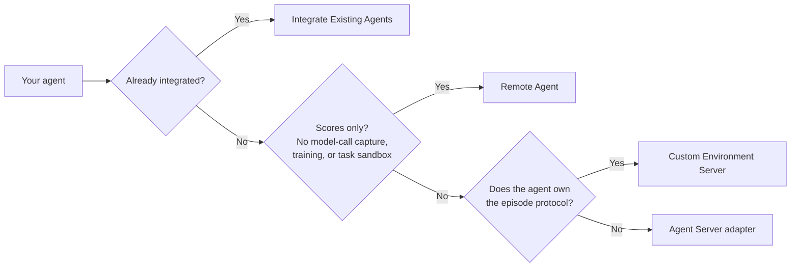

The Agent server is the central component of environment design. It defines whether a rollout is single-step or multi-step, single-turn or multi-turn, and orchestrates all interaction logic — calling the model, executing tool calls through resources, and collecting the final reward. The Agent server does not run an LLM itself; it is orchestration code that delegates all text generation to the Model server.

## Rollout Lifecycle

The following pseudocode illustrates a typical agent rollout in three phases: initialize the episode, run the agent loop, and grade the result. During the agent loop, the agent sends the conversation to the model, gets back a response, and if the model makes any tool calls, it routes them to the Resources server and feeds the results back to the model. The loop repeats until stop criteria are met, such as model max sequence length or the agent reaching a defined max steps or turns. Once the loop completes, the agent calls the Resources server to verify the result and collect a reward.

```python
# Agent Server - pseudocode
class Agent:
    async def run(self, task_data):
        # 1. Initialize episode
        resources_server.seed_session(task_data)

        # 2. Run the agent loop
        response = self.responses(task_data.prompt, task_data.tools)

        # 3. Grade the result
        reward = resources_server.verify(response, task_data.ground_truth)
        return response, reward

    async def responses(self, prompt, tools):
        conversation = prompt
        step = 0

        # Agent loop
        while step < max_steps:
            model_output = model_server.responses(conversation, tools)
            conversation.append(model_output)

            if model_output is text:
                break # model is done, no more tool calls

            for tool_call in model_output.function_calls:
                result = resources_server.post(f"/{tool_call.name}", tool_call.arguments)
                conversation.append(result)

            step += 1

        return conversation
```

<Note>
The pseudocode shows an agent that runs the whole episode itself through its `/run` endpoint. Most agents, including Remote Agent, still run this way: rollout collection reaches them through a `legacy_agent` Environment Server that relays `/run` unchanged. Agents that implement agent sessions, such as SimpleAgent and the [sandboxed harnesses](/main/agent-server/integrate-existing-agents#sandboxed-harnesses), can instead run under an [Environment Server](/main/about/architecture#environment-server) that drives agent sessions, such as `single_agent_turn`. It calls `seed_session` and `verify` on the Resources server and drives the agent through session endpoints, so the agent does not decide when to verify.
</Note>

## Choose a Path

Start from what you have, and move to a deeper path only when you need what it adds.



| Path | What you do | What Gym does | Limits |
| --- | --- | --- | --- |
| [Integrate Existing Agents](/main/agent-server/integrate-existing-agents) | Pick an agent that Gym already integrates and pair it with a benchmark in YAML. | Runs the episode, captures model calls and observations, and verifies. | Each agent has its own supported benchmarks, tools, and training status. Check its row in the catalog. |
| [Remote Agent](/main/agent-server/remote-agent) | An HTTP service that you host, with a `/v1/responses` endpoint that returns the agent's next step. | Drives the loop, runs the environment tools that your service requests, holds the session, and verifies the result. | Scores only. No model-call capture and no training, because your service calls its own model and Gym sees only what the service returns. No task sandbox, because the service cannot reach one. |
| [Agent Server adapter](/main/agent-server/add-or-update-a-harness) | An adapter under `responses_api_agents/<harness>/` that runs the harness or framework. | Everything in [What Gym provides](/main/agent-server/add-or-update-a-harness#what-gym-provides), including model-call capture, tool grants, and task sandboxes. | You write the conversion and mapping code described in [What you write](/main/agent-server/add-or-update-a-harness#what-you-write). |
| Custom Environment Server | A server that owns the episode protocol, such as [`nemo_user_sim`](https://github.com/NVIDIA-NeMo/Gym/tree/main/environment_servers/nemo_user_sim), which routes simulated-user and assistant turns through their own Agent Servers. | Rollout collection, the `BaseEnvironmentServer` base class with concurrency and cleanup handling, and the Resources Server session and verification APIs. | Not covered on this page. See [system design](/main/infrastructure/engineering-notes/system-design) for how Environment Servers drive rollouts. |

### Grow from a score to training

A common route for an agent that you already run:

1. **Score it.** Drive the agent through a Remote Agent and get verifier rewards without rewriting it. Gym treats the agent as a black box.
2. **Evaluate it with Gym's models, tools, and sandboxes.** Build an Agent Server adapter so that Gym can show its model calls, tool use, and execution trace. These rollouts are not yet validated for training.
3. **Train it.** Confirm that every policy-generating model call is captured with token IDs and logprobs, then run an end-to-end training job. This needs a model server that returns token information, such as the vLLM model server. See [Choose the capabilities you need](/main/agent-server/add-or-update-a-harness#choose-the-capabilities-you-need).

## Server Configuration

To add conversations, tool timing, and model-call references to a custom harness, see
[Rollout Evidence](/main/observability/rollout-evidence#add-evidence-to-a-custom-agent).

<Note>
[Agent Server Fields](/reference/configuration#agent-server-fields) for server configuration syntax and fields.

</Note>
