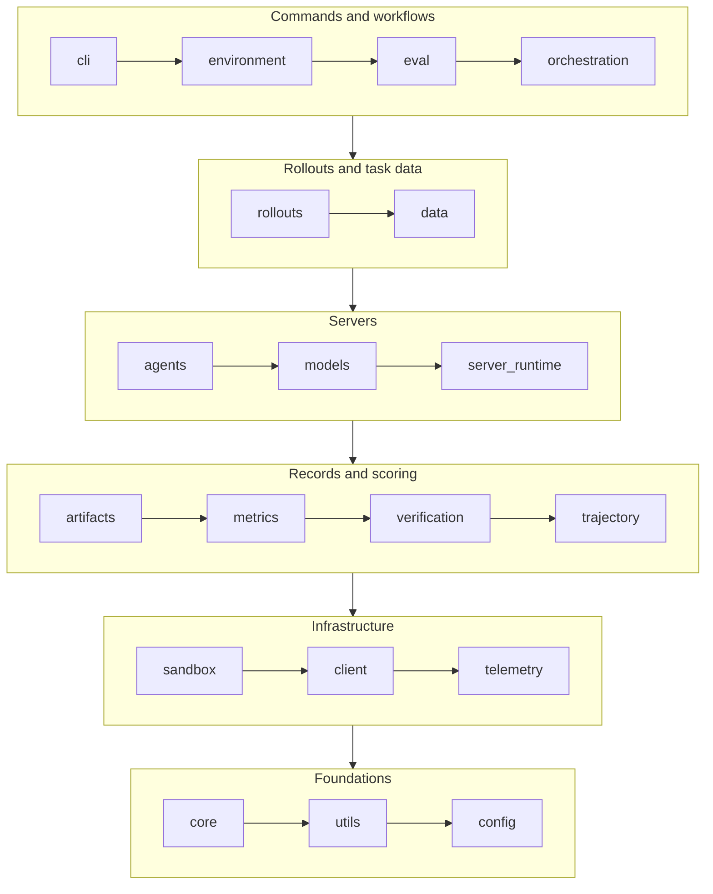

Auto-generated reference documentation for the `nemo_gym` Python package.

This reference is built from docstrings in the [source code](https://github.com/NVIDIA-NeMo/Gym/tree/main/nemo_gym). Browse the sidebar to explore modules, classes, and functions.

## Repository Layout

| Directory | What it holds |
|-----------|---------------|
| `nemo_gym/` | The library: everything servers, benchmarks, and the `gym` command line share. See [The nemo_gym Package](#the-nemo_gym-package). |
| `resources_servers/` | Resources servers: one directory per server, with its tools, verifier, configs, and tests. |
| `responses_api_agents/` | Agent servers: built-in agent harnesses and integrations with external ones. |
| `responses_api_models/` | Model servers for inference providers and local models, such as vLLM. |
| `environment_servers/` | Environment servers, such as `single_agent_turn` and `legacy_agent`, that run each episode. |
| `environments/` | Environment configs that wire a resources server, an agent, and a dataset together. |
| `benchmarks/` | Benchmark definitions: config, manifest, and data preparation for each benchmark. |
| `nemotron_recipes/` | Recipe configs for Nemotron models. |
| `examples/` | Example configs, such as Slurm and Kubernetes launches. |
| `scripts/` | Repository maintenance and CI scripts. |
| `tests/` | Unit, functional, and end-to-end tests for the library. Each server keeps its own tests in its directory. |
| `docker/` | The container image build. |
| `fern/` | This documentation site. |

## The nemo_gym Package

`nemo_gym` is split into packages, each with one job. The packages form layers: a package builds only on packages below it, so lower packages never depend on higher ones.

Read the diagram top to bottom, and left to right within a group: each package may use any package after it, and none before it.

| Package | What it handles |
|---------|-----------------|
| `cli` | The `gym` command line. |
| `environment` | Authoring environments and benchmarks: manifests, registries, scaffolding, and validation. |
| `eval` | Evaluation on top of collected rollouts. |
| `orchestration` | Starting servers and submitting jobs to clusters. |
| `rollouts` | Collecting rollouts and checking the results. |
| `data` | Datasets and task data. |
| `agents` | The shared base for agent servers. |
| `models` | The shared base for model servers, and provider clients. |
| `server_runtime` | What runs inside every server, including the resources server and environment server bases. |
| `artifacts` | The files a run writes and exports. |
| `metrics` | Rollout metrics, such as reward profiles and pass@k. |
| `verification` | Helpers resources servers share for verification, such as LLM judges. |
| `trajectory` | Records of what happened in a rollout. |
| `sandbox` | Isolated command execution and its providers. See [Sandbox](/main/infrastructure/sandbox). |
| `client` | HTTP calls between servers. |
| `telemetry` | Optional OpenTelemetry instrumentation. |
| `core` | Types every package shares, such as the Responses API types. |
| `utils` | General helpers. |
| `config` | Loading the run config. |

`nemo_gym.verifiers` sits outside the layers. It runs inside a Harbor task's verifier sandbox, so it uses only the standard library.

Servers, benchmarks, and other code outside `nemo_gym/` import from the package, such as `from nemo_gym.server_runtime import ...`, rather than from the modules inside it.

### Old Import Paths

Modules that moved when `nemo_gym` was split into packages keep their old import paths, such as `nemo_gym.server_utils`, until release 0.10.0. Each use of an old path emits a `DeprecationWarning` that names the new one. To update your code, run `python scripts/migrate_imports.py <path>` from a Gym checkout.
