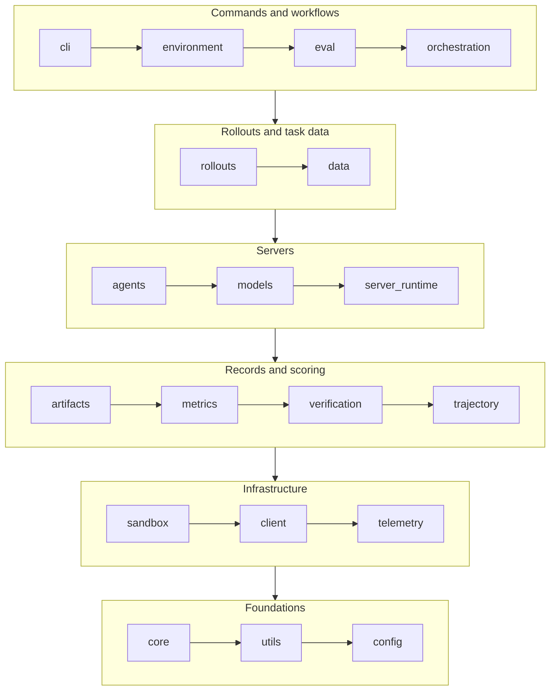

Auto-generated reference documentation for the `nemo_gym` Python package.

This reference is built from docstrings in the [source code](https://github.com/NVIDIA-NeMo/Gym/tree/main/nemo_gym). Browse the sidebar to explore modules, classes, and functions.

## Repository Layout

| Directory | What it holds |
|-----------|---------------|
| `nemo_gym/` | The library: everything servers, benchmarks, and the `gym` command line share. See [The nemo_gym Package](#the-nemo_gym-package). |
| `resources_servers/` | Resources servers: one directory per server, with its tools, verifier, configs, and tests. |
| `responses_api_agents/` | Agent servers: built-in agent harnesses and integrations with external ones. |
| `responses_api_models/` | Model servers for inference providers and local models, such as vLLM. |
| `environment_servers/` | Environment servers, such as `single_agent_turn` and `legacy_agent`, that run each episode. |
| `environments/` | Environment configs that wire a resources server, an agent, and a dataset together. |
| `benchmarks/` | Benchmark definitions: config, manifest, and data preparation for each benchmark. |
| `nemotron_recipes/` | Recipe configs for Nemotron models. |
| `examples/` | Example configs, such as Slurm and Kubernetes launches. |
| `scripts/` | Repository maintenance and CI scripts. |
| `tests/` | Unit, functional, and end-to-end tests for the library. Each server keeps its own tests in its directory. |
| `docker/` | The container image build. |
| `fern/` | This documentation site. |

## The nemo_gym Package

`nemo_gym` is split into packages, each with one job. The packages form layers: a package builds only on packages below it, so lower packages never depend on higher ones.



Read the diagram top to bottom, and left to right within a group: each package may use any package after it, and none before it.

| Package | What it handles |
|---------|-----------------|
| `cli` | The `gym` command line. |
| `environment` | Authoring environments and benchmarks: manifests, registries, scaffolding, and validation. Also running a benchmark from Python: `plan_benchmark` and `TaskRunner`. |
| `eval` | Evaluation on top of collected rollouts. |
| `orchestration` | Starting servers, submitting jobs to clusters, and recovering a submitted run from its saved evidence. |
| `rollouts` | Collecting rollouts and checking the results. |
| `data` | Datasets and task data. |
| `agents` | The shared base for agent servers. |
| `models` | The shared base for model servers, and converters between model API formats. |
| `server_runtime` | What runs inside every server, including the resources server and environment server bases. |
| `artifacts` | The files a run writes and exports. |
| `metrics` | Rollout metrics, such as reward profiles and pass@k. |
| `verification` | Helpers resources servers share for verification, such as LLM judges. |
| `trajectory` | Records of what happened in a rollout. |
| `sandbox` | Isolated command execution and its providers. See [Sandbox](/main/infrastructure/sandbox). |
| `client` | HTTP calls to Gym servers and model endpoints, including the OpenAI client. |
| `telemetry` | Optional OpenTelemetry instrumentation. |
| `core` | Types every package shares, such as the Responses API types, and the failure types and failure reports passed from one Gym server to the next. |
| `utils` | General helpers, such as reading the causes, type name, and HTTP status of any Python exception. |
| `config` | Loading the run config. |

`nemo_gym.verifiers` sits outside the layers. It runs inside a Harbor task's verifier sandbox, so it uses only the standard library.

Servers, benchmarks, and other code outside `nemo_gym/` import from the package, such as `from nemo_gym.server_runtime import ...`, rather than from the modules inside it.

### Old Import Paths

Modules that moved when `nemo_gym` was split into packages keep their old import paths, such as `nemo_gym.server_utils`, until release 0.10.0. Each use of an old path emits a `DeprecationWarning` that names the new one. To update your code, run `python scripts/migrate_imports.py <path>` from a Gym checkout.

## Planning and running single tasks in-process

To run a benchmark task by task from Python, plan it once with `plan_benchmark`, then run each task through
`TaskRunner.run_task` against Gym servers that are already running:

```python
from nemo_gym.config import BaseServerConfig
from nemo_gym.environment import TaskRunner, plan_benchmark

planned = plan_benchmark("ifeval")          # resolve, prepare, plan and collate the benchmark
runner = TaskRunner(planned.rows, registry_server=BaseServerConfig(host="127.0.0.1", port=11000))
result = await runner.run_task(planned.task_ids()[0])
print(result.rewards)
```

`plan_benchmark` builds the same plan as `gym eval plan` and collates the benchmark's rows. It reads no
command-line arguments and does not set Gym's process-wide configuration, so a long-lived process can call it.
Start the servers with `gym env start --benchmark NAME` first. The registry server is the server that serves the
run's config and the other servers' addresses.

### What is stable

Import everything from `nemo_gym.environment`: `plan_benchmark`, `serve_benchmark`, `TaskRunner`, `PlannedBenchmark`,
`TaskResult` and `EvalPlan`. The error type is `nemo_gym.config.ConfigError`. Signatures and the fields of the result
types change only additively: a new parameter is optional and keyword-only, and a parameter is deprecated before it is
removed or renamed. A test pins them.

`TaskResult.results` holds Gym's raw `/run` responses. Their keys are not part of the contract: read `rewards`, and
use `results` for debugging.

### Constraints

- `serve_benchmark` sets the process's Gym configuration, as `gym env start` does, so serve one benchmark per process.
- Benchmark names resolve relative to the working directory, `NEMO_GYM_EXTRA_ROOTS` and the install root.
- Preparing a benchmark's data and installing a server's environment write beside their source, so the Gym checkout or
  install must be writable.
- To serve from another process, pass `registry_port` to `serve_benchmark` and build the `TaskRunner` with the same
  port, for example `BaseServerConfig(host="127.0.0.1", port=port)`. `PlannedBenchmark.to_json` and `from_json` carry a
  plan between processes.
