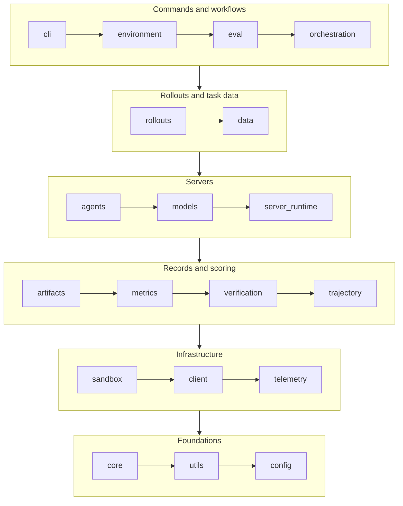

Auto-generated reference documentation for the `nemo_gym` Python package.

This reference is built from docstrings in the [source code](https://github.com/NVIDIA-NeMo/Gym/tree/main/nemo_gym). Browse the sidebar to explore modules, classes, and functions.

## Package Layout

`nemo_gym` is split into packages, each with one job. The packages form layers: a package imports only packages below it. The `import-linter` contract in `pyproject.toml` defines the order, and a pre-commit hook enforces it.



Read the diagram top to bottom, and left to right within a group: each package may import any package after it, and none before it.

| Package | What it holds |
|---------|---------------|
| `nemo_gym.cli` | The `gym` command line and its command groups. |
| `nemo_gym.environment` | Environment authoring contracts and tooling: the `manifest.yaml` contract and its validation, the registries of resources servers, agents, models, environments, and benchmarks, scaffolding, and publication checks. |
| `nemo_gym.eval` | Evaluation on top of collected rollouts: evaluation plans, reverifying saved rollouts, and comparing runs. |
| `nemo_gym.orchestration` | Starting and running Gym: the server supervisor behind `gym env start`, per-server virtual environments, the Ray Serve gateway, and job submission to Slurm and Kubernetes. |
| `nemo_gym.rollouts` | Collecting rollouts and interpreting the saved evidence: rollout collection, rollout health, outcomes, performance, and harness capability checks. |
| `nemo_gym.data` | Task data: datasets and their preparation, prompts, task rows and their materialization, and task formats such as Harbor. |
| `nemo_gym.agents` | What agent servers share: the agent server base (`SimpleResponsesAPIAgent`), agent outcomes and activations, sandbox sessions and tools, and skills. |
| `nemo_gym.models` | Model servers and what they share: the model server base (`SimpleResponsesAPIModel`), provider clients, converters, and model call capture. |
| `nemo_gym.server_runtime` | What runs inside every Gym server: the server bases (`BaseServer`, `SimpleServer`), the resources server base (`SimpleResourcesServer`), the environment server base, request handling, sessions, and partial-rollout checkpoints. |
| `nemo_gym.artifacts` | What a run writes and exports: run artifacts, the resolved config, rollout rows, and the exporters that publish them. |
| `nemo_gym.metrics` | Rollout metrics: reward profiles, pass@k and majority statistics, and the metric definitions they share. |
| `nemo_gym.verification` | Helpers that resources servers share for verifying submissions: LLM judge calls, verifier contract tests, and grading in a single-use sandbox. |
| `nemo_gym.trajectory` | The trajectory data model: the records of what happened in a rollout, and their ATIF export and import. |
| `nemo_gym.sandbox` | The provider-neutral sandbox API for isolated command execution and file transfer, and its providers. See [Sandbox](/main/infrastructure/sandbox). |
| `nemo_gym.client` | Calling HTTP endpoints and Gym servers: the shared aiohttp client with retries (`request`) and `ServerClient`. |
| `nemo_gym.telemetry` | Optional OpenTelemetry instrumentation through nemo-lens; every instrumentation site is a no-op when it is off. |
| `nemo_gym.core` | The definitions every package and every environment shares: the Responses API and Chat Completions types, episode identity, and failure kinds. |
| `nemo_gym.utils` | General helpers: paths, decorators, text, process information, and import compatibility. |
| `nemo_gym.config` | Loading and accessing the run config, and the server config types. |

`nemo_gym.verifiers` sits outside the layers. It holds helpers for a Harbor task's Python verifier, which runs inside the task's verifier sandbox with nothing installed, so it uses only the standard library and imports nothing else from `nemo_gym`.

A few imports still point up the order, such as `nemo_gym.config.global_config` reading settings from packages above it. The contract lists each one under `ignore_imports`, and each goes away with the split or move that resolves it. New code belongs in a package that sits above everything it imports, not in a new `ignore_imports` entry.

### Server Base Classes

| Module | Classes |
|--------|---------|
| `nemo_gym.server_runtime.base_server` | `BaseServer`, `SimpleServer`: FastAPI app setup and the middleware stack every server shares |
| `nemo_gym.server_runtime.base_resources_server` | `SimpleResourcesServer`, `BaseVerifyRequest`, `BaseVerifyResponse`, `BaseMultiRewardVerifyResponse` |
| `nemo_gym.agents.base_responses_api_agent` | `SimpleResponsesAPIAgent` |
| `nemo_gym.models.base_responses_api_model` | `SimpleResponsesAPIModel` |

## Importing from `nemo_gym`

Each package lists the names it offers to code outside the library in `_PUBLIC_API` in its `__init__.py`. Names load on first use, so importing a package imports none of its modules.

- **Code outside `nemo_gym/`**, such as resources servers, agents, model servers, benchmarks, scripts, and their tests, imports from the package:

  ```python
  from nemo_gym.server_runtime import BaseVerifyRequest, BaseVerifyResponse, SimpleResourcesServer
  ```

  If you need a name the package does not export, add it to the package's `_PUBLIC_API` rather than importing the module that defines it.
- **Code inside `nemo_gym/` and its tests** imports from the module that defines each name, such as `from nemo_gym.server_runtime.base_resources_server import SimpleResourcesServer`. This keeps every dependency between packages visible to the `import-linter` contract.

### Old Import Paths

Modules that moved in the reorganization keep their old import paths until release 0.10.0. Each use of an old path, such as `nemo_gym.server_utils` or `nemo_gym.openai_utils`, emits a `DeprecationWarning` that names the new path. `nemo_gym/_moved_paths.py` records every move and the release that removes it.

To update your own code, run the migration script from a Gym checkout. It rewrites old imports, `mock.patch` targets, and file paths:

```bash
python scripts/migrate_imports.py path/to/your/code
```

Then run `ruff check --fix` and `ruff format` on the changed files to sort the rewritten imports.
