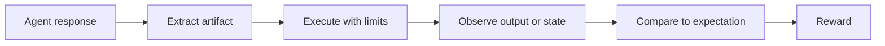

import { NavButton } from "../../../../../components/NavButton";

Use **execution and state matching** when correctness is best defined by what an answer does. Instead of comparing the answer text to a reference string, the verifier runs generated code, SQL, tool calls, or a formal proof and scores an observable result.

<NavButton href="/build-verifiers/verification-patterns" label="Back to Verification Patterns" direction="back" />

---

## Quick Mental Model

An execution-based verifier follows the same four steps across domains:

1. **Extract** an executable artifact from the rollout, such as a code block, SQL query, or tool calls.
2. **Execute** it with explicit limits in an isolated or task-local environment.
3. **Observe** the output, test results, compiler status, or final state.
4. **Compare and score** that observation against task-specific expectations.



This pattern accepts multiple valid implementations naturally. Two programs can use different algorithms, and two tool traces can take different paths, while still producing the same correct result.

<Warning>
Generated code and tool calls are untrusted input. A timeout or semaphore limits resource use but does not provide security isolation. Use a sandbox or container when the verifier executes code that can access the host.
</Warning>

---

## Choose the Observable

Define correctness at the most semantic layer that you can evaluate deterministically:

| Task | Execute | Compare |
|---|---|---|
| Code generation | Generated program against tests | Test outcomes or stdout |
| Text-to-SQL | Predicted and reference queries on the same database | Result sets |
| Tool-use workflow | Predicted and reference actions in separate fresh environments | Resulting state |
| Formal proof | Completed source with the proof compiler | Compiler status and forbidden placeholders |
| Hardware or systems code | Generated files with a test harness in a sandbox | Harness exit status and reports |

Avoid comparing implementation details when the task only requires an outcome. For example, compare SQL result sets instead of SQL strings, and compare final application state instead of requiring the exact reference tool sequence.

---

## Code Execution Against Tests

A code verifier extracts code, combines it with task-specific tests, executes it under a timeout, and maps the test outcome to a reward.

The [`bigcodebench`](https://github.com/NVIDIA-NeMo/Gym/tree/main/resources_servers/bigcodebench) server runs each candidate in a dedicated virtual environment subprocess. Its core flow is:

```python
async with self._semaphore:
    result = await self._run_in_venv(
        code=calibrated,
        test_code=meta["test"],
        entry_point=meta["entry_point"],
    )

reward = 1.0 if result.get("status") == "pass" else 0.0
```

The subprocess has a hard outer timeout and decodes arbitrary output without crashing on non-UTF-8 bytes:

```python
proc = await asyncio.create_subprocess_exec(
    python,
    runner,
    stdin=asyncio.subprocess.PIPE,
    stdout=asyncio.subprocess.PIPE,
    stderr=asyncio.subprocess.PIPE,
)
try:
    stdout, stderr = await asyncio.wait_for(
        proc.communicate(payload),
        timeout=subprocess_timeout,
    )
except asyncio.TimeoutError:
    proc.kill()
    await proc.wait()
    return {"status": "timeout"}

text = stdout.decode("utf-8", errors="replace")
```

If the checker is too heavy to run in the server's own processes, run it in a sandbox or spread it across nodes; see [Distributing Heavy Work](/about/architecture#distributing-heavy-work).

Other examples:

- [`competitive_coding_challenges`](https://github.com/NVIDIA-NeMo/Gym/tree/main/resources_servers/competitive_coding_challenges) checks competitive-programming inputs and outputs.
- [`nvarc`](https://github.com/NVIDIA-NeMo/Gym/tree/main/resources_servers/nvarc) executes a generated Python transformation and validates its returned grid.
- [`evalplus`](https://github.com/NVIDIA-NeMo/Gym/tree/main/resources_servers/evalplus) runs generated Python functions against the HumanEval+ and MBPP+ tests.
- [`code_fim`](https://github.com/NVIDIA-NeMo/Gym/tree/main/resources_servers/code_fim) runs code-infilling completions against the HumanEval-Infilling tests.

---

## SQL Execution Against a Database

Text-to-SQL verification should compare query semantics, not query text:

1. Extract the predicted SQL.
2. Execute the reference query against the task database.
3. Execute the predicted query against the same database.
4. Normalize and compare the result sets.

[`bird_sql`](https://github.com/NVIDIA-NeMo/Gym/tree/main/resources_servers/bird_sql) runs SQLite work in a bounded worker thread so blocking database calls do not block the event loop:

```python
async def execute_sqlite_async(db_path, sql, semaphore, timeout_s):
    async with semaphore:
        try:
            return await asyncio.wait_for(
                asyncio.to_thread(execute_sqlite, db_path, sql),
                timeout=timeout_s,
            )
        except asyncio.TimeoutError:
            return None

gold_rows = await execute_sqlite_async(db_path, gold_sql, semaphore, timeout_s)
pred_rows = await execute_sqlite_async(db_path, pred_sql, semaphore, timeout_s)
match = gold_rows is not None and pred_rows is not None and set(gold_rows) == set(pred_rows)
```

Result normalization is benchmark-specific. Decide whether row order, duplicate rows, floating-point tolerance, column order, and `NULL` values are significant. Record execution errors separately from valid but incorrect results so infrastructure failures are diagnosable.

[`spider2_lite`](https://github.com/NVIDIA-NeMo/Gym/tree/main/resources_servers/spider2_lite) is another execution-based SQL example.

---

## State Matching for Tool Use

Exact tool-call matching can reject a correct trajectory merely because the agent took a different valid route. State matching instead asks whether the agent produced the intended world state.

Use two independently initialized environments:

```python
predicted_env = create_fresh_environment()
reference_env = create_fresh_environment()

execute_actions(predicted_env, predicted_actions)
execute_actions(reference_env, reference_actions)

predicted_state = normalize(snapshot(predicted_env))
reference_state = normalize(snapshot(reference_env))
reward = float(predicted_state == reference_state)
```

[`workplace_assistant`](https://github.com/NVIDIA-NeMo/Gym/tree/main/resources_servers/workplace_assistant) applies this pattern across calendar, email, analytics, project-management, and CRM state. It executes the predicted and ground-truth actions in separate fresh tool environments, normalizes fields where comparison is case-insensitive, and requires every relevant state table to match:

```python
predict_env = execute_actions_and_reset_state(predicted_actions)
ground_truth_env = execute_actions_and_reset_state(ground_truth_actions)

return (
    predicted_calendar_state.equals(ground_truth_calendar_state)
    and predicted_email_state.equals(ground_truth_email_state)
    and predicted_project_management_state.equals(ground_truth_project_management_state)
    and predicted_crm_state.equals(ground_truth_crm_state)
)
```

Keep the live rollout state separate from both verification environments. Replaying actions from a clean baseline prevents the reference run from seeing mutations made by the agent and makes verification reproducible.

Define a canonical state projection rather than comparing every internal field. Ignore timestamps, generated IDs, caches, and other nondeterministic fields unless they are part of the task contract.

---

## Formal Compilation

For formal mathematics, successful compilation is a deterministic correctness signal. The verifier builds a complete proof file from the task statement and generated proof, invokes the compiler in a sandbox, and checks both process status and benchmark-specific forbidden constructs.

[`math_formal_lean`](https://github.com/NVIDIA-NeMo/Gym/tree/main/resources_servers/math_formal_lean) uses this flow:

```python
predicted_proof = build_lean4_proof(
    generation=body.response.output_text,
    data_point={"header": body.header, "formal_statement": body.formal_statement},
    config=self._proof_build_config,
)

compiler_output = await self._sandbox_client.execute_lean4(
    code=predicted_proof,
    timeout=self.config.compilation_timeout,
)
proof_status = determine_proof_status(compiler_output)
reward = 1.0 if proof_status == "completed" else 0.0
```

Compilation success alone may not be sufficient if the language permits placeholders or unsound escape hatches. The Lean verifier also inspects output for incomplete proofs such as `sorry`. Apply the equivalent policy for the formal system you use.

Compiler diagnostics are useful observations, not only failures. `math_formal_lean` returns structured error feedback so an agent can revise the proof in a later turn.

---

## Sandbox and Container Execution

Use a sandbox when generated artifacts need compilers, simulators, system tools, or stronger isolation than a subprocess provides.

[`cvdp`](https://github.com/NVIDIA-NeMo/Gym/tree/main/resources_servers/cvdp) verifies generated RTL and testbench files with task-provided harnesses. It translates Docker Compose metadata into an Apptainer sandbox specification, creates a temporary workspace per rollout, runs the harness, and always closes the sandbox:

```python
with tempfile.TemporaryDirectory(prefix=f"cvdp_{task_id}_") as workdir:
    write_harness_files(workdir, harness_files)
    write_generated_files(workdir, rtl_files)

    handle = await provider.create(sandbox_spec)
    try:
        result = await provider.exec(
            handle,
            command,
            timeout_s=container_timeout,
        )
    finally:
        await provider.close(handle)

reward = 1.0 if result.return_code == 0 else 0.0
```

Treat file paths, environment variables, container mounts, and harness content as untrusted. Resolve every requested path under the rollout workspace, mount only required directories, and avoid exposing host credentials or sockets.

---

### CVDP heavy repository tasks

Heavy tasks use complete starting repositories rather than only inline RTL files.
Run these commands from the Gym repository root with Gym installed, Git, the
Hugging Face `hf` CLI, and uv ≥ 0.13.4 available. The `uv run --locked` commands
use the resources server's locked dependencies. The existing
[non-agentic preparation](https://github.com/NVIDIA-NeMo/Gym/tree/main/resources_servers/cvdp#download-dataset)
and [generic-agent instructions](https://github.com/NVIDIA-NeMo/Gym/tree/main/responses_api_agents/cvdp_agent)
remain available for other subsets.

**Reviewed artifacts.** Use the CVDP v1.1.0 non-commercial heavy task JSONL and
sanitized context bundles from the same Hugging Face dataset revision,
[`5b807d945f6a99aa645f7e43a64a2115e281b4bf`](https://huggingface.co/datasets/nvidia/cvdp-benchmark-dataset/tree/5b807d945f6a99aa645f7e43a64a2115e281b4bf).
This task file contains 75 tasks. The bundle directory also supports tasks outside
this selected subset. Its `manifest.txt` maps original task commits to sanitized
context commits; it is different from the verifier-image manifest generated below.
Retain the upstream LICENSE/NOTICE and the individual projects' license notices.

```bash
hf download nvidia/cvdp-benchmark-dataset \
  --repo-type dataset \
  --revision 5b807d945f6a99aa645f7e43a64a2115e281b4bf \
  --include "cvdp_v1.1.0_agentic_heavy_code_generation_no_commercial.jsonl" \
    "cvdp_v1.1.0_agentic_heavy_code_generation_public/*.bundle" \
    "cvdp_v1.1.0_agentic_heavy_code_generation_public/manifest.txt" \
    LICENSE NOTICE \
  --local-dir resources_servers/cvdp/data
```

At this revision the raw task JSONL has SHA-256
`809916fa3248a4b2597b2a2ac364d3450d24936cad0e25bbe1bf0f1243ad1ea7`;
the bundle `manifest.txt` has SHA-256
`90977fa56c94df56299d8607fcd480f3f90497d7fda58d3809d31c77093ba357`.
Do not mix task files, manifests, or bundles from different revisions.

**Prepare the starting repositories and Gym rows.** No upstream prompt export is
needed for heavy tasks:

```bash
uv run --locked --project resources_servers/cvdp python -m resources_servers.cvdp.scripts.prepare_heavy \
  --dataset resources_servers/cvdp/data/cvdp_v1.1.0_agentic_heavy_code_generation_no_commercial.jsonl \
  --bundles resources_servers/cvdp/data/cvdp_v1.1.0_agentic_heavy_code_generation_public \
  --workspaces resources_servers/cvdp/data/heavy_workspaces \
  --output resources_servers/cvdp/data/cvdp_v1.1.0_agentic_heavy_code_generation_no_commercial_gym.jsonl \
  --cache results/cvdp-heavy/git-cache
```

The converter selects each manifest's sanitized starting commit, extracts the
project tree, and writes content-addressed `<sha256>.tar.gz` snapshots. It uses
reference-patch keys to identify target paths but **does not apply reference
patches**. A
`*.repositories.json` receipt beside the converted JSONL records the selected
commits and snapshot identifiers. Preparation does not certify that the upstream
repository itself is free of answer-bearing companion files.

The output filename and snapshot directory above match
[`cvdp_agent_heavy_claude.yaml`](https://github.com/NVIDIA-NeMo/Gym/blob/main/responses_api_agents/cvdp_agent/configs/cvdp_agent_heavy_claude.yaml).
Both the resources server and agent must read the same `prepared_repository_dir`.
The config inherits the agent instance name **`cvdp_agent_generic_claude`**; there
is no separate `cvdp_agent_heavy_claude` agent instance.

**Prepare verifier images.** Select simulator images compatible with the worker
architecture and provider. This example uses `nvidia/cvdp-sim:v1.0.0` for both
simulation and synthesis; use the same substitutions in image preparation and
at runtime. The reviewed subset has 81 direct-image services and no Compose
`build:` recipes. The first command therefore writes an empty image mapping
without invoking Docker; `--image-prefix` is required by the preparation CLI but
unused for these tasks. For another subset with `build:` recipes, use a
Docker-capable build host, a registry image prefix accessible to workers, and
`--push`.

```bash
uv run --locked --project resources_servers/cvdp python -m resources_servers.cvdp.prepare \
  resources_servers/cvdp/data/cvdp_v1.1.0_agentic_heavy_code_generation_no_commercial_gym.jsonl \
  --prepared-repository-dir resources_servers/cvdp/data/heavy_workspaces \
  --oss-sim-image nvidia/cvdp-sim:v1.0.0 \
  --oss-pnr-image nvidia/cvdp-sim:v1.0.0 \
  --image-prefix cvdp-heavy \
  --manifest resources_servers/cvdp/data/heavy_prepared_images.json

uv run --locked --project resources_servers/cvdp python -m resources_servers.cvdp.prepare \
  resources_servers/cvdp/data/cvdp_v1.1.0_agentic_heavy_code_generation_no_commercial_gym.jsonl \
  --prepared-repository-dir resources_servers/cvdp/data/heavy_workspaces \
  --oss-sim-image nvidia/cvdp-sim:v1.0.0 \
  --oss-pnr-image nvidia/cvdp-sim:v1.0.0 \
  --manifest resources_servers/cvdp/data/heavy_prepared_images.json \
  --check-only
```

The image manifest covers Compose build recipes; it does not replace repository
snapshots. Images referenced directly by tasks must also be available to the
provider. A local `.sif` requires Apptainer; if using local image mappings, validate
manifest coverage with those same mappings instead of reusing keys generated
with different base-image substitutions.

**Configure and run.** Keep endpoint credentials local. Set these values in your
repo-root `env.yaml` (replace the model and endpoint; supply `POLICY_API_KEY` through
your local environment):

```yaml
cvdp_sim_image: nvidia/cvdp-sim:v1.0.0
anthropic_model_name: YOUR_MODEL_NAME
policy_model_name: ${anthropic_model_name}
policy_base_url: https://YOUR_ENDPOINT/v1
policy_api_key: ${oc.env:POLICY_API_KEY}
```

Create a local overlay with an absolute image-manifest path. Both snapshot-directory
settings are shown explicitly; their values match the heavy config defaults.

```bash
mkdir -p results/cvdp-heavy
cat > results/cvdp-heavy/local.yaml <<EOF
cvdp:
  resources_servers:
    cvdp:
      prepared_repository_dir: resources_servers/cvdp/data/heavy_workspaces
      prepared_image_manifest: ${PWD}/resources_servers/cvdp/data/heavy_prepared_images.json
cvdp_agent_generic_claude:
  responses_api_agents:
    cvdp_agent:
      prepared_repository_dir: resources_servers/cvdp/data/heavy_workspaces
EOF

gym eval run \
  --config responses_api_agents/cvdp_agent/configs/cvdp_agent_heavy_claude.yaml \
  --config responses_api_models/vllm_model/configs/vllm_model.yaml \
  --config results/cvdp-heavy/local.yaml \
  --agent cvdp_agent_generic_claude \
  --split validation --limit 1 --num-repeats 1 --concurrency 1 \
  --output results/cvdp-heavy/smoke.jsonl
```

The shipped config uses Apptainer. Configure another supported provider for both
components if needed. The Claude Code budget is 1,800 seconds and 60 turns; the
outer agent sandbox execution limit is 1,920 seconds, and each verifier service
has a separate 600-second limit. Inspect the smoke trajectory and verifier output
before removing `--limit 1` for the complete 75-task subset; choose a fresh output
path for the full run. Keep downloaded data, generated repositories, local overlays,
and credentials out of source control.

---

## Concurrency, Timeouts, and Cleanup

Execution verifiers can exhaust CPUs, file descriptors, processes, database connections, or sandbox capacity. Bound the expensive region, not just request admission:

```python
def model_post_init(self, context):
    self._semaphore = asyncio.Semaphore(self.config.num_processes)

async def verify(self, body):
    async with self._semaphore:
        result = await run_with_timeout(body)
    return build_verify_response(result)
```

Use all of the following where applicable:

- **Semaphore:** cap concurrent subprocesses, queries, compilers, or sandboxes.
- **Timeout:** enforce an outer wall-clock limit and terminate timed-out work.
- **Output limit:** truncate retained stdout and stderr to keep responses and logs bounded.
- **Robust decoding:** decode subprocess bytes with `errors="replace"`.
- **Per-task isolation:** create fresh databases, state containers, or workspaces when mutations are possible.
- **Guaranteed cleanup:** reap subprocesses and close sandboxes in `finally`; use temporary-directory context managers for files.
- **Structured outcomes:** distinguish `incorrect`, `timeout`, `execution_error`, and `verifier_error`.

<Info>
A failed execution normally earns the task's failure reward. A verifier infrastructure failure is different: preserve enough structured detail to diagnose or retry it instead of silently treating every failure as an incorrect model answer.
</Info>

---

## Checklist

1. Define the executable artifact and how it is extracted.
2. Choose an observable that captures task semantics.
3. Specify normalization and comparison rules.
4. Isolate untrusted execution and set resource limits.
5. Bound concurrency and enforce timeouts.
6. Clean up processes, workspaces, sessions, and sandboxes on every path.
7. Return structured diagnostics alongside the reward.
8. Test correct, incorrect, malformed, timed-out, and crashing candidates.

---

## Related Topics

- [Build Verifiers](/build-verifiers) — resources server interfaces and verification overview
- [Verification Patterns](/build-verifiers/verification-patterns) — other scoring approaches
- [Environment Components](/about/architecture) — where resources servers fit in a rollout
- [Deployment Topology](/infrastructure/deployment-topology) — scaling servers and execution workers
