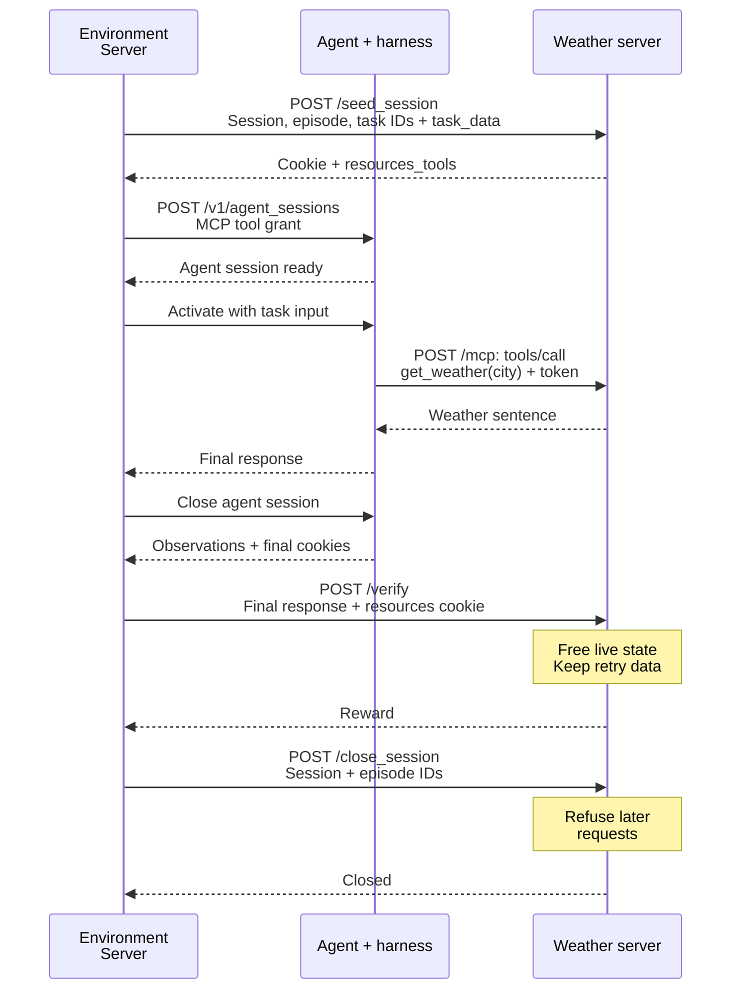
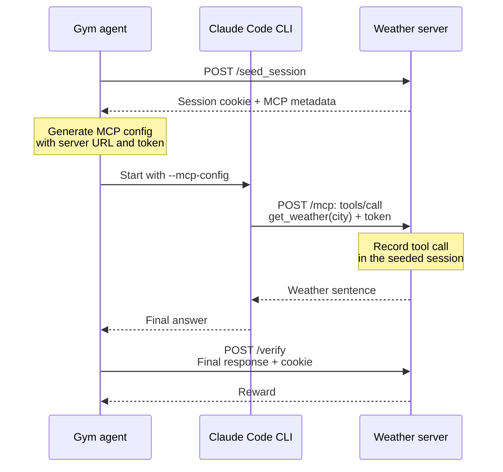

import { NavButton } from "../../../../components/NavButton";

# MCP Resources Server

Expose a Resources Server's HTTP tools over the **Model Context Protocol (MCP)** with `expose_tools_over_mcp: true`. Use an Environment Server with typed resources and agent sessions for new integrations. This tutorial uses the weather tool to explain MCP grants, tool calls, verification, and cleanup on that path.

<NavButton href="/main/environment-tutorials/stateful-environment" label="Stateful Environment" direction="prev" />

## Turn it on

The weather server has one tool, `get_weather(city)`. A successful episode calls it for the requested city and includes the returned weather sentence in the final answer.

For a Resources Server that already has HTTP tool routes, enable MCP in its configuration. The weather example already includes this setting:

```yaml
example_mcp_weather:
  resources_servers:
    example_mcp_weather:
      entrypoint: app.py
      expose_tools_over_mcp: true
```

At startup, Gym mounts a Streamable-HTTP `/mcp` endpoint on the same app. Each eligible `POST` route becomes an MCP tool named after its path: `/get_weather` becomes `get_weather`. The request model supplies the input schema and the handler's docstring supplies the description. Session and verification routes remain control endpoints.

## Sessions under an Environment Server

**Recommended for new integrations:** use an Environment Server such as `single_agent_turn` to own seed, verification, and close. Select an agent that accepts per-session MCP tool grants.

Add this Environment Server block alongside your resources and agent definitions. `my_mcp_agent` is a placeholder for your configured compatible agent; this block alone is not a complete runnable configuration.

```yaml
config_paths:
  - environment_servers/single_agent_turn/configs/single_agent_turn.yaml

weather_environment:
  _inherit_from: single_agent_turn
  environment_servers:
    single_agent_turn:
      resources_server: { type: resources_servers, name: example_mcp_weather }
      agent_server: { type: responses_api_agents, name: my_mcp_agent }
      resources_tool_transports: [mcp]
```

See [Run an integrated agent on a benchmark](/main/agent-server/integrate-existing-agents#run-an-integrated-agent-on-a-benchmark) for pairing and execution setup.

<Note>
The Claude Code adapter's session path does not yet consume per-session MCP grants. The shipped weather YAML still uses the agent-owned `/run` path; it is retained only for compatibility and is not a typed-session pairing. Its commands and wiring are in the agent-owned compatibility section below.
</Note>

With a compatible agent and `resources_tool_transports: [mcp]`, the successful episode follows this sequence. The agent lifeline groups the Agent Server and its harness runtime; model calls are omitted.



The Environment Server assigns the resources session ID and owns cleanup. It converts the seed's `resources_tools` metadata into the agent session's `tool_accesses`, including the MCP URL and token. Closing the agent session disconnects its tool clients; the Resources Server keeps running. Resources cleanup is registered before seeding, so it is also attempted if the episode fails before verification.

On the typed-session path:

- `/seed_session` accepts `ResourcesSeedSessionRequest` with `resources_session_id`, `episode_id`, `task_id`, and the row's fields in `task_data`. It returns MCP connection metadata in `resources_tools`, which the Environment Server grants to the agent.
- HTTP cookies and MCP tokens identify the same resources session. Repeating the same seed preserves its state; conflicting episode or task identities receive `409`, and invalid task data receives `422`.
- After verification releases the live state, the Environment Server calls `/close_session`. Close needs no cookie, succeeds for unknown or already-closed sessions, and rejects an episode that does not own the session. During the close retry window, later seeds receive `409`, tools receive `404`, and verification returns a masked sample.

The [weather README](https://github.com/NVIDIA-NeMo/Gym/tree/main/resources_servers/example_mcp_weather#sessions-under-an-environment-server) has more on this path.

[`SimpleResourcesServer`](https://github.com/NVIDIA-NeMo/Gym/blob/main/nemo_gym/server_runtime/base_resources_server.py) owns seed, verification cleanup, close, and checkpoint retirement. Stateless servers keep the default no-op lifecycle. A stateful environment supplies three hooks: `has_session_state`, `initialize_session_state`, and `release_session_state`, and sets `seed_request_model` to validate task data. Initialization and release must be async. The base releases an existing cookie run before replacing it and attempts cleanup if initialization fails. Release must tolerate missing or already-released state; on failure, retain the handles needed to retry.

The verifier scores inside `async with self.verifying(session_id) as verification`. The context holds the session lock, identifies lost sessions, and makes compact evidence available through `verification.retained` on a retry. The verifier calls `verification.retain(payload)` with the evidence it needs; the context calls `release_session_state` and transfers the identity only after cleanup succeeds. It also attempts release when scoring raises. The weather verifier retains only the unique called cities, while recomputing the score from each request. Tool handlers that await must hold `session_lock(session_id)` or coordinate their in-flight work with release; this weather tool does not await.

## How MCP reaches the tool

The weather server extends `SimpleResourcesServer`, which supplies the common session lifecycle. The example implements its state hooks, tool, and verifier. These are excerpts from [the weather server's `app.py`](https://github.com/NVIDIA-NeMo/Gym/blob/main/resources_servers/example_mcp_weather/app.py); use that file for the complete class and request models.

```python
# Methods of ExampleMCPWeatherResourcesServer.
def setup_webserver(self) -> FastAPI:
    app = super().setup_webserver()
    app.post("/get_weather")(self.get_weather)
    return app


async def get_weather(
    self,
    request: Request,
    body: ExampleMCPWeatherGetWeatherRequest,
) -> ExampleMCPWeatherGetWeatherResponse:
    """Get a deterministic weather report for a city."""
    state = self.session_id_to_state.get(request.session[SESSION_ID_KEY])
    if state is None:
        raise ResourcesSessionLostError("No open example_mcp_weather session for this request")
    weather = _weather_sentence(body.city)
    state["weather_calls"].append({"city": body.city, "weather": weather})
    return ExampleMCPWeatherGetWeatherResponse(weather=weather)
```

`ExampleMCPWeatherGetWeatherRequest` declares `city: str`. The handler records the call in the current session and returns the deterministic weather sentence. Gym invokes this same handler for both HTTP and MCP calls; it supplies the MCP call's session on `request.session`. Tool failures surface to the MCP client with the HTTP handler's status and error text.

## Verification and cleanup

The weather verifier rewards a response only when the session recorded a call for the expected city and the final answer contains the expected weather sentence, compared case-insensitively.

`/verify` releases the full weather-call history and any active typed-session binding. It keeps only the unique called cities and optional typed identity for `session_close_retry_window_seconds`, allowing verification retries during that window. Without live state or unexpired retry evidence, verification returns a masked sample (`failure_kind: session_lost`). An explicit `/close_session` also refuses verification retries and releases any remaining live state if verify was never reached. See the [full implementation](https://github.com/NVIDIA-NeMo/Gym/blob/main/resources_servers/example_mcp_weather/app.py) for the cleanup and retry handling.

<Tip>
To inspect the protocol without an LLM, see the [weather README's MCP round-trip example](https://github.com/NVIDIA-NeMo/Gym/tree/main/resources_servers/example_mcp_weather#inspect-the-mcp-round-trip-without-an-llm).
</Tip>

## Which handler shapes are supported

Use a typed request body for a new tool, as in `get_weather`. The reference below covers other signatures and startup checks.

<Accordion title="Handler reference and startup checks">

| Handler signature | Exposed over MCP? |
|---|---|
| `async def tool(self, body: MyModel)` | Yes; the input schema comes from `MyModel` |
| `async def tool(self, request: Request, body: MyModel)` | Yes; session reads work unchanged |
| `def tool(self, body: MyModel)` | Yes; runs in a threadpool |
| `async def tool(self, body: dict)` | Yes; permissive object schema |
| `async def tool(self, request: Request)` reading `await request.json()` | Yes; permissive object schema |
| `async def tool(self, request: Request, path: str)` on `POST /{path}` | Via the `mcp_tools()` override below |
| `async def tool(self, request: Request, my_string: str)` | No; `my_string` is a query parameter |
| `async def tool(self, body: MyModel, limit: int = 3)` | No; `limit` is a query parameter |
| `async def tool(self, body: MyModel \| None)` | No; union/optional body |
| `async def tool(self, a: ModelA, b: ModelB)` | No; multiple body models |
| `async def tool(self, dep = Depends(...))` | No; dependency injection |

MCP calls carry arguments in the body. Move query parameters into the body model. Header/cookie parameters, `*args`/`**kwargs`, non-string path parameters, and unsupported middleware also cause startup errors because direct dispatch cannot preserve their HTTP behavior.

Startup also rejects multiple parameterized catch-all routes, invalid tool names (outside `[A-Za-z0-9_-]+`), and an existing `/mcp` mount. Errors identify the route and reason.

Gym protects the endpoint with the per-rollout session token. Its MCP transport disables DNS-rebinding host/origin checks to support the routable addresses used by distributed deployments; users do not need to configure an SDK allowlist.

</Accordion>

## Per-rollout tool restriction

To expose only the tools a task allows, override `mcp_allowed_tools_for_session`. Its argument is the seed body, or the typed seed's `task_data`. Return tool names or `None` for unrestricted access:

```python
def mcp_allowed_tools_for_session(self, seed_body: dict) -> list[str] | None:
    return (seed_body.get("verifier_metadata") or {}).get("allowed_tools")
```

The names are signed into the session token. `tools/list` advertises only those tools, and `tools/call` rejects others.

## Agent-owned Claude Code compatibility

<Warning>
Use the Environment Server typed-session path above for new integrations. The shipped `claude_code_agent` configuration still uses its agent-owned `/run`; the deprecation of `/run` on sandboxed harnesses does not apply to this adapter. The Environment Server's `/run` remains the episode entrypoint.
</Warning>

The following examples are retained only to explain existing configurations. Claude Code needs per-session MCP grant support before its weather pairing can move to the recommended path.

<Accordion title="Claude Code weather example (/run)">

### Run the weather example (agent-owned /run)

Start with a working Gym installation from the [quickstart](/main/get-started/quickstart). Add your Anthropic API key to the repository-root `env.yaml`:

```yaml
anthropic_api_key: sk-ant-...
```

The [shipped configuration](https://github.com/NVIDIA-NeMo/Gym/blob/main/resources_servers/example_mcp_weather/configs/example_mcp_weather.yaml) enables MCP and runs `claude_code_agent` through its `/run` endpoint under the `legacy_agent` Environment Server. Claude Code is installed automatically on its first local invocation; see the [agent README](https://github.com/NVIDIA-NeMo/Gym/tree/main/responses_api_agents/claude_code_agent) for other model endpoints.

Start the servers:

```bash
gym env start --config resources_servers/example_mcp_weather/configs/example_mcp_weather.yaml
```

In another terminal, collect the example rollouts:

```bash
gym eval run --no-serve \
    --agent example_mcp_weather_claude_code_agent \
    --input resources_servers/example_mcp_weather/data/example.jsonl \
    --output results/weather_rollouts.jsonl
```

In `results/weather_rollouts.jsonl`, a successful episode contains a call to `mcp__example_mcp_weather__get_weather` and a `reward` of `1.0`. For Paris, the expected answer contains `The weather in Paris is sunny and 72 F.` The verifier checks that the tool was actually called in that episode's session, as well as checking the answer.

### Wiring the agent (Claude Code, agent-owned /run)

The Gym agent seeds the weather session and starts the Claude Code CLI with the generated MCP config:



The Gym agent and Claude Code CLI are separate processes. All three weather endpoints run in the same Resources Server. The MCP config carries a signed `X-NeMo-Gym-Session-Token`; it identifies the same resources session as the cookie used for verification.

The generated MCP config uses the weather server's name and address; you do not need to write it yourself.

</Accordion>

<Accordion title="Agent-owned /run: workplace_assistant with Claude Code">

`workplace_assistant` is a real environment with 27 tools (five toolkits plus an always-included company-directory lookup).

Some servers dispatch every tool through `POST /{path}`. For those servers, override `mcp_tools(self, harvested, catchall)` to supply each tool's schema. `harvested` contains the tools found from typed routes; `catchall.tool(...)` creates a tool that dispatches through the catch-all route.

Save this user-side subclass as `resources_servers/workplace_assistant/app_mcp.py`:

```python
from nemo_gym.utils import is_nemo_gym_fastapi_entrypoint
from resources_servers.workplace_assistant.app import WorkbenchResourcesServer
from resources_servers.workplace_assistant.utils import get_tools

TOOLKITS = ["email", "calendar", "analytics", "project_management", "customer_relationship_manager"]


class MCPWorkbenchResourcesServer(WorkbenchResourcesServer):
    def mcp_tools(self, harvested, catchall):
        specs = get_tools(TOOLKITS)["schemas"]
        return harvested + [catchall.tool(s["name"], s["parameters"], s.get("description")) for s in specs]


if __name__ == "__main__":
    MCPWorkbenchResourcesServer.run_webserver()
elif is_nemo_gym_fastapi_entrypoint(__file__):
    app = MCPWorkbenchResourcesServer.run_webserver()  # noqa: F401
```

For this server, `harvested` is empty because its tools all use the catch-all. Keeping `harvested +` also supports servers that mix typed routes with a dispatcher.

Save this configuration as `workplace_claude.yaml`, using the same `anthropic_api_key` in `env.yaml` as the weather example:

```yaml
workplace_assistant:
  resources_servers:
    workplace_assistant:
      entrypoint: app_mcp.py
      domain: agent
      expose_tools_over_mcp: true

workplace_claude:
  responses_api_agents:
    claude_code_agent:
      entrypoint: app.py
      resources_server: { type: resources_servers, name: workplace_assistant }
      model: claude-sonnet-4-6
      anthropic_api_key: ${anthropic_api_key}
```

Start the servers, then run the evaluation in another terminal:

```bash
gym env start --config workplace_claude.yaml
```

```bash
gym eval run --no-serve \
    --agent workplace_claude \
    --input resources_servers/workplace_assistant/data/example.jsonl \
    --output results/workplace_claude_rollouts.jsonl
```

A successful episode calls `mcp__workplace_assistant__*` tools and receives a reward of `1.0`. Gym normalizes MCP tool-name prefixes for verification while preserving the emitted names in the stored trajectory.

The same `mcp_tools()` override can filter `harvested` to exclude routes or return `None`/`[]` to expose no tools. The latter keeps `/mcp` and its seed metadata available; turn off `expose_tools_over_mcp` to disable MCP exposure entirely.

</Accordion>

<Accordion title="Agent-owned /run: Claude Code with an external MCP server">

For an existing Claude Code `/run` integration with a server outside Gym, the agent accepts a static `mcp_config`. The Resources Server verifies the resulting trajectory, since it does not own the external tool's session state:

```yaml
my_external_mcp_agent:
  responses_api_agents:
    claude_code_agent:
      entrypoint: app.py
      resources_server: { type: resources_servers, name: my_verifier }
      mcp_config: /abs/path/to/external_mcp_config.json
```

The external connection uses its own authentication. Gym's session cookie still connects the agent to its Resources Server. The agent can merge static MCP entries with the per-rollout Gym entry; if their server names collide, the Gym entry takes precedence.

</Accordion>

<NavButton href="/main/environment-tutorials/real-world-environment" label="Real-World Environment" direction="next" />
