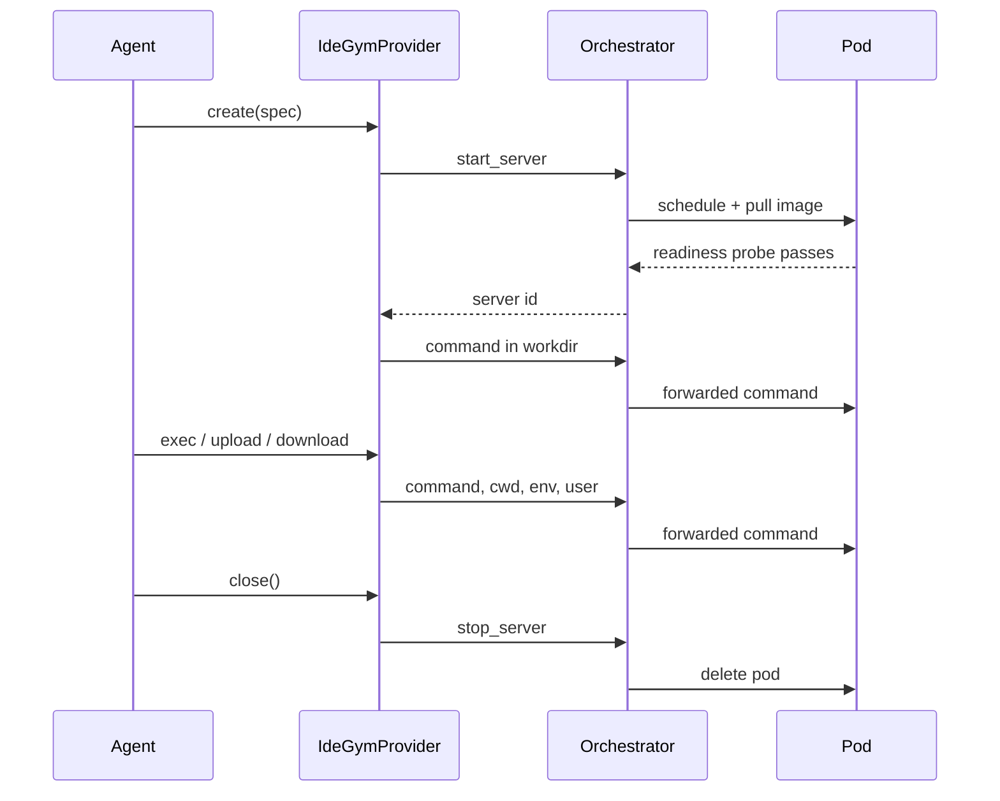

The `idegym` provider runs each sandbox as an [IdeGYM](https://github.com/JetBrains-Research/idegym) *server*: a Kubernetes pod provisioned through the IdeGYM orchestrator and driven over the HTTP API the orchestrator forwards to it. Use it when your evaluation environments already live in IdeGYM — SWE-bench-style repository tasks, IDE-backed environments, or anything else IdeGYM images provide.

It implements the provider-neutral `SandboxProvider` contract, so any sandbox-backed agent or resources server can use it by selecting `idegym` in its sandbox config.

## Setup

The provider needs IdeGYM **0.13.1 or later** in three places: the orchestrator, the server images and the client SDK. Install the optional dependency:

```bash
uv pip install 'nemo-gym[idegym]'
```

Point the provider at your orchestrator:

```bash
export IDEGYM_ORCHESTRATOR_URL=idegym.example.com
export IDEGYM_NAMESPACE=idegym
export IDEGYM_AUTH_USERNAME=...
export IDEGYM_AUTH_PASSWORD=...
```

<Warning>
`spec.image` must be an **IdeGYM server image, 0.13.1 or later**. The pod runs the IdeGYM server, and that server exposes the API this provider talks to. A plain benchmark image such as `swebench/sweb.eval.x86_64.*` has none, so it never becomes ready and `create()` fails. See [Images](#images).
</Warning>

```python
import asyncio

from nemo_gym.sandbox import AsyncSandbox, SandboxSpec

provider_config = {
    "idegym": {
        "connection": {"orchestrator_url": "idegym.example.com", "namespace": "idegym"},
        "create": {"run_as_root": True},
    }
}

spec = SandboxSpec(
    image="registry.example.com/idegym/my-env:latest",
    workdir="/testbed",
    resources={"cpu": 2, "memory_mib": 8192, "disk_gib": 30},
    metadata={"instance_id": "django__django-11099"},
)


async def main() -> None:
    async with AsyncSandbox(provider_config, spec) as sandbox:
        await sandbox.start()
        result = await sandbox.exec("python -m pytest -q", timeout_s=600)
        print(result.stdout or result.stderr)


asyncio.run(main())
```

Leaving the `async with` block stops the server and deletes its Kubernetes resources.

## Provider Config

`nemo_gym/sandbox/providers/idegym/configs/idegym.yaml` ships the full block with each setting commented, except `attribution.run`, which is auto-detected per launch. The essentials:

```yaml
sandbox:
  default_metadata:
    sandbox-api: idegym-client
  idegym:
    connection:
      orchestrator_url: ${oc.env:IDEGYM_ORCHESTRATOR_URL,idegym.test}
      namespace: ${oc.env:IDEGYM_NAMESPACE,idegym}
      username: ${oc.env:IDEGYM_AUTH_USERNAME,null}
      password: ${oc.env:IDEGYM_AUTH_PASSWORD,null}
      # Quota rules match this name by regex; pin it to whatever your rule expects.
      client_name: ${oc.env:IDEGYM_CLIENT_NAME,null}
      max_connections: 64
    create:
      ready_timeout_s: 1200
      run_as_root: true
    exec:
      default_timeout_s: 180
      max_output_bytes: 1048576
    verify:
      check_workdir: true
```

Every shipped provider config binds the same instance name `sandbox`, so switching a benchmark to IdeGYM is swapping one config path:

```bash
AGENT=responses_api_agents/mini_swe_agent_2/configs/mini_swe_agent_2.yaml
MODEL=responses_api_models/vllm_model/configs/vllm_model.yaml
gym env start \
    --config $AGENT \
    --config nemo_gym/sandbox/providers/idegym/configs/idegym.yaml \
    --config $MODEL
```

The remaining sections are `files` (transfer chunk size and per-chunk timeout),
`operations` (status and teardown timeouts and retries, and the keepalive ceiling `keepalive_minutes_max`), and `attribution`
(how the client name is derived when it is not pinned). `connection` also holds the HTTP retry knobs:
`connect_retries` for requests that never connected, and `poll_retries` / `retry_delay_s` for
idempotent GETs such as the SDK's operation-status polls.

`connection.max_connections` caps in-flight HTTP on both transport backends, and `null` means no cap.
`max_keepalive_connections` applies only with `transport_backend: httpx`; the aiohttp backend honors only
`keepalive_expiry_s`. `create.retries` also covers connect timeouts and 408. `create.ready_timeout_s` defaults to 1200 in code,
and `create.run_as_root` defaults to `false` in code; the shipped YAML sets it to `true` on purpose.

<Note>
Tracing is opt-in. With `connection.tracing_endpoint` null, the provider passes the SDK no tracing config, and the SDK traces only if `IDEGYM_OTEL_TRACING_ENDPOINT` is set. Once you set an endpoint in Gym config, the SDK reads none of its `IDEGYM_OTEL_TRACING_*` variables: the timeout and credentials come only from `tracing_timeout_s`, `tracing_username` and `tracing_password`.

Tracing also needs `opentelemetry-instrumentation-httpx`, which `nemo-gym[idegym]` does not install. Run `uv pip install 'idegym-client[otel]'` to add it. Without it the SDK logs a warning and skips tracing.
</Note>

## SandboxSpec Provider Options

`SandboxSpec.provider_options` carries the IdeGYM pod options that have no neutral equivalent. They are validated before a pod is allocated.

| Option | Notes |
| --- | --- |
| `resource_requests` | Kubernetes *requests*, paired with `spec.resources` as the limits. |
| `runtime_class_name` | e.g. `gvisor` for a sandboxed runtime. |
| `run_as_root` | Overrides `create.run_as_root` for this sandbox. |
| `node_selector` | Node labels for scheduling. |
| `volumes`, `volume_mounts` | Kubernetes `V1Volume` / `V1VolumeMount` shapes. |
| `env_from` | ConfigMap/Secret env import — the only way to put environment on the *pod*. |
| `service_account_name` | ServiceAccount for the pod. |
| `pod_overrides` | Partial `V1PodSpec` deep-merged into the generated pod spec (tolerations, affinity, ...). |
| `labels`, `annotations` | Extra pod labels and annotations, applied over `spec.metadata`. Reserved keys fail `create()`. |
| `keepalive_minutes` | Holds this sandbox against IdeGYM's inactivity reaper (at most 1440). Overrides `create.keepalive_minutes`. |
| `reuse_strategy`, `server_kind`, `snapshot`, `max_restarts` | Passed through to IdeGYM. |
| `server_name` | Pins the server name IdeGYM's reuse lookup matches on. Otherwise it is derived from the name prefix and metadata hints. |
| `service_port`, `container_port` | Override the configured ports. |

```yaml
mini_swe_agent_2:
  responses_api_agents:
    mini_swe_agent_2:
      sandbox_provider: sandbox
      sandbox_spec:
        ready_timeout_s: 1200
        workdir: /testbed
        resources:
          cpu: 2
          memory_mib: 8192
          disk_gib: 30
        provider_options:
          resource_requests:
            cpu: 0.5
            memory_mib: 2048
          runtime_class_name: gvisor
        metadata:
          instance_id: django__django-11099
```

## Relevant SandboxSpec Fields

| Field | Behavior |
| --- | --- |
| `workdir` | Not a pod setting. It is sent as each command's `cwd`, and `create()` fails early if it does not exist (`verify.check_workdir`). |
| `env` | Sent as each command's `env`. IdeGYM can only put ConfigMap/Secret env on the pod, via `provider_options.env_from`. |
| `metadata` | Pod labels, values sanitized, next to the attribution labels, so `kubectl get pods -l <key>=<value>` finds a sandbox. Reserved keys (`app`, `app.kubernetes.io/*`, `idegym.jetbrains.com/*`) fail `create()`. `create.server_name_metadata_keys` also folds selected keys (default `instance_id`) into the pod name, for readability only. |
| `ttl_s` | Not enforced; warns. IdeGYM servers live until stopped, and its watcher reaps servers that sit idle or whose client stops heartbeating. Keepalive extends the idle window; it is not a lifetime cap. |
| `ports` | Ignored; warns. An IdeGYM pod exposes only its own API port. |
| `entrypoint` | Fails `create()`. The container entrypoint starts the IdeGYM server. |

## Resource Mapping

| `SandboxSpec` field | IdeGYM mapping |
| --- | --- |
| `resources.cpu` | Kubernetes CPU **limit** (`2`, `500m`). |
| `resources.memory_mib` | Memory **limit** (`8192Mi`). |
| `resources.disk_gib` | `ephemeral-storage` **limit** (`30Gi`). |
| `provider_options.resource_requests` | The matching Kubernetes **requests**. |
| `resources.gpu`, `resources.gpu_type` | Not mapped; warns. Request accelerators via `node_selector` or `pod_overrides`. |

IdeGYM's resource quota accounting reads limits first, so `spec.resources` is what counts against your quota rule — not the smaller `resource_requests`.

## Lifecycle



**Create trusts IdeGYM's readiness wait.** The orchestrator reports a server only once its pod passes the Kubernetes readiness probe against the server's health endpoint, so `create()` adds what it cannot see: a command run in `spec.workdir`. It does not check the version of the orchestrator or the server image; 0.13.1 is required on both. Anything that fails after provisioning stops the server.

**One registered client per process.** IdeGYM's unit of ownership is a *client*: a heartbeating entity that owns N server pods, carries the resource quota keyed on its name, and terminates all of its servers when it stops. Every sandbox with an identical `connection` config shares one, reference-counted; the last release unregisters it, which also cleans up any server never closed. `connection.max_connections` bounds in-flight HTTP across all of them — bounding requests rather than whole operations, so provisioning a new sandbox cannot block execs on sandboxes already running.

**Keepalive is opt-in.** Set `create.keepalive_minutes` (or `provider_options.keepalive_minutes` per sandbox, at most 1440) and the server is held against IdeGYM's inactivity reaper right after start, and again before any command whose timeout would outlive the hold.

**Status** reads the orchestrator's per-server status endpoint. A server that is no longer usable, or is gone, reports stopped; any other failure reports `unknown`.

**Errors are typed.** The SDK raises typed exceptions, which the provider classifies as gone, retryable, timed out or invalid request. On `exec`, an orchestrator 408 or 504 and a malformed response are `error_type="sandbox"`, not `timeout` or `invalid_request`. A bad environment variable name or a NUL in a value is `invalid_request`, caught before the request is sent. The one text check left is the bash timeout, a 500 whose message starts with `Command execution timed out after`.

**`close()` always deletes** the pod and its Kubernetes resources; it is idempotent, and a server the orchestrator no longer has counts as success. It retries only retryable failures. `operations.retries` covers stop only, and the SDK makes 3 stop attempts in total, sharing one `close_timeout_s`.

## Job Attribution

Resource-limit rules are matched by regex against the client name, so set `connection.client_name` to whatever your deployment's rule expects. Left unset, the name is derived from job attribution — `NEMO_GYM_TEAM` / `NEMO_GYM_USER` / `NEMO_GYM_WORKLOAD`, then Slurm job variables — as `nemo-gym-<team>-<user>-<workload>`, so a run is attributable in the IdeGYM dashboard. The run id is deliberately excluded: a name that changes per launch defeats both quota matching and dashboard grouping.

## File Transfer

Uploads and downloads use the SDK's binary file endpoints, one orchestrator request per chunk of `files.chunk_bytes` (1 MiB by default, at most 8 MiB), each bounded by `files.timeout_s`. A download is written to a hidden `.<name>.<uuid>.part` file beside the target and renamed over it only when it completes, so a failed transfer leaves no partial file.

This is fine for the config files, patches, and logs a benchmark moves around, but it is not a bulk channel — have the sandbox fetch large inputs itself.

## Images

Every sandbox image needs an IdeGYM server inside it — that server provides the bash tool this provider runs commands through, and the health endpoint the pod's readiness check polls. Build such images with IdeGYM's image builder, publish them where your cluster can pull them, then map upstream benchmark tags onto them:

```yaml
sandbox_spec:
  image_rewrites:
    - from: "swebench/"
      to: "registry.example.com/idegym-swebench/"
```

Rewrites are ordered and the first matching prefix wins. The provider does not build images.

## User and Runtime Notes

**Users.** `exec(user=...)` takes a user name and is sent as the command's `user` field; a numeric uid is rejected as `invalid_request`. With no user, commands run as the container's user. The pod-level default is `create.run_as_root`, and `provider_options.run_as_root` overrides it per sandbox.

**Output limits.** Each output stream keeps at most `exec.max_output_bytes` (1 MiB by default); past it IdeGYM keeps the head and the tail around a truncation marker. Set it to `null` for complete output.

## Unavailable Capabilities

| Capability | Reason |
| --- | --- |
| `sandbox.endpoint(port)` | The orchestrator forwards API requests rather than routing raw TCP to arbitrary container ports. |
| `sandbox.pty` | IdeGYM has no terminal API. The IdeGYM dashboard's pod shell is not part of the client API. |
| `sandbox.serialize()` / `AsyncSandbox.connect()` | A server is only reachable through the registered client that owns it. Front this provider with a sandbox server to share a sandbox across processes. |
