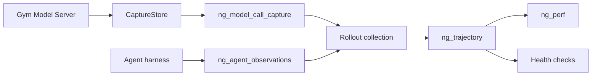

Model-call evidence records exchanges with a model. Agent observations record harness activity,
including conversations and tool execution. Rollout collection joins these sources into a
trajectory for analysis.



## Enable Collection

Set these top-level fields in the shared global configuration used by the agent servers, model
servers, and rollout collector, not inside an individual server's configuration:

```yaml
observability_enabled: true
model_call_capture_dir: /absolute/shared/path/model-calls
```

Agent processes also need `observability_enabled: true` to propagate rollout prefixes and collect
supported agent-side evidence. The model servers and rollout collector must use the same shared
capture directory. Compatible agents route model calls through
`/ng-rollout/<rollout_id>` on the Gym Model Server. Unprefixed and direct-provider calls bypass capture.
Use a separate directory for each evaluation job: rollout IDs do not contain a run ID.

Follow [Model-Call Capture](/main/model-server/model-call-capture) for a runnable evaluation example.
Agent-side evidence depends on the harness and execution path. See the
[harness conformance results](/main/observability/harness-conformance#results) for measured harness checks.

## Tool Timing v2

Set `trajectory_schema_version: "2.0"` alongside the collection settings above to retain
attempt-level tool timing. The default remains `"1.0"` for existing readers. Direct callers can use
`RolloutCollectionHelper.run_examples(..., enrich_results=True, trajectory_schema_version="2.0")`
or await `nemo_gym.rollouts.enrich_run_result(row, result, capture_dirs=[...],
observability_enabled=True, trajectory_schema_version="2.0")` after a run. Both paths use the
collector's capture merge and normalization. Raw `run_examples` behavior stays unchanged.

V2 names the capture namespace `capture_key`. Each tool execution has a stable `span_id`, its
native request ID, optional agent instance and requesting model-call ID, and `timings` with
explicit boundary, producer, clock domain, endpoints and duration method. OpenCode reads its
persisted tool parts as lifecycle measurements. Repeated native IDs remain separate attempts;
a started but unfinished tool stays `incomplete`, including when its enclosing harness times out.

`TrajectoryRecord.model_validate(...)` accepts v1 and v2 and rejects unknown versions. Use
`nemo_gym.trajectory.project_trajectory_v1(...)` explicitly for a legacy reader. The projection
loses attempt, instance, parent, failure and detailed timing provenance. It projects one measured
boundary into legacy flat fields; multiple boundaries require an explicit consumer choice and
produce no flat interval. Legacy measurements with unknown boundaries remain diagnostic evidence
when upgraded. In particular, the coarse `artifact` source does not identify a timing boundary.
Raw observation spans and parent references are qualified by producer and capture namespace on
import together with their diagnostics; canonical trajectory spans and gaps retain those
identities on replay. An adapter gap that cannot identify one imported attempt keeps its code
and original detail, with `unresolved_span_reference` in its diagnostic detail and no canonical
`span_id`. It is never copied onto multiple attempts.

Missing agent identity, clock provenance, completion, failure details or exact requesting-call
links produce scoped gaps. Tool IDs alone never select a model call. Payload omission happens
after joins and leaves a verification gap. Durations from different clock domains can be summed
as work, but their endpoints cannot establish overlap. The wall-time reader selects lifecycle
measurements by default and leaves incompatible-clock unions unknown.

## Which Artifact to Read

| Artifact | Produced by | Use |
| --- | --- | --- |
| `CaptureStore` | Model-server middleware | Original requests and responses in `<rollout_id>.capture.jsonl` |
| `ng_model_call_capture` | Collection, from capture files | Model-call index and capture metrics in rollout JSONL |
| `ng_agent_observations` | Agent harness | Source conversations, invocation relationships, tool timing, compaction, and sandbox details |
| `ng_trajectory` | Rollout collection | Canonical normalized calls, turns, tools, and gaps for downstream analysis |

After each attempt, collection joins call references and projects the available evidence into
`ng_trajectory`. Successful projection removes duplicate request and response payloads from
`ng_model_call_capture`; originals remain in `CaptureStore`. If projection fails, attached payloads
remain and a `trajectory_projection_failed` gap is recorded. LabBench's
`multimodal_history_redacted` gap indicates that trajectory payload copies were omitted.

The trajectory does not include the full compaction and sandbox records. Read
`ng_agent_observations` for those details.

## Correlation and Gaps

Collection matches calls by `model_call_id`, or by the exact pair of `model_ref` and `response_id`.
A match must be unique and consistent with any other supplied identifiers. Timestamps and list
order do not establish ownership, including for concurrent calls.

| Gap | Meaning |
| --- | --- |
| `model_call_reference_unmatched` | An explicit reference matches no captured call |
| `model_call_reference_ambiguous` | A reference matches multiple calls |
| `model_call_reference_conflict` | References disagree about call identity or ownership |
| `model_call_ownership_unavailable` | Ownership cannot be established |
| `turns_unavailable` | The producer did not supply semantic turns |
| `trajectory_projection_failed` | Collection could not normalize the evidence |

Missing evidence makes dependent health checks unobserved. Unmatched, ambiguous, or conflicting
references produce a capture-mismatch finding. A gap alone does not mean the task failed.

## Joined Example

This synthetic rollout contains one model call requesting a tool, its observed execution, and the
resulting trajectory. Optional fields are omitted. The harness provides no semantic turns, so
collection records `turns_unavailable` instead of inferring a turn from the model call.

{/* joined-rollout-example:start */}
```json
{
  "ng_model_call_capture": {
    "rollout_id": "0-0",
    "metrics": {"num_calls": 1, "tokens_in": 12, "tokens_out": 8},
    "calls": [{"model_call_id": "call-1", "tokens_in": 12, "tokens_out": 8}]
  },
  "ng_agent_observations": {
    "source": "example_agent",
    "records": [
      {
        "kind": "agent_invocation",
        "invocation_id": "root",
        "model_calls": [{"model_call_id": "call-1"}],
        "conversation": [
          {"type": "function_call", "call_id": "tool-1", "name": "lookup", "arguments": "{}"},
          {"type": "function_call_output", "call_id": "tool-1", "output": "42"}
        ]
      },
      {
        "kind": "tool_call", "invocation_id": "root", "tool_call_id": "tool-1",
        "tool_name": "lookup", "duration_ms": 200, "timing_source": "harness",
        "status": "completed"
      }
    ],
    "gaps": []
  },
  "ng_trajectory": {
    "schema_version": "1.0",
    "task_id": "task-7",
    "rollout_id": "0-0",
    "invocations": [{
      "kind": "agent_invocation",
      "invocation_id": "root",
      "model_calls": [{"model_call_id": "call-1"}],
      "conversation": [
        {"type": "function_call", "call_id": "tool-1", "name": "lookup", "arguments": "{}"},
        {"type": "function_call_output", "call_id": "tool-1", "output": "42"}
      ]
    }],
    "turns": [],
    "model_calls": [{
      "model_call_id": "call-1",
      "request": {"input": "Look up the answer"},
      "response": {"output": [
        {"type": "function_call", "call_id": "tool-1", "name": "lookup", "arguments": "{}"}
      ]},
      "token_stats": {"prompt_tokens": 12, "completion_tokens": 8}
    }],
    "tool_calls": [{
      "kind": "tool_call", "invocation_id": "root", "tool_call_id": "tool-1",
      "tool_name": "lookup", "duration_ms": 200, "timing_source": "harness",
      "status": "completed", "output": "42"
    }],
    "gaps": [{"code": "turns_unavailable"}]
  },
  "ng_perf": {
    "num_turns": 1, "num_tool_calls": 1, "token_observability_coverage": 1.0,
    "prompt_tokens": 12, "completion_tokens": 8, "total_latency_ms": 910
  }
}
```
{/* joined-rollout-example:end */}

The invocation references `call-1`. Tool timing joins the conversation output through
`(invocation_id, tool_call_id)`, giving the trajectory tool record its output of `42`.

## Add Evidence to a Custom Agent

Preserve the [rollout URL prefix](/main/model-server/model-call-capture#if-you-build-a-custom-agent)
and return an `AgentObservationBundle` as `ng_agent_observations`:

- Use stable invocation IDs and exact model-call references.
- Put model-visible tool calls and results in the invocation's conversation; put measured execution
  intervals in `ToolCallObservation`. Join them by invocation and tool-call ID.
- Record missing evidence as gaps. Sandbox usage must be measured, not copied from configured
  limits or assigned to individual overlapping tools.
- Report the agent's response `usage` as the sum over model responses that finished. A call that
  failed without a finished response adds nothing, so report zero tokens when no call finished,
  for example when every request was rejected. Omit usage only when a finished response's usage
  was lost; [rollout health](/main/evaluation/rollout-health) then leaves the token comparison
  unobserved.
- Supply explicit `TrajectoryTurn` records in a producer `ng_trajectory` when semantic turns are
  observable. Collection preserves them; it does not derive them from an invocation's conversation.

See the [observation schemas](/main/nemo-gym/nemo_gym/trajectory/trajectory_record) for field definitions.

## Health and Performance

[Rollout health checks](/main/evaluation/rollout-health) read `ng_trajectory` without reopening capture
files. They check evidence integrity; the verifier determines task success.

`ng_perf` summarizes invocation-owned calls and tools. Its turn count uses explicit turns, then
owned model-call counts, then one per invocation. This fallback explains `num_turns: 1` in the
example even though semantic turns are unavailable. Token totals include only observed values;
`token_observability_coverage` reports matched calls divided by counted turns, capped at one.

Collection adds measured wall-clock latency when available. `ng_perf` is absent when observability
is disabled or no valid trajectory invocation exists. Aggregate metrics include `perf_summary`
when rollouts contain `ng_perf`.

## Recording tool attempts in a harness

Use `ToolCallRecorder` at an existing start/completion hook when the harness does not
already persist suitable tool timings. Enable it under the adapter's existing
`observability_enabled` setting. `tool_recording_files(runner_directory)` returns the
two standard-library-only sources to add to `SandboxSpec.files` or session setup;
the sandbox runner imports `ClockContext` and `ToolCallRecorder` from `tool_recording`.
Host-owned operations import those names from `nemo_gym.utils`.

```python
recorder = ToolCallRecorder(
    path=session_directory / "tool_events.jsonl",
    producer_id=producer_id,
    invocation_id=invocation_id,
    agent_instance=agent_instance,
    clock=ClockContext(location="sandbox", owner=sandbox_id),
    boundary="executor",
    timing_source="my_harness.execute_tool",
)
with recorder.call(
    native_call_id=call_id,
    tool_name="bash",
    model_call_ref={"model_call_id": requesting_model_call_id},
) as observed:
    result = await execute_tool()
    observed.set_outcome("completed" if result.exit_code == 0 else "failed")
```

A start is flushed before execution so it survives a harness process exit while the
sandbox files remain available. Tool capture does not fsync each event and does not
guarantee recovery after host or storage loss. Normal return without `set_outcome` remains
`unknown`; an exception is recorded as failed and re-raised. Explicit cancellation
closes the observed boundary and does not assert remote process termination.
Separate callbacks use `start(...)` and `finish(handle, status=...)`; passing
`parent=parent_handle` preserves an explicit parent relationship. `SystemExit` and
other process-control exceptions leave an unfinished start rather than fabricating
a normal completion.

Choose a producer ID unique to the recording process/epoch and retain it with the
artifact. A recorder serializes its own sequences; distinct processes use separate
producer IDs, even if they append to the same file. Share a `ClockContext` only when
the clocks are known to be the same. Each context gets a fresh epoch; a detected wall
clock step changes its domain while retaining monotonic elapsed durations.

Collect the JSONL file through the adapter's existing stop/capture/release lifecycle.
On the host, `nemo_gym.trajectory.read_tool_events(path)` returns tool observations
and gaps. Add them to a v2 `AgentObservationBundle` for the common trajectory
normalizer to resolve model-call and instance ownership. Keep the file under the
existing artifact retention policy. Add a `tool_capture_unavailable` gap for every
entry in `recorder.failed_spans` when collecting an in-process recorder; an I/O
failure cannot guarantee that its own diagnostic was written to the failed storage.

Replay tolerates interrupted final lines and deduplicates `(producer_id, sequence)`.
Conflicting copies produce gaps. Missing starts or finishes retain the available
endpoint and elapsed duration. `tool_event_json_schema()` generates the same wire
contract for hooks implemented in another runtime. This stream is adapter capture
input; `ng_trajectory.tool_calls` remains the normalized consumer contract.

Timing conformance checks accept an explicit `ToolTimingScope` in `EvidenceScope`,
including the tested runtime version, mode, tool paths and authoritative sources.
Lifecycle and executor checks run independently; transcript measurements cannot
satisfy either. Process attribution is never established from timing alone. The
nine targets in `P0_TOOL_TIMING_HARNESSES` identify the migration scope; only existing
executable probes in `HARNESSES` are dispatched until an adapter's runtime setup is
verified.

The local probe runner accepts `--tool-timing-scopes scopes.json`. This JSON object
maps selected harness names to `ToolTimingScope` fields, for example:

```json
{
  "opencode": {
    "runtime_version": "1.2.3",
    "mode": "local",
    "tool_paths": ["bash"],
    "lifecycle_sources": ["opencode.part.state.time"]
  }
}
```

Use the version and source exercised by your probe. These declarations express
expectations; inspect the separately captured `runtime.json` to verify the actual
runtime. Tool scenarios apply the declared boundary checks to both their results
and artifact reports. `--list-timing-targets` reports all nine migration targets
and whether a runtime probe is available. Suite reports retain this inventory and
the declared timing scopes; an unverified target is not a conformance result.
For adapters without a runnable local probe, use `inspect_record` or
`inspect_bundle` with `EvidenceScope(tool_timing=...)` on collected artifacts until
the runtime-specific setup is verified.
