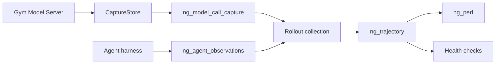

Model-call evidence records exchanges with a model. Agent observations record harness activity,
including conversations and tool execution. Rollout collection joins these sources into a
trajectory for analysis.



## Enable Collection

Set these top-level fields in the shared global configuration used by the agent servers, model
servers, and rollout collector, not inside an individual server's configuration:

```yaml
observability_enabled: true
model_call_capture_dir: /absolute/shared/path/model-calls
```

Agent processes also need `observability_enabled: true` to propagate rollout prefixes and collect
supported agent-side evidence. The model servers and rollout collector must use the same shared
capture directory. Compatible agents route model calls through
`/ng-rollout/<rollout_id>` on the Gym Model Server. Unprefixed and direct-provider calls bypass capture.
Use a separate directory for each evaluation job: rollout IDs do not contain a run ID.

Follow [Model-Call Capture](/main/model-server/model-call-capture) for a runnable evaluation example.
Agent-side evidence depends on the harness and execution path. See the
[harness conformance results](/main/observability/harness-conformance#results) for measured harness checks.

## Record From a Training Framework

A framework that dispatches through `RolloutCollectionHelper.run_examples` instead of `gym eval run` gets the same
evidence with two opt-in options:

- `enrich_results=True` attaches what collection records to each result before it is returned: the row's rollout
  identity, the captured model calls (`ng_model_call_capture`, with request and response bodies unless
  `include_model_call_payloads=False`), the standardized `ng_trajectory` and `ng_perf`. Model calls are captured only
  when the global config enables `observability_enabled`. A failed `/run` under `route_failures_to_sidecar=True` comes
  back as the typed `RolloutFailureRecord`. `delete_model_call_capture=True` removes a rollout's capture file once its
  calls are on the record, and needs the payloads kept.
- `record_output_dir` with `record_shard` also writes each rollout to that folder as collection lays out a run:
  `rollouts-<shard>.jsonl`, its failures sidecar with the typed failure rows collection writes, the rows as the shard's
  materialized inputs, the shard's run manifest, and its saved progress (`rollouts-<shard>_batch_status.json`, read by
  `gym eval status`). The caller picks the shard label (for example a training step and
  worker) and Gym owns the file names, so `gym eval aggregate +input_glob='run/rollouts-*.jsonl'`, the run health
  check and the Store read a folder of shards like an eval run. Reopening a shard replaces it, so a replayed step does
  not duplicate rows. Rows need their task and rollout indices; `record_omitted_rollouts=True` also keeps an
  omitted-rollout row for an interrupted or never-started try. A shard dispatches each row under the row's own
  rollout id (its `_ng_rollout_id`, or `<task>-<rollout>`) prefixed with the shard's run id, so its model calls are
  captured under keys of its own even when a later shard dispatches the same task and rollout; read a capture's key
  from the returned row. A shard whose rollouts did not all succeed resumes like a run:
  `gym eval run +input_jsonl_fpath=runs/policy/rollouts-<shard>_materialized_inputs.jsonl
  +output_jsonl_fpath=runs/policy/rollouts-<shard>.jsonl +resume_from_cache=true`, with the same servers, runs only
  what the shard still lacks.

```python
from nemo_gym.rollouts import RolloutCollectionHelper

helper = RolloutCollectionHelper()
completions = helper.run_examples(
    rows, route_failures_to_sidecar=True, record_output_dir="runs/policy", record_shard="step_000007-w0"
)
for completion in completions:
    row, result = await completion  # the record the shard holds, or the typed failure record
```

## Tool Timing v2

Set `trajectory_schema_version: "2.0"` alongside the collection settings above to retain
attempt-level tool timing. The default remains `"1.0"` for existing readers. Direct callers can use
`RolloutCollectionHelper.run_examples(..., enrich_results=True, trajectory_schema_version="2.0")`
or await `nemo_gym.rollouts.enrich_run_result(row, result, capture_dirs=[...],
observability_enabled=True, trajectory_schema_version="2.0")` after a run. Both paths use the
collector's shared capture merge and normalization. Manual enrichment accepts a collected
record; `run_examples` also handles materialized episode replies without changing their shape.
Raw `run_examples` behavior stays unchanged.

V2 names the capture namespace `capture_key`. Each tool execution has a stable `span_id`, its
native request ID, optional agent instance and requesting model-call ID, and `timings` with
explicit boundary, producer, clock domain, endpoints and duration method. OpenCode reads its
persisted tool parts as lifecycle measurements. Repeated native IDs remain separate attempts;
a started but unfinished tool stays `incomplete`, including when its enclosing harness times out.

The timing `boundary` describes the interval measured, independently of how its evidence is
stored or delivered:

| Boundary | Measured interval |
| --- | --- |
| `lifecycle` | Harness dispatch/start through result/completion handling; may include queuing. |
| `executor` | Instrumented executor entry through return or observed termination. |
| `transcript` | Native call-record timestamp through native result-record timestamp. |
| `event_receipt` | Observer receipt of start and end events. |

`timing_source` identifies the instrumentation. Reading native lifecycle timestamps from a
file or database preserves their `lifecycle` boundary; it does not make them `transcript`
timing. Likewise, receiving those timestamps later does not make them `event_receipt` timing.
A transcript timestamp must not be substituted for an executor endpoint.

Current producer mappings and migration constraints:

| Producer evidence | Boundary or migration status |
| --- | --- |
| OpenCode persisted `state.time.start/end` | `lifecycle`; database delivery is independent of this meaning. V1 retains its `artifact` source label. |
| Claude Code transcript `tool_use` / `tool_result` record timestamps | `transcript`; not executor or lifecycle timing. |
| Pi stdout start/end event receipt | Semantically `event_receipt`. The generic legacy upgrader currently maps `harness` to `lifecycle`; this needs explicit producer qualification. Producer-side timestamps are needed for lifecycle timing. |
| Simple Agent, compaction agent and agentic turn simulation dispatch wrappers | Legacy `executor` labels are coarse client-side measurements. Qualify their actual dispatch/response boundary before migrating them. |
| Hermes tool wrapper / hooks | Executor-wrapper / lifecycle scope respectively; preserve the instrumentation's actual endpoints. |
| NOOA before/after hooks | Lifecycle scope. |
| Stirrup native tool timestamps | Verify the pinned runtime's measured endpoints before assigning a boundary. |

New adapters should qualify the measured endpoints explicitly rather than copy a legacy
`harness`, `executor`, or `artifact` label. Cross-harness migration aims to use the same semantic
boundaries wherever the instrumentation supports them, leaving unsupported measurements unknown.

OpenCode runtime collection assigns one wall-clock domain per local launch or retained sandbox
session. Repeated snapshots in that session share it. Standalone database imports require explicit
clock-owner evidence and otherwise retain an unknown domain. Gym's model-call endpoints come from
its model-server ASGI middleware, on a separate observer clock; they cannot share OpenCode's domain.
Claude Code runtime collection assigns one wall-clock domain and agent instance per collected run;
a transcript directory parsed without that context keeps an unknown domain.
Model capture does not yet emit its own domain, so v2 unions across multiple model calls also
remain unknown until that provenance is populated.
Tool-only busy-time unions are therefore available with runtime collection, while unions across
model and tool clocks still require evidence of clock comparability.

`TrajectoryRecord.model_validate(...)` accepts v1 and v2 and rejects unknown versions. Use
`nemo_gym.trajectory.project_trajectory_v1(...)` explicitly for a legacy reader. Where each
attempt has an explicit, unique `native_tool_call_id` and the destination does not collide with
retained IDs, v1 restores that ID throughout the invocation's tools, conversation and turn
references, including matching tool-item IDs. Already-native turn references remain unchanged
when exact captured model-call evidence proves their request identity; unproven references
remain collision barriers. Enrichment makes one projection decision for the retained trajectory
and observation bundle before stripping metadata, so repeated export cannot split an attempt.
Observation bundles also restore spawn and compaction references. Reused or
ambiguous native IDs retain their normalized IDs with a `tool_native_identity_unrepresentable`
gap; consumers needing those attempts should retain v2. Primary responses and captured model
payloads are unchanged. The projection
loses attempt, instance, parent, failure and detailed timing provenance. It projects one measured
boundary into legacy flat fields; multiple boundaries require an explicit consumer choice and
produce no flat interval. Legacy measurements with unknown boundaries remain diagnostic evidence
when upgraded. In particular, the coarse `artifact` source does not identify a timing boundary.
Raw observation spans and parent references are qualified by producer and capture namespace on
import together with their diagnostics; canonical trajectory spans and gaps retain those
identities on replay. An adapter gap that cannot identify one imported attempt keeps its code
and original detail, with `unresolved_span_reference` in its diagnostic detail and no canonical
`span_id`. It is never copied onto multiple attempts.

Tool names are span attributes by default. Metrics should use a bounded allowlist with an
`other` bucket, and omit missing durations instead of recording them as zero.

Missing agent identity, clock provenance, completion, failure details or exact requesting-call
links produce scoped gaps. Tool IDs alone never select a model call. Payload omission happens
after joins and leaves a verification gap. Durations from different clock domains can be summed
as work, but their endpoints cannot establish overlap. The wall-time reader selects lifecycle
measurements by default and leaves incompatible-clock unions unknown.

Invocation IDs must remain unique across the entire trajectory, including agent and verifier
invocations. Reusing an invocation ID across named agent instances is unsupported and rejected;
complete support depends on the capture-identity integration. Optional instance evidence is
preserved without changing the invocation namespace.

The shared OpenCode observation parser defaults to legacy v1 IDs and flat artifact timings for
existing callers. OpenCode explicitly requests `observation_schema_version="2.0"` before any
collector export, including when the exported trajectory uses v1. `run_examples` applies its
explicit schema choice, or the configured/default version, even with `enrich_results=False`;
this projection reads no captures and does not add enrichment. Direct HTTP `/run` responses
remain raw producer evidence. Caller-facing schema selection happens at `run_examples` or
export, rather than through a separate HTTP version-negotiation protocol.

OpenCode observation conversation IDs use the persisted part identity from the first snapshot;
`native_tool_call_id` retains the model-facing request ID. Runtime execution and primary response
output retain their native IDs. Interrupted calls with persisted parts retain usable partial
timing and an explicit completion gap. Missing or unreadable artifacts produce coverage gaps.
There is no guaranteed recovery of interrupted activity that was never persisted, and no
streaming recorder is enabled by this change.

## Which Artifact to Read

| Artifact | Produced by | Use |
| --- | --- | --- |
| `CaptureStore` | Model-server middleware | Original requests and responses in `<rollout_id>.capture.jsonl` |
| `ng_model_call_capture` | Collection, from capture files | Model-call index and capture metrics in rollout JSONL |
| `ng_agent_observations` | Agent harness | Source conversations, invocation relationships, tool timing, compaction, and sandbox details |
| `ng_trajectory` | Rollout collection | Canonical normalized calls, turns, tools, and gaps for downstream analysis |

After each attempt, collection joins call references and projects the available evidence into
`ng_trajectory`. Successful projection removes duplicate request and response payloads from
`ng_model_call_capture`; originals remain in `CaptureStore`. If projection fails, attached payloads
remain and a `trajectory_projection_failed` gap is recorded. LabBench's
`multimodal_history_redacted` gap indicates that trajectory payload copies were omitted.

The trajectory does not include the full compaction and sandbox records. Read
`ng_agent_observations` for those details.

## Correlation and Gaps

Collection matches calls by `model_call_id`, or by the exact pair of `model_ref` and `response_id`.
A match must be unique and consistent with any other supplied identifiers. Timestamps and list
order do not establish ownership, including for concurrent calls.

| Gap | Meaning |
| --- | --- |
| `model_call_reference_unmatched` | An explicit reference matches no captured call |
| `model_call_reference_ambiguous` | A reference matches multiple calls |
| `model_call_reference_conflict` | References disagree about call identity or ownership |
| `model_call_ownership_unavailable` | Ownership cannot be established |
| `turns_unavailable` | The producer did not supply semantic turns |
| `trajectory_projection_failed` | Collection could not normalize the evidence |

Missing evidence makes dependent health checks unobserved. Unmatched, ambiguous, or conflicting
references produce a capture-mismatch finding. A gap alone does not mean the task failed.

## Joined Example

This synthetic rollout contains one model call requesting a tool, its observed execution, and the
resulting trajectory. Optional fields are omitted. The harness provides no semantic turns, so
collection records `turns_unavailable` instead of inferring a turn from the model call.

{/* joined-rollout-example:start */}
```json
{
  "ng_model_call_capture": {
    "rollout_id": "0-0",
    "metrics": {"num_calls": 1, "tokens_in": 12, "tokens_out": 8},
    "calls": [{"model_call_id": "call-1", "tokens_in": 12, "tokens_out": 8}]
  },
  "ng_agent_observations": {
    "source": "example_agent",
    "records": [
      {
        "kind": "agent_invocation",
        "invocation_id": "root",
        "model_calls": [{"model_call_id": "call-1"}],
        "conversation": [
          {"type": "function_call", "call_id": "tool-1", "name": "lookup", "arguments": "{}"},
          {"type": "function_call_output", "call_id": "tool-1", "output": "42"}
        ]
      },
      {
        "kind": "tool_call", "invocation_id": "root", "tool_call_id": "tool-1",
        "tool_name": "lookup", "duration_ms": 200, "timing_source": "harness",
        "status": "completed"
      }
    ],
    "gaps": []
  },
  "ng_trajectory": {
    "schema_version": "1.0",
    "task_id": "task-7",
    "rollout_id": "0-0",
    "invocations": [{
      "kind": "agent_invocation",
      "invocation_id": "root",
      "model_calls": [{"model_call_id": "call-1"}],
      "conversation": [
        {"type": "function_call", "call_id": "tool-1", "name": "lookup", "arguments": "{}"},
        {"type": "function_call_output", "call_id": "tool-1", "output": "42"}
      ]
    }],
    "turns": [],
    "model_calls": [{
      "model_call_id": "call-1",
      "request": {"input": "Look up the answer"},
      "response": {"output": [
        {"type": "function_call", "call_id": "tool-1", "name": "lookup", "arguments": "{}"}
      ]},
      "token_stats": {"prompt_tokens": 12, "completion_tokens": 8}
    }],
    "tool_calls": [{
      "kind": "tool_call", "invocation_id": "root", "tool_call_id": "tool-1",
      "tool_name": "lookup", "duration_ms": 200, "timing_source": "harness",
      "status": "completed", "output": "42"
    }],
    "gaps": [{"code": "turns_unavailable"}]
  },
  "ng_perf": {
    "num_turns": 1, "num_tool_calls": 1, "token_observability_coverage": 1.0,
    "prompt_tokens": 12, "completion_tokens": 8, "total_latency_ms": 910
  }
}
```
{/* joined-rollout-example:end */}

The invocation references `call-1`. Tool timing joins the conversation output through
`(invocation_id, tool_call_id)`, giving the trajectory tool record its output of `42`.

## Add Evidence to a Custom Agent

Materialized task rows use the scalar `task_id.task_id` for trajectory and turn task IDs.
A valid explicit row `trajectory_identity` overrides both task and rollout IDs. Otherwise,
rollout IDs retain the capture identity and retry attempt suffix. Match these IDs when
supplying producer `ng_trajectory` records and their turns.

Preserve the [rollout URL prefix](/main/model-server/model-call-capture#if-you-build-a-custom-agent)
and return an `AgentObservationBundle` as `ng_agent_observations`:

- Use stable invocation IDs and exact model-call references.
- Put model-visible tool calls and results in the invocation's conversation; put measured execution
  intervals in `ToolCallObservation`. Join them by invocation and tool-call ID.
- Record missing evidence as gaps. Sandbox usage must be measured, not copied from configured
  limits or assigned to individual overlapping tools.
- Report the agent's response `usage` as the sum over model responses that finished. A call that
  failed without a finished response adds nothing, so report zero tokens when no call finished,
  for example when every request was rejected. Omit usage only when a finished response's usage
  was lost; [rollout health](/main/evaluation/rollout-health) then leaves the token comparison
  unobserved.
- Supply explicit `TrajectoryTurn` records in a producer `ng_trajectory` when semantic turns are
  observable. Collection preserves them; it does not derive them from an invocation's conversation.

See the [observation schemas](/main/nemo-gym/nemo_gym/trajectory/trajectory_record) for field definitions.

## Health and Performance

[Rollout health checks](/main/evaluation/rollout-health) read `ng_trajectory` without reopening capture
files. They check evidence integrity; the verifier determines task success.

`ng_perf` summarizes invocation-owned calls and tools. Its turn count uses explicit turns, then
owned model-call counts, then one per invocation. This fallback explains `num_turns: 1` in the
example even though semantic turns are unavailable. Token totals include only observed values;
`token_observability_coverage` reports matched calls divided by counted turns, capped at one.

Collection adds measured wall-clock latency when available. `ng_perf` is absent when observability
is disabled or no valid trajectory invocation exists. Aggregate metrics include `perf_summary`
when rollouts contain `ng_perf`.
