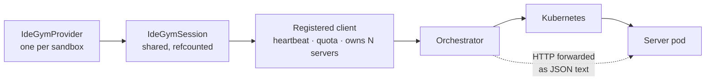

# IdeGYM Sandbox Provider — Design Decisions

## The shape of the integration

A NeMo Gym sandbox is one *server pod*, but nothing addresses that pod directly. Everything goes
through the orchestrator, and the orchestrator will only talk to a pod on behalf of a registered
*client*.

Two properties of that chain shape most of what follows.

The **client is the unit of ownership**: it holds the heartbeat, it carries the resource quota, and
it owns every server it started — so its lifetime, not any single sandbox's, decides when pods go
away. That is why the session is shared and counted rather than created per sandbox.

The **orchestrator relays rather than proxies**: a request is stored and replayed as JSON text, not
carried over a socket held open to the pod. That rules out raw TCP to a container port and anything
resembling an interactive terminal — hence the capabilities gaps at the end of this document. Files
go through the SDK's binary-safe chunk endpoints.

## Choices with real alternatives

### How `SandboxSpec.image` is resolved

An IdeGYM sandbox is a pod running the **IdeGYM server**, and that server exposes the API the
orchestrator forwards commands to. A plain benchmark image does not boot one, so the image cannot
simply be a SWE-bench tag.

| Option | Decision |
| --- | --- |
| **Pass pre-built IdeGYM images through, and document `image_rewrites` for mapping benchmark images onto them** | **Chosen** |
| Build and push a wrapped image on demand, using IdeGYM's image builder | Deferred: needs a registry, cluster build permissions, and a build-cache story |
| Accept any image that serves the same health endpoint, without an IdeGYM server behind it | Not workable: the orchestrator runs commands and file transfers by forwarding them to the IdeGYM server in the pod, so an image that only answers the health check would start but could never run a command |

`spec.image` is therefore normalized (`docker://` stripped) and checked against IdeGYM's OCI
reference pattern, and nothing more. The provider does not try to detect a wrong image: one without
an IdeGYM server never reports ready, so `start_server` fails instead of handing back a sandbox that
cannot run commands.

### What `close()` does

IdeGYM distinguishes `stop_server` (delete the pod and its Kubernetes resources) from `finish_server`
(mark the server free, keep the pod warm for reuse).

| Option | Decision |
| --- | --- |
| `stop_server` only | **Chosen** |
| `stop` by default, with `finish` + reuse behind a config knob | Not implemented in this milestone |
| `finish` by default | Not chosen: keeps pods warm, but leaks them whenever a run dies |

So `close()` always deletes. Reuse can only hit a server that something other than this provider left
`FINISHED` under the same client name, so the provider manages no warm pool, and
`operations` has no `close_action` knob to get wrong. Pod startup cost is paid per task; if that
becomes the bottleneck on long benchmarks, a `finish`-based warm pool is the follow-up.

### Where the SDK dependency lives

| Option | Decision |
| --- | --- |
| Opt-in extra `nemo-gym[idegym]`, imported lazily, with an actionable `ModuleNotFoundError` | **Chosen** |
| Core dependency alongside `opensandbox` / `daytona` / `boto3` | Not chosen: IdeGYM is a third-party control plane, and its SDK should not sit in installs that will never talk to one |

This follows the `nemo-gym[openshell]` precedent. CI installs the extra alongside the other sandbox
extras so the SDK-gated tests run rather than skip.

## Implementation decisions

### One registered client per process, not per sandbox

A *client* is a registered, heartbeating entity that owns N server pods, carries the resource quota
(matched by regex against its **name**), and terminates all of its servers when it stops.

Registering one per sandbox looked simpler but does not survive a benchmark fan-out: registrations
are serialized on the orchestrator, heartbeats multiply by the concurrency, and one job's pods scatter
across many owners in the dashboard. A session is therefore shared by every sandbox with an identical
`connection` config, and reference-counted across providers.

The refcount is correctness, not efficiency: unregistering a client **terminates all of its servers**,
so releasing early would kill live sandboxes belonging to other providers.

### The shared client is the SDK's `SharedIdeGYMClient`

The SDK client owns an httpx session and a heartbeat task, so it belongs to the loop that created it.
NeMo Gym drives sandboxes from two directions: `AsyncSandbox` on the caller's loop, and the sync
`Sandbox` facade — which gives *every sandbox its own* loop in its own thread, and is what
`mini_swe_agent_2` uses. `SharedIdeGYMClient` serves both from one client, so the provider runs no
event loop of its own.

The provider's reference count stays. The SDK shares the client but registration is still serialized
on the orchestrator, and unregistering terminates every server, so the last release must be the
single one that stops it. For the same reason the session guard is a `threading.Lock`, never an
`asyncio.Lock`: one provider can be reached from two loops, and nothing is awaited while it is held.

Alternative considered: key sessions on `(connection, running loop)`. Simpler, and correct for the
async case, but it degenerates to one registration per sandbox under the sync facade — exactly the
case that motivated sharing.

### Tracing is off unless configured

Tracing is opt-in: with no `otel_config`, the client reads only `IDEGYM_OTEL_TRACING_ENDPOINT`,
and an empty value means off. The session passes an `OTELConfig` only when `connection.tracing_endpoint`
is set (`null` by default), and passes none otherwise, so the environment variable alone decides.
Once an endpoint is set in Gym config the SDK reads none of its `IDEGYM_OTEL_TRACING_*` variables, so
the timeout and credentials come only from `tracing_timeout_s`, `tracing_username` and
`tracing_password`. The SDK also needs `opentelemetry-instrumentation-httpx`, which
`nemo-gym[idegym]` does not install (`idegym-client[otel]` does). Without it the SDK logs a warning
and skips tracing, so whoever opts in installs it.

### The SDK's httpx transport is injected, and retries live in it

`AGENTS.md` requires async HTTP to go through aiohttp — httpx's connection pool is O(n²) at high
concurrency. The SDK accepts a `transport=` for its httpx client. `http.py` builds the aiohttp
bridge (falling back to httpx with a warning when `httpx-aiohttp` is missing) and wraps it in
`RetryingTransport`.

The wrapper exists because the SDK sends each operation-status poll once, so one dropped GET fails a
whole create or exec. A request that never connected is retried for any method, since nothing was
sent. After that only GET and HEAD are retried — on a transport error or a 429/502/503/504, honoring
`Retry-After` — and a streamed body never is. A POST that may have reached the orchestrator is not
repeated, because repeating it could start a second server.

Alternative considered: a `GymAiohttpTransport` of our own built on `nemo_gym.server_utils.request()`.
Rejected: the global client is shaped for whole request/response calls, and the bridge already maps
`max_connections` onto the connector's `limit`.

### Files use the SDK's chunk endpoints

The SDK's upload, download and size calls use IdeGYM's chunked binary file endpoints. Each chunk is
one orchestrator request, `files.chunk_bytes` large (1 MiB by default, at most 8 MiB), bounded by
`files.timeout_s`. The orchestrator forwards requests as JSON text, so the SDK base64-encodes each
chunk inside its request, and a transfer carries about a third more bytes than the file.

There is no download size cap: the provider calls the SDK's `download_file` as is. It writes to a
hidden temporary file and renames it into place, so a failed download leaves an existing target alone.

### Command context is request fields

The bash call takes `cwd`, `env` and `user` next to the command, the timeout and the graceful
termination timeout, so the command goes through as written, with no wrapper script around it.
`user` must be a name; the server switches users with `runuser`/`sudo -u`, so a numeric uid is
refused as `invalid_request`. `create.run_as_root` defaults to `false` in code, as in the SDK, but
the shipped config sets it to `true`, which makes `exec(user="root")` — what `mini_swe_agent_2`
passes — a no-op.

The provider asks for `strip_output=False`: stripping was the executor's habit, not the caller's
request, and it hid meaningful whitespace. Output is bounded server-side by `exec.max_output_bytes`
(1 MiB per stream), which keeps the head and the tail around a truncation marker.

Keepalive fits here too. IdeGYM's reaper takes a server after its inactivity
timeout, and a long command is one request. Keepalive is therefore opt-in and per sandbox
(`create.keepalive_minutes` or `provider_options.keepalive_minutes`): it holds right after start and
before any command whose timeout would outlive the hold.

### `create()` checks the workdir

IdeGYM does not report a server until `wait_for_pods_ready` sees its pod `Running` with every
container ready, and that readiness probe is an HTTP GET against the IdeGYM server's own health
endpoint. A provider-side readiness probe would only re-ask the question. What the orchestrator cannot
check is `spec.workdir`, so `create()` runs `true` with `cwd=spec.workdir` and reports a bad workdir as
such; `verify.check_workdir: false` turns it off.

There are no version probes. 0.13.1 is required on the client, the orchestrator and the server image,
and `create()` does not check for older ones: an older server image would ignore the new request
fields, and an older orchestrator has no status or keepalive endpoint.

### Status comes from the status endpoint

The orchestrator's per-server status endpoint reports availability and pod readiness. A server that
is not usable never comes back — IdeGYM does not restart it — so it is marked stopped and later
commands short-circuit. A not-found also means gone. Any other failure leaves the status `unknown`.

### Errors are typed, not parsed from text

The SDK raises typed exceptions (`IdeGYMNotFoundError`, `IdeGYMBusyError`, `IdeGYMSandboxError`,
...), so the classifiers are `isinstance` checks. A not-found that is *not* an `IdeGYMSandboxError`
is the only "gone": a sandbox error carries the command's own output, so `curl failed: 404` inside
it must not read as a missing server.

One text check remains. The server reports a command timeout as a 500 whose message starts with
`Command execution timed out after`, and no typed exception exists for it, so that single prefix is
matched at the start of the message rather than searched for.

On `exec`, an orchestrator 408 or 504 means the control plane gave up, not that the command ran too
long, so it is `error_type="sandbox"`, and a malformed response is `sandbox` too. A bad environment
variable name or a NUL in a value is still `invalid_request`, caught before the request is sent.

Retries follow the same split. `create.retries` covers connect timeouts and 408 next to the other
transient failures. `close()` retries only retryable failures, `operations.retries` covers stop only,
and the SDK makes 3 stop attempts in total, sharing one `close_timeout_s`.

### Transport failures are the SDK's to wrap

The SDK wraps httpx's exceptions as `IdeGYMConnectionError` and `IdeGYMTimeoutError`, and the
provider imports httpx only to tell a connect timeout apart. `ConnectTimeout` is excluded from the
*command*-timeout check: failing to reach the orchestrator is a connectivity problem, not a slow command.

### `ready_timeout_s` is a deadline for the whole create, not per attempt

`_start_server` tracks a deadline across retries and hands each attempt only the remaining budget,
because the config documents `ready_timeout_s` as bounding the whole call. Per-attempt budgets would
let a *late* retryable failure — a 503 after 1100s of a 1200s wait — start a fresh full-length
attempt, up to 80 minutes on the shipped default. A bare `TimeoutError` is additionally never retried:
the SDK raises it only after spending the budget it was given.

The SDK also adds a grace of `max(60 s, 10%)` on top of the orchestrator's wait, so the provider
subtracts it: the orchestrator is asked for `max(1, floor(max(fitted, t / 2)))` seconds, where
`fitted` is `min(t - 60, t / 1.1)`. From 120 s up the whole call ends by `t`. Below that the
orchestrator gets half the budget and the call can run up to 60 s past `t`, because subtracting the
full grace would leave it almost no time and fail every start.

### Concurrency is bounded by the HTTP pool, not by serializing operations

The obvious way to bound load is a semaphore around each session operation, and it is the wrong one
here. A create polls for as long as the readiness timeout, so holding a slot for the whole operation
would let provisioning block the exec calls of sandboxes already running, and queue teardown behind
provisioning. What actually needs bounding is in-flight *requests*, which is what
`connection.max_connections` does — both transports honor it, and the aiohttp bridge maps it onto the
connector's `limit`.

### Failure paths get the same fidelity as success paths

Two places where the SDK's failure behavior is not the obvious one, each covered by a test:

- A server leaves the session's bookkeeping only once it is really stopped. Dropping it on failure
  would make the caller's own retry look like "already stopped" and leave the pod running.
  `stop_server` raises on a failed delete.
- A download is written to a hidden `.<name>.<uuid>.part` file beside the target and renamed over it
  only on success, so a failed transfer cannot leave a truncated file where a caller expects a whole
  one.

An `exec` failure the classifier does not recognize is logged with its traceback before being turned
into a return value, because that return value is the only other place it would ever appear.

### Server names are not made unique

The provider sends `<prefix>-<metadata hints>` and stops there. IdeGYM appends its own autoincrement
id to derive `generated_name`, and that is the name Kubernetes sees and the only one the database
keeps unique (`server_name` is an unconstrained column). A random suffix on top would buy no
uniqueness, cost 9 of the 63 name characters that instance ids need, and make pod names harder to read.

It would also mislead: a suffix looks like it prevents unintended reuse, but reuse is skipped entirely
unless `reuse_strategy` is `RESTART`/`RESET`, and even then only servers left `FINISHED` qualify —
while this provider always *stops* the ones it creates, which marks them `STOPPED`.

The same reasoning applies to retries, which keep the name rather than re-rolling it: an attempt whose
response was lost may have landed anyway, but that orphan gets its own `generated_name` and is reaped
by the watcher once the client stops heartbeating. Renaming would only break the name matching that a
pinned `provider_options.server_name` exists to drive.

### Metadata becomes labels

On OpenSandbox, `SandboxSpec.metadata` becomes queryable Kubernetes labels, and 0.13.1 lets IdeGYM
do the same: `start_server` takes `labels` and `annotations`. The provider sends the attribution
labels, then `spec.metadata`, then `provider_options.labels`, later ones winning, with values
sanitized to Kubernetes' label rules. Keys IdeGYM owns (`app`, `app.kubernetes.io/*`,
`idegym.jetbrains.com/*`) and annotations that steer the cluster (`safe-to-evict`, `prometheus.io/*`,
`podsnapshot.gke.io/*`) fail `create()` rather than being dropped.

`create.server_name_metadata_keys` still folds keys (default `instance_id`) into the pod name, but only
for readable names. Job attribution also names the registered client, which is what the dashboard
groups by and what quota rules match. The run id is deliberately excluded from the client name: it
changes per launch, and a name that changes per launch defeats both quota matching and dashboard
grouping.

## Capabilities deliberately not claimed

| Capability | Why not |
| --- | --- |
| `SupportsSandboxEndpoint` (`endpoint()`) | The orchestrator forwards API requests through an async-operation indirection; it does not route raw TCP to arbitrary container ports, so there is no honest URL to hand back. |
| `SupportsSandboxPty` | IdeGYM has no terminal API. The IdeGYM dashboard can open a shell in a pod, but that is a dashboard feature, not a client API, so there is nothing for the provider to call. |
| `ConnectableProvider` (`serialize()` / `connect()`) | A server is reachable only through the registered client that owns it. Attaching from another process would mean a client with no registration and no heartbeat, and tearing one down cleanly is not expressible through the SDK's public surface without also stopping the client — which would kill the original process's sandboxes. Sharing a sandbox across processes is possible by fronting this provider with a sandbox server. |
