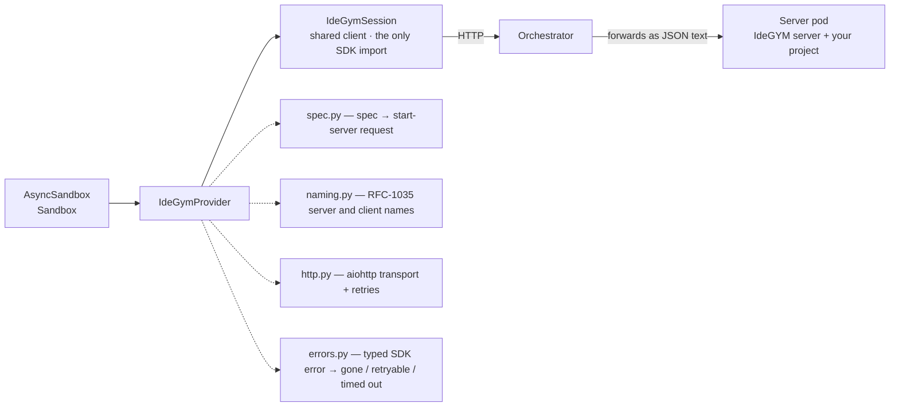
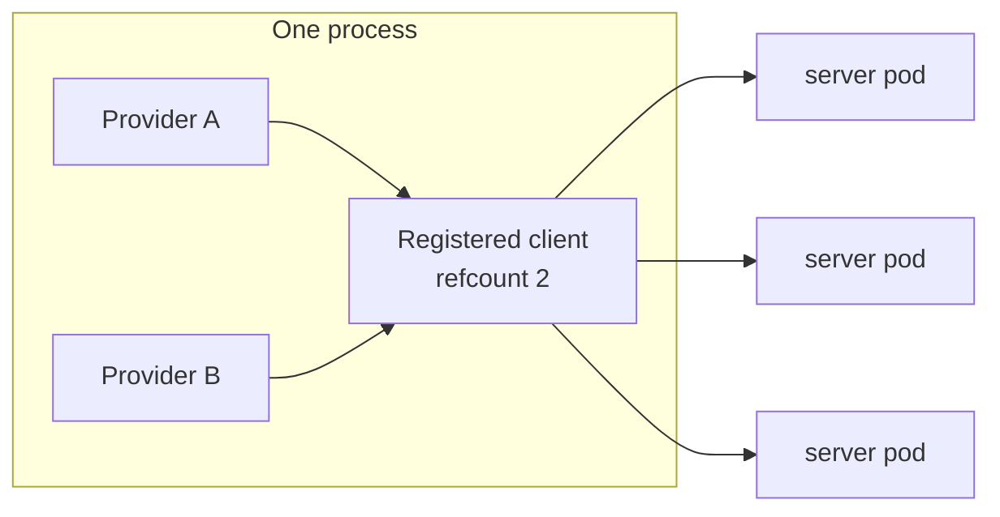

# IdeGYM Sandbox Provider

Runs each NeMo Gym sandbox as an [IdeGYM](https://github.com/JetBrains-Research/idegym) *server*: a
Kubernetes pod provisioned through the IdeGYM orchestrator and driven over the HTTP API the
orchestrator forwards to it. Use it when your environments already live in IdeGYM — SWE-bench-style
repository tasks, IDE-backed environments, anything else IdeGYM images provide.

It implements the provider-neutral `SandboxProvider` contract, so any sandbox-backed agent (for
example `mini_swe_agent_2`) can use it by pointing at this provider's config.

## Requirements

- A reachable IdeGYM **0.13.1 or later** orchestrator, and Basic auth credentials for it.
- The client SDK, also 0.13.1 or later: `uv pip install 'nemo-gym[idegym]'`.
- **An IdeGYM server image, 0.13.1 or later.** The pod runs the IdeGYM server, and that server exposes the API
  this provider talks to. A plain benchmark image such as `swebench/sweb.eval.x86_64.*` has none, so it
  never becomes ready. See [Images](#images).

Nothing else is needed in the image: files move through the server's own endpoints, not shell tools.
0.13.1 is required on the client, the orchestrator and the server image; `create()` does not probe for
older ones.

## Quick start

```bash
export IDEGYM_ORCHESTRATOR_URL=idegym.example.com
export IDEGYM_NAMESPACE=idegym
export IDEGYM_AUTH_USERNAME=...
export IDEGYM_AUTH_PASSWORD=...

AGENT=responses_api_agents/mini_swe_agent_2/configs/mini_swe_agent_2.yaml
MODEL=responses_api_models/vllm_model/configs/vllm_model.yaml
gym env start \
    --config $AGENT \
    --config nemo_gym/sandbox/providers/idegym/configs/idegym.yaml \
    --config $MODEL
```

Every shipped provider config binds the same instance name `sandbox`, so moving a benchmark from
Docker or OpenSandbox to IdeGYM is swapping that one config path. No agent edit.

Directly from Python:

```python
import asyncio

from nemo_gym.sandbox import AsyncSandbox, SandboxSpec

provider_config = {
    "idegym": {
        "connection": {"orchestrator_url": "idegym.example.com", "namespace": "idegym"},
        "create": {"run_as_root": True},
    }
}

spec = SandboxSpec(
    image="registry.example.com/idegym/my-env:latest",
    workdir="/testbed",
    resources={"cpu": 2, "memory_mib": 8192, "disk_gib": 30},
    provider_options={"resource_requests": {"cpu": 0.5, "memory_mib": 2048}},
    metadata={"instance_id": "django__django-11099"},
)


async def main() -> None:
    async with AsyncSandbox(provider_config, spec) as sandbox:
        await sandbox.start()
        result = await sandbox.exec("python -m pytest -q", timeout_s=600)
        print(result.stdout or result.stderr)


asyncio.run(main())
# leaving the `async with` block stops the server and deletes its Kubernetes resources
```

Leave `connection.username` and `connection.password` unset and the SDK reads
`IDEGYM_AUTH_USERNAME` / `IDEGYM_AUTH_PASSWORD`. That is the normal way to pass them.

## Selecting and configuring the provider

`configs/idegym.yaml` is the shipped block, with each setting commented — it is the reference for
individual settings. Only `attribution.run` is left out, because it is auto-detected per launch. The constructor takes one section per concern:

| Section | Purpose |
| --- | --- |
| `connection` | Orchestrator URL, namespace, auth, client name, HTTP pooling, tracing. |
| `create` | Readiness budget, retries, generated server names, pod defaults, polling backoff. |
| `exec` | Default command timeout, client-side overhead, graceful termination, output bound. |
| `verify` | The post-start working-directory check. |
| `files` | Transfer chunk size and per-chunk timeout. |
| `operations` | Status and teardown timeouts and retries, and the keepalive ceiling. |
| `attribution` | How the registered client name is derived when it is not pinned. |

`SandboxSpec.provider_options` carries the per-sandbox Kubernetes options that have no neutral
equivalent — `runtime_class_name`, `node_selector`, `volumes`, `env_from`, `pod_overrides` and the
rest — validated before a pod is allocated. The
[provider docs](https://docs.nvidia.com/nemo/gym/latest/infrastructure/sandbox/idegym) list them all.

### Spec fields that behave differently here

| Field | Behavior |
| --- | --- |
| `image` | Must run the IdeGYM server. `docker://` is stripped; the rest must be a valid lowercase OCI reference. |
| `workdir` | Not a pod setting — it is sent as the command's `cwd`, and create fails early if it is missing (`verify.check_workdir`). |
| `env` | Sent as the command's `env` field. IdeGYM can only put ConfigMap/Secret env on the pod, via `provider_options.env_from`. |
| `resources` | Kubernetes **limits**; `provider_options.resource_requests` supplies the requests. Quota accounting reads the limits, so `spec.resources` is what counts against your rule. |
| `metadata` | Pod labels (values sanitized), next to the attribution labels. Reserved keys (`app`, `app.kubernetes.io/*`, `idegym.jetbrains.com/*`) fail `create()`. `provider_options.labels` and `annotations` add more. `create.server_name_metadata_keys` also folds selected keys into the pod name, for readability only. |
| `exec(user=...)` | A named user, sent as the command's `user` field. A numeric uid is rejected as `invalid_request`. |
| `ttl_s`, `ports`, `resources.gpu` | Unsupported; each warns once. `ttl_s` is no lifetime cap: the orchestrator reaps idle servers, and keepalive only extends that idle window. `entrypoint` fails `create()`, since the entrypoint starts the IdeGYM server. |

## How it works



**One registered client per process.** IdeGYM's unit of ownership is a *client*: a heartbeating
entity that owns N server pods, carries the resource quota keyed on its name, and terminates all of
its servers when it stops. Every sandbox with an identical `connection` config shares one, reference
counted across providers — the last release unregisters it, cleaning up anything never closed.



**The client is the SDK's `SharedIdeGYMClient`.** It runs the registered client on a loop of its own
and hands every caller a loop-safe handle, so one registration serves `AsyncSandbox` on the caller's
loop and the sync `Sandbox` facade, which has one loop per sandbox. The provider keeps its own
reference count on top, because registration is still serialized and the last release must be the one
that unregisters.

**Tracing is opt-in.** With `connection.tracing_endpoint` null the provider passes the SDK no tracing
config, and the SDK traces only if `IDEGYM_OTEL_TRACING_ENDPOINT` is set. Once an endpoint is set in
Gym config, the SDK reads none of its `IDEGYM_OTEL_TRACING_*` variables: the timeout and credentials
come only from `tracing_timeout_s`, `tracing_username` and `tracing_password`. Tracing also needs
`opentelemetry-instrumentation-httpx`, which `nemo-gym[idegym]` does not install; add it with
`uv pip install 'idegym-client[otel]'`. Without it the SDK logs a warning and skips tracing.

**Commands are request fields.** The bash call takes `cwd`, `env`, `user`, a timeout and a graceful
termination timeout, so the command is sent as written, with no generated script. Output is bounded
by `exec.max_output_bytes` (1 MiB per stream by default): past it IdeGYM keeps the head and the tail
around a truncation marker. Leading and trailing whitespace is kept.

**Errors are typed.** The SDK raises typed exceptions, and `errors.py` classifies them: a not-found
that is not a sandbox error means the server is gone, 408/502/504 and connection or busy errors are
retryable, a 400 is an invalid request. On `exec`, an orchestrator 408 or 504 and a malformed response
are `error_type="sandbox"`; a bad environment variable name or a NUL in a value is
`invalid_request`, caught before the request is sent. The one text check left is the bash timeout, which the server
reports as a 500 whose message starts with `Command execution timed out after`.

**HTTP goes through an injected transport.** The aiohttp bridge (`httpx-aiohttp`, falling back to
httpx with a warning) is passed to the SDK client, wrapped in a retrying layer (`http.py`). A request
that never connected is retried for any method (`connection.connect_retries`). Idempotent GETs, above
all the operation-status polls the SDK sends once each, are retried on a transport error or a
429/502/503/504 (`connection.poll_retries`, `retry_delay_s`, honoring `Retry-After`). `connection.max_connections`
caps in-flight requests on both backends, and `null` means no cap. `max_keepalive_connections`
applies only with `transport_backend: httpx`; the aiohttp backend honors only `keepalive_expiry_s`.

**Create checks the workdir.** The orchestrator reports a server only once its pod passes the
Kubernetes readiness probe, so `create()` adds what it cannot see: a command run with `spec.workdir`
as its `cwd`. Anything that fails after provisioning stops the server.

**Readiness budget.** `create.ready_timeout_s` (1200 s by default) is the budget for the start call.
The SDK adds a start-up grace of at least 60 s to the orchestrator's wait. From 120 s up,
`ready_timeout_s` still bounds the whole call. A shorter budget gives the orchestrator at least half
of it and can overrun by up to 60 s, because otherwise every start would fail. `create.retries` also
covers connect timeouts and 408 next to the other transient control-plane failures, and every retry
keeps the server name.

**Files use the SDK's chunk endpoints.** Uploads and downloads are binary-safe requests of
`files.chunk_bytes` (1 MiB by default, at most 8 MiB). A download is written to a hidden
`.<name>.<uuid>.part` file beside the target and renamed over it only when it completes, so a failed
transfer leaves no partial file.

**Status** reads the orchestrator's per-server status endpoint. A server that is no longer usable
(crashed, killed, stopped) or is gone reports stopped; any other failure leaves it `unknown`
rather than guessing.

**Teardown.** `close()` retries a failed stop only when the failure is retryable.
`operations.retries` covers stop only. The SDK makes 3 stop attempts in total, all sharing one
`close_timeout_s`.

**Keepalive** is opt-in (`create.keepalive_minutes`, or `provider_options.keepalive_minutes` per
sandbox, at most 1440). The server is held right after start, and again before any command whose
timeout would outlive the hold, so IdeGYM's inactivity reaper cannot take a running sandbox.

## Images

`spec.image` must run the IdeGYM server. Build those with IdeGYM's own image builder, publish them
where your cluster can pull them, then map upstream benchmark tags onto them with `image_rewrites`:

```yaml
mini_swe_agent_2:
  responses_api_agents:
    mini_swe_agent_2:
      sandbox_provider: sandbox
      sandbox_spec:
        image_rewrites:
          - from: "swebench/"
            to: "registry.example.com/idegym-swebench/"
```

Rewrites are ordered and the first matching prefix wins. The provider does not build images.

## Limitations

- **No `endpoint()`.** The orchestrator forwards API requests rather than routing raw TCP to
  arbitrary container ports, so a long-lived service inside the sandbox cannot be reached this way.
- **No PTY sessions.** IdeGYM has no terminal API, so `sandbox.pty` is unavailable.
- **No `serialize()` / `connect()`.** A server is reachable only through the registered client that
  owns it; sharing one across processes needs a sandbox server in front of this provider.
- **No capability for the pod shell.** The IdeGYM dashboard offers a shell into a pod, but it is not
  part of the client API, so nothing here can drive it.
- **Output is bounded.** Each stream keeps at most `exec.max_output_bytes` (1 MiB by default); set it
  to `null` for complete output.
- **`ttl_s` is not enforced**, so a crashed process leaks pods until its client stops heartbeating
  and the watcher reaps them.

## Development

```bash
uv pip install 'nemo-gym[idegym]'
pytest tests/unit_tests/sandbox/test_idegym_provider.py tests/unit_tests/sandbox/test_idegym_session.py
```

The tests need no orchestrator. They run against a fake session or a fake SDK client. Both test
modules skip as a whole when `idegym-client` is not installed.

See [DESIGN-DECISIONS.md](DESIGN-DECISIONS.md) for the choices behind this layout and the
alternatives rejected along the way.
