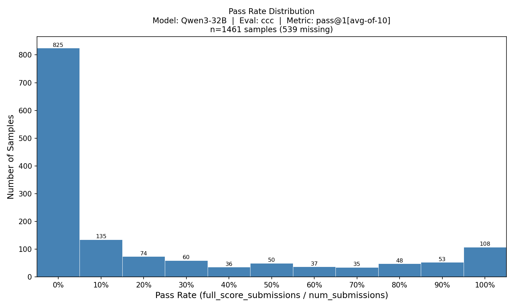

# Description

Competitive coding resources server. It grades C++ submissions (and text answers for SIMULATION problems) against
each problem's tests. Every submission compiles and runs in a fresh sandbox from a Gym
[sandbox provider](https://docs.nvidia.com/nemo/gym/main/infrastructure/sandbox); nothing the model wrote runs on
the server's host, and there is no fallback that would.

## Training config

Define server-specific runtime knobs on the resources server config, then read
them from `self.config` in `app.py`. For this server the relevant config path is:

`env.nemo_gym.competitive_coding_challenges_resources_server.resources_servers.competitive_coding_challenges`

Example override from NeMo RL:

```bash
uv run python examples/nemo_gym/run_grpo_nemo_gym.py --config path/to/grpo.yaml \
  env.nemo_gym.config_paths='[responses_api_models/vllm_model/configs/vllm_model_for_training.yaml,resources_servers/competitive_coding_challenges/configs/competitive_coding_challenges.yaml,responses_api_agents/simple_agent/configs/simple_agent.yaml,nemo_gym/sandbox/providers/opensandbox/configs/opensandbox.yaml]'
```

Please see the resources server YAML for settings that can be modified, such as:
```yaml
competitive_coding_challenges:
    test_file: ${oc.env:CCC_TEST_FILE,data/test_metadata.jsonl}
    test_batch_size: 4
    num_parallel_requests: 16
    time_scale: 2.0
    sandbox_provider: sandbox
    sandbox_config:
      image: ${oc.env:CCC_SANDBOX_IMAGE,null}
```

You must set the following at runtime:
- `export CCC_TEST_FILE=` path to metadata.jsonl file which contains data test cases and necessary execution artifacts
- `export CCC_SANDBOX_IMAGE=` an image built from `sandbox/Dockerfile`
- a sandbox provider config that binds `sandbox`, and each problem's data at `sandbox_config.problem_data_dir`
  (see [Sandbox](#sandbox))

and optionally can set to following:
- `export CCC_LOG_JSONL_PATH=` set path to view generations and runtime/compilation information (ex: stderr, stdout)
- `test_batch_size` tests of one submission that run in parallel in its sandbox; it may not exceed
  `sandbox_config.resources.cpu`
- `num_parallel_requests` number of submissions graded in parallel, which is also the number of concurrent sandboxes
- `time_scale` timeout limit factor, multiply's each problem's inherent time limit
- `num_workers` uvicorn worker processes; each one loads the full metadata (about 27 GB for the full test set) at startup, so size memory for all of them
- `grade_all_subtasks` (default `false`) grade every subtask of the row's problem, not only the row's own,
  as NeMo Skills does. Rewards use only the row's own subtask either way, so for training this only
  adds test runs.
- `partial_credit` (default `false`) score a `min` subtask as its lowest test score times its points, as
  IOI does, instead of all-or-nothing. A near-full subtask can then round up to full marks at its
  `score_precision`. Grading of a subtask stops at the first test below full marks without partial
  credit, and at the first zero with it.

  The IOI benchmarks turn both on so their totals match Skills' numbers.

One can also override via the config, ex: `++env.nemo_gym.competitive_coding_challenges_resources_server.resources_servers.competitive_coding_challenges.test_file=`.

## Sandbox

Each verification runs in a fresh sandbox from any
[sandbox provider](https://docs.nvidia.com/nemo/gym/main/infrastructure/sandbox), which is stopped
when the verification ends. The server uploads `ccc_eval.py` and `sandbox/sandbox_runner.py`; inside
the sandbox the evaluator runs each shell command the way the NeMo Skills sandbox does (`/bin/bash`
in a new session, 50 GiB `RLIMIT_AS`/`RLIMIT_DATA`, output cut at 1000 characters), so scores stay
comparable with baselines scored there. The per-test time and memory limits still come from each
problem's `run.sh`. The server does not start without a known provider and an image.

Where each part runs:

| Files | Where they run |
|---|---|
| `sandbox/sandbox_runner.py` | Only in the sandbox; uploaded with every verification. |
| `ccc_eval.py` | The evaluator: uploaded next to the runner and run only in the sandbox. The server imports it only to load problem metadata for scoring. |
| `sandbox/Dockerfile` | Builds the sandbox image; not uploaded. |
| `split_problem_metadata.py` | Run once by hand to write the per-problem data the sandbox reads (step 2 below). |
| Everything else, including `app.py` and `sandbox_evaluator.py` (which does the upload) | Only in the Gym server. |

1. Build and push the image. It pins the toolchain of the NeMo Skills sandbox the baselines were
   scored with (Debian 13, g++ 14.2.0-19), including `python`, which some problems' `run.sh` call:

   ```bash
   docker build --platform linux/amd64 -t <registry>/ccc-verifier:<tag> resources_servers/competitive_coding_challenges/sandbox
   docker push <registry>/ccc-verifier:<tag>
   ```

2. Split the metadata into one file per problem. Full-problem test sets reach hundreds of
   megabytes, so they are not uploaded per verification:

   ```bash
   python -m resources_servers.competitive_coding_challenges.split_problem_metadata "$CCC_TEST_FILE" <problem_dir>
   ```

   The script reads `$CCC_TEST_FILE` one line at a time, so memory is bounded by its largest line,
   not its total size (full RL problem sets exceed 100 GB).

   Make `<problem_dir>` available read-only at `sandbox_config.problem_data_dir` (default
   `/data/ccc`): a volume mount (`sandbox_config.provider_options.volumes`; for Docker,
   `["<problem_dir>:/data/ccc:ro"]`) or a layer of the image. For large sets, put `<problem_dir>` in
   object storage the provider can mount, as in the example below. If the provider mounts shared
   storage into every sandbox by default, turn that off, so submissions cannot browse other data
   for answers. The server still loads `test_file` itself to compute rewards and metrics, so re-run
   this split whenever `test_file` changes: a stale copy grades with the old points and tests, and
   nothing reports the mismatch.

3. Pass a provider config that binds `sandbox`, after the server config. On a machine with Docker:

   ```yaml
   # ccc_docker.yaml
   # export CCC_SANDBOX_IMAGE=<registry>/ccc-verifier:<tag>
   # gym env start --model-type openai_model --config resources_servers/competitive_coding_challenges/configs/competitive_coding_challenges.yaml --config ccc_docker.yaml
   config_paths:
     - nemo_gym/sandbox/providers/docker/configs/docker.yaml

   sandbox:
     docker:
       create:
         # Submissions need no network. Docker ignores the server's OpenSandbox network_policy.
         network: none

   competitive_coding_challenges_resources_server:
     resources_servers:
       competitive_coding_challenges:
         sandbox_config:
           provider_options:
             volumes:
               - <problem_dir>:/data/ccc:ro
   ```

   This example is for NVIDIA's OpenSandbox cells on AWS, with the problem data in their shared S3
   bucket:

   ```yaml
   # ccc_sandbox.yaml
   # gym env start --model-type openai_model --config resources_servers/competitive_coding_challenges/configs/competitive_coding_challenges.yaml --config ccc_sandbox.yaml
   config_paths:
     - nemo_gym/sandbox/providers/opensandbox/configs/opensandbox.yaml

   competitive_coding_challenges_resources_server:
     resources_servers:
       competitive_coding_challenges:
         sandbox_config:
           image: <registry>/ccc-verifier@sha256:<digest>
           metadata:
             # Grants CAP_SYS_RESOURCE so run.sh can lift the stack limit (see below).
             nemo.nvidia.com/sys-resource: "true"
             # Don't mount the whole shared bucket; mount only the problem data.
             nemo.nvidia.com/s3-hostpath: "false"
           provider_options:
             volumes:
               - name: ccc-data
                 host:
                   path: /mnt/s3/data/<prefix holding problem_dir>
                 mountPath: /data/ccc
                 readOnly: true
   ```

   Keys left out keep the server's defaults, such as `resources` (8 CPUs, 16 GiB),
   `test_batch_size` (4) and the deny-all `network_policy`.

   `num_parallel_requests` caps concurrent sandboxes, so size it to what the provider can run at
   once. Time limits are wall-clock, so `test_batch_size` may not exceed
   `sandbox_config.resources.cpu` (8 by default); Communication tasks run a manager and the
   submission per test, so about half the CPUs keeps them from competing. The default
   `sandbox_config.provider_options.network_policy` denies all egress on OpenSandbox and E2B.
   Docker, Enroot, Apptainer and ECS ignore the key, so they need their own setting (Docker's
   `network: none`, as above; Enroot cannot cut the network). Daytona, OpenShell and bwrap reject it,
   so remove it for them. The `local` provider is refused: it would run submissions on the host.

   The sandbox must let `run.sh` raise the stack limit (`ulimit -s unlimited`): its hard
   `RLIMIT_STACK` must be unlimited, or the process needs `CAP_SYS_RESOURCE`. Otherwise
   deep-recursion solutions crash and score lower than in the NeMo Skills sandbox. On NVIDIA's
   OpenSandbox cells, the `nemo.nvidia.com/sys-resource` metadata above grants the capability.

A failure of the sandbox itself, not of the submission, returns `mask_sample: true` with
`failure_kind` set to `provider_unavailable` (the sandbox could not start) or `verifier_error` (the
runner failed or produced no valid result), and `failure_reason` holding the details. Gym's
aggregate metrics leave masked samples out; whether training skips them is up to the trainer.

What the sandbox protects: the host, the network (where the provider enforces the policy) and other
rollouts. It does not protect the grade from the submission. The runner and the submission run as the
same user, and each test's expected output sits in the directory the submission runs in. A submission
that kills the runner fails the verification, which is masked as `verifier_error`, so watch that rate.

## Migrating from the NeMo Skills sandbox

Earlier versions sent every compile and test run to a NeMo Skills sandbox over HTTP by default, and
used a provider sandbox only when `sandbox_provider` was set. That path is removed. The NeMo Skills
sandbox is one long-lived service shared by every rollout of a job: a container started with host
networking and the shared work directory mounted, or a plain host process under Skills' `none`
executor. It cannot keep one submission away from another's files or from the network.

- A config that does not name a provider and an image fails at startup instead of grading elsewhere.
- `shared_dir`, `local_compile_dir`, `CCC_SHARED_TEMP_DIR`, `CCC_LOCAL_COMPILE_DIR`, `SHARED_TEMP_DIR`,
  `LOCAL_COMPILE_DIR`, `NEMO_SKILLS_SANDBOX_HOST` and `NEMO_SKILLS_SANDBOX_PORT` are no longer read.
- The default `test_batch_size` is 4 (it was 32), so it fits the default 8 sandbox CPUs.

## Generating Rollouts

The following allows users to launch the environment followed by the request for generating and collecting rollouts.
`$config_paths` includes a sandbox provider config (see [Sandbox](#sandbox)), and `CCC_SANDBOX_IMAGE` is set.
```bash
gym env start \
  --config "$config_paths" \
  +simple_agent.responses_api_agents.simple_agent.resources_server.name=competitive_coding_challenges_resources_server

gym eval run --no-serve \
  --agent simple_agent \
  --input $input_jsonl_fpath \
  --output $output_jsonl_fpath \
  --limit null \
  --num-repeats 1 \
  --concurrency null
```

## Additional Information

- The data necessary for this environment is currently not available and a future release of it is TBD.
- Example reward profiling done with Qwen3-32B can be found at 
- The default settings for `test_batch_size`, `num_parallel_requests` and `time_scale` should work well but if you notice many `"run_stderr": "Time limit exceeded` in your `ccc_verify.jsonl` file then its worth increasing this to remove false negatives. Conversely, lowering `time_scale` will speed up training.
