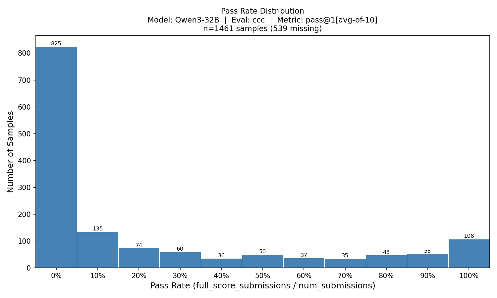

# Description

Competitive coding resource server.

## Training config

Define server-specific runtime knobs on the resource server config, then read
them from `self.config` in `app.py`. For this server the relevant config path is:

`env.nemo_gym.competitive_coding_challenges_resources_server.resources_servers.competitive_coding_challenges`

Example override from NeMo RL:

```bash
uv run python examples/nemo_gym/run_grpo_nemo_gym.py --config path/to/grpo.yaml \
  env.nemo_gym.config_paths='[responses_api_models/vllm_model/configs/vllm_model_for_training.yaml,resources_servers/competitive_coding_challenges/configs/competitive_coding_challenges.yaml,responses_api_agents/simple_agent/configs/simple_agent.yaml]'
```

Please see the resource server yaml for settings that can be modified such as:
```yaml
competitive_coding_challenges
    test_file: ${oc.env:CCC_TEST_FILE,data/test_metadata.jsonl}
    test_batch_size: 32
    num_parallel_requests: 16
    time_scale: 2.0
    shared_dir: ${oc.env:CCC_SHARED_TEMP_DIR,${oc.env:SHARED_TEMP_DIR,/tmp}}
    local_compile_dir: ${oc.env:CCC_LOCAL_COMPILE_DIR,${oc.env:LOCAL_COMPILE_DIR,/tmp/nemo-gym-compile}}
```

You must set the following at runtime:
- `export CCC_SHARED_TEMP_DIR=` shared directory for code-execution artifacts that must be visible to all Ray nodes
- `export CCC_TEST_FILE=` path to metadata.jsonl file which contains data test cases and necessary execution artifacts

and optionally can set to following:
- `export CCC_LOG_JSONL_PATH=` set path to view generations and runtime/compilation information (ex: stderr, stdout)
- `export CCC_LOCAL_COMPILE_DIR=` override the default `/tmp/nemo-gym-compile` staging directory before completed artifacts are published to `shared_dir`
- `local_compile_dir: null` disable local compilation staging and compile directly in `shared_dir`
- `test_batch_size` per problem test case parallelism
- `num_parallel_requests` number of problems to evaluate in parallel
- `time_scale` timeout limit factor, multiply's each problem's inherent time limit
- `grade_all_subtasks` (default `false`) grade every subtask of the row's problem, not only the row's own,
  as NeMo Skills does. Rewards use only the row's own subtask either way, so for training this only
  adds test runs.
- `partial_credit` (default `false`) score a `min` subtask as its lowest test score times its points, as
  IOI does, instead of all-or-nothing. A near-full subtask can then round up to full marks at its
  `score_precision`. Grading of a subtask stops at the first test below full marks without partial
  credit, and at the first zero with it.

  The IOI benchmarks turn both on so their totals match Skills' numbers.

The unprefixed `SHARED_TEMP_DIR` and `LOCAL_COMPILE_DIR` are still read as fallbacks when the `CCC_`-prefixed variables are unset; prefer the prefixed names.

One can also override via the config, ex: `++env.nemo_gym.competitive_coding_challenges_resources_server.resources_servers.competitive_coding_challenges.test_file=`.

## Sandbox prerequisite (local)

This server compiles and runs candidate solutions inside the NeMo Skills
sandbox over HTTP. Bring one up locally before launching the server.

There is no published image — build it from the NeMo-Skills repo:

```bash
git clone --depth 1 https://github.com/NVIDIA-NeMo/Skills.git /tmp/NeMo-Skills \
  && docker build -t nemo-skills-sandbox \
       -f /tmp/NeMo-Skills/dockerfiles/Dockerfile.sandbox /tmp/NeMo-Skills \
  && docker run --rm -p 6000:6000 nemo-skills-sandbox
```

The server defaults to `http://127.0.0.1:6000/execute`; override with
`NEMO_SKILLS_SANDBOX_HOST` / `NEMO_SKILLS_SANDBOX_PORT` if the sandbox is
elsewhere. Cluster/SLURM users can co-launch the sandbox via Skills'
`nemo_gym_rollouts(with_sandbox=True)` — separate path, not covered here.

## Running in a provider sandbox

Instead of the NeMo Skills sandbox, each verification can run in a fresh sandbox from any
[sandbox provider](https://docs.nvidia.com/nemo/gym/main/infrastructure/sandbox). The server
uploads `ccc_eval.py` and `sandbox_runner.py`; inside the sandbox the unchanged evaluator runs
each shell command the way the NeMo Skills sandbox does (`/bin/bash` in a new session, 50 GiB
`RLIMIT_AS`/`RLIMIT_DATA`, output cut at 1000 characters). The per-test time and memory limits
still come from each problem's `run.sh`.

1. Build and push the image. It pins the toolchain of the NeMo Skills sandbox the baselines were
   scored with (Debian 13, g++ 14.2.0-19), including `python`, which some problems' `run.sh` call:

   ```bash
   docker build --platform linux/amd64 -t <registry>/ccc-verifier:<tag> resources_servers/competitive_coding_challenges/sandbox_image
   docker push <registry>/ccc-verifier:<tag>
   ```

2. Split the metadata into one file per problem. Full-problem test sets reach hundreds of
   megabytes, so they are not uploaded per verification:

   ```bash
   python -m resources_servers.competitive_coding_challenges.split_problem_metadata "$CCC_TEST_FILE" <problem_dir>
   ```

   The script reads `$CCC_TEST_FILE` one line at a time, so memory is bounded by its largest line,
   not its total size (full RL problem sets exceed 100 GB).

   Make `<problem_dir>` available read-only at `sandbox_config.problem_data_dir` (default
   `/data/ccc`): a volume mount (`sandbox_config.provider_options.volumes`; for Docker,
   `["<problem_dir>:/data/ccc:ro"]`) or a layer of the image. For large sets, put `<problem_dir>` in
   object storage the provider can mount, as in the example below. If the provider mounts shared
   storage into every sandbox by default, turn that off, so submissions cannot browse other data
   for answers. The server still loads `test_file` itself to compute rewards and metrics.

3. Enable the sandbox path, with command-line overrides:

   ```bash
   export CCC_SANDBOX_IMAGE=<registry>/ccc-verifier:<tag>
   gym env start \
       --model-type openai_model \
       --config resources_servers/competitive_coding_challenges/configs/competitive_coding_challenges.yaml \
       --config nemo_gym/sandbox/providers/opensandbox/configs/opensandbox.yaml \
       ++competitive_coding_challenges_resources_server.resources_servers.competitive_coding_challenges.sandbox_provider=sandbox \
       ++competitive_coding_challenges_resources_server.resources_servers.competitive_coding_challenges.test_batch_size=4
   ```

   or with a config file passed after the server config. This example is for NVIDIA's OpenSandbox
   cells on AWS, with the problem data in their shared S3 bucket:

   ```yaml
   # ccc_sandbox.yaml
   # gym env start --model-type openai_model --config resources_servers/competitive_coding_challenges/configs/competitive_coding_challenges.yaml --config ccc_sandbox.yaml
   config_paths:
     - nemo_gym/sandbox/providers/opensandbox/configs/opensandbox.yaml

   competitive_coding_challenges_resources_server:
     resources_servers:
       competitive_coding_challenges:
         sandbox_provider: sandbox
         test_batch_size: 4
         sandbox_config:
           image: <registry>/ccc-verifier@sha256:<digest>
           metadata:
             # Grants CAP_SYS_RESOURCE so run.sh can lift the stack limit (see below).
             nemo.nvidia.com/sys-resource: "true"
             # Don't mount the whole shared bucket; mount only the problem data.
             nemo.nvidia.com/s3-hostpath: "false"
           provider_options:
             volumes:
               - name: ccc-data
                 host:
                   path: /mnt/s3/data/<prefix holding problem_dir>
                 mountPath: /data/ccc
                 readOnly: true
   ```

   Keys left out keep the server's defaults, such as `resources` (8 CPUs, 16 GiB) and the
   deny-all `network_policy`.

   `num_parallel_requests` caps concurrent sandboxes, so size it to what the provider can run at
   once. Time limits are wall-clock, so `test_batch_size` may not exceed
   `sandbox_config.resources.cpu` (8 by default); Communication tasks run a manager and the
   submission per test, so about half the CPUs keeps them from competing. The default
   `sandbox_config.provider_options.network_policy` is an OpenSandbox option that denies all
   egress. Other providers need their own setting (Docker's `network: none`), and Daytona, E2B and
   OpenShell reject the key, so remove it for them.

   The sandbox must let `run.sh` raise the stack limit (`ulimit -s unlimited`): its hard
   `RLIMIT_STACK` must be unlimited, or the process needs `CAP_SYS_RESOURCE`. Otherwise
   deep-recursion solutions crash and score lower than in the NeMo Skills sandbox. On NVIDIA's
   OpenSandbox cells, the `nemo.nvidia.com/sys-resource` metadata above grants the capability.

A failure of the sandbox itself, not of the submission, returns `mask_sample: true` with
`failure_kind` set to `provider_unavailable` (the sandbox could not start) or `verifier_error` (the
runner failed or produced no valid result), and `failure_reason` holding the details. Gym's
aggregate metrics leave masked samples out; whether training skips them is up to the trainer.

## Generating Rollouts

The following allows users to launch the environment followed by the request for generating and collecting rollouts.
```bash
gym env start \
  --config "$config_paths" \
  +simple_agent.responses_api_agents.simple_agent.resources_server.name=competitive_coding_challenges_resources_server

gym eval run --no-serve \
  --agent simple_agent \
  --input $input_jsonl_fpath \
  --output $output_jsonl_fpath \
  --limit null \
  --num-repeats 1 \
  --concurrency null
```

## Additional Information

- The data necessary for this environment is currently not available and a future release of it is TBD.
- Example reward profiling done with Qwen3-32B can be found at 
- The default settings for `test_batch_size`, `num_parallel_requests` and `time_scale` should work well but if you notice many `"run_stderr": "Time limit exceeded` in your `ccc_verify.jsonl` file then its worth increasing this to remove false negatives. Conversely, lowering `time_scale` will speed up training.
