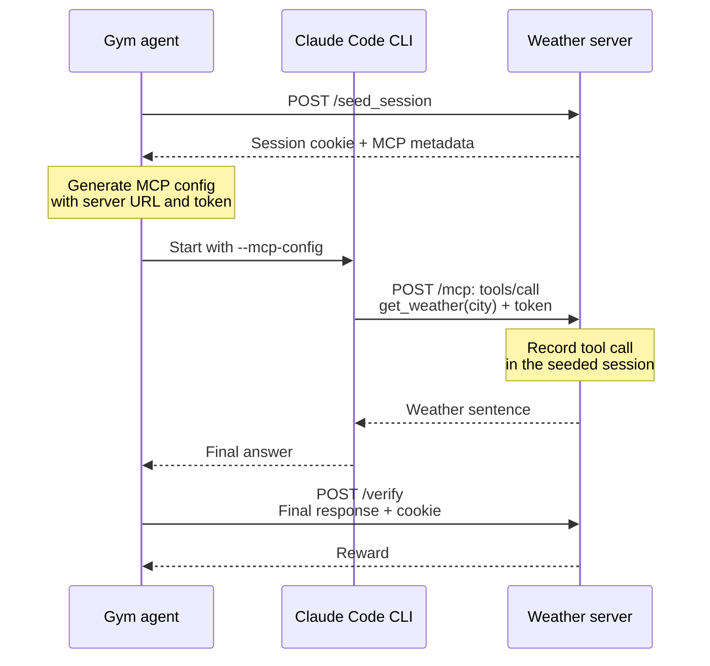

# Example MCP Weather

A minimal example of serving a Resources Server's tools over the **Model Context Protocol (MCP)**.
The server extends `StatefulResourcesServer` with one typed HTTP tool route (`POST /get_weather`) —
no MCP imports, no decorators. The base class handles seed, close, and checkpoint retirement; the example
provides its weather state and scoring. Setting `expose_tools_over_mcp: true` in its YAML config serves that
same route over a Streamable-HTTP MCP endpoint at `/mcp` on the same FastAPI app as `/seed_session`
and `/verify`. Tool calls record against the per-rollout Gym session (resolved from a signed
`X-NeMo-Gym-Session-Token`), and `/verify` rewards a rollout only if the tool was used **in that same
session** and the final answer repeats the returned sentence.

This is the runnable companion to the [MCP Resources Server tutorial](https://github.com/NVIDIA-NeMo/Gym/tree/main/fern/versions/latest/pages/environment-tutorials/mcp-resources-server.mdx).

## Run with an agent (Claude Code)

Put your key in a repo-root `env.yaml` (the config interpolates `${anthropic_api_key}`), then start the servers
— the `claude_code_agent` runs `claude` with that key injected:

```bash
# env.yaml:  anthropic_api_key: sk-ant-...
gym env start --config resources_servers/example_mcp_weather/configs/example_mcp_weather.yaml
```

Then collect rollouts against `data/example.jsonl` and reward-profile as in the
[quickstart](https://github.com/NVIDIA-NeMo/Gym/tree/main/fern/versions/latest/pages/get-started/quickstart.mdx).
A correct rollout shows Claude Code calling `mcp__example_mcp_weather__get_weather` and a `reward` of `1.0`.

## Wiring the agent (Claude Code)

In the example's `/run` flow, the Gym agent seeds the weather Resources Server and generates an MCP config
for the Claude Code CLI:



The MCP config carries the signed `X-NeMo-Gym-Session-Token` header. It resolves to the same session as the
cookie used for verification. `/mcp` dispatches to the existing `get_weather` handler; all three endpoints
run in the same weather server. A reward of `1.0` requires both a tool call for the expected city in that
session and the matching weather sentence in the final answer.

## Sessions under an Environment Server

An Environment Server such as `single_agent_turn` seeds the server with a typed `ResourcesSeedSessionRequest`. It names
the session (`resources_session_id`), and `task_data` carries the row's own fields, here `verifier_metadata`. The reply
is a `ResourcesSeedSessionResponse` whose `resources_tools` holds the same MCP metadata (the `/mcp` path and the
per-rollout session token) that a legacy seed returns under `mcp`; the Environment Server grants it to the agent.
`/verify` releases the live weather-call history and typed binding before checkpoint tracking ends. It keeps only
the unique called cities and optional typed identity for `session_close_retry_window_seconds`, so a repeated verify
can still score the response. Checkpoint retirement also releases a live history. Legacy seeds cannot replace typed
sessions; a new legacy `/run` reusing a completed legacy cookie receives a fresh cookie. The Environment Server then
calls `/close_session`, which fences verification retries. From then on:

- a `/get_weather` call for the session, over HTTP or with its MCP token, fails with 404 (`failure_kind: session_lost`);
- `/verify` returns a masked sample (`mask_sample: true`, `failure_kind: session_lost`) instead of a reward of 0;
- a seed that reuses the closed `resources_session_id` is refused with 409.

Running the example under `single_agent_turn` with the `mcp` tool transport needs an agent that accepts per-session
MCP tool grants. The Claude Code agent's session path does not consume those grants yet, so this example uses `/run`.

## Inspect the MCP round-trip without an LLM

Start the server and drive the endpoint directly — a `requests.Session` preserves the session cookie so
`/verify` sees the same session as the tool call:

```python
import requests

s = requests.Session()
meta = s.post("http://127.0.0.1:<port>/seed_session", json={"verifier_metadata": {"expected_city": "Paris"}}).json()["mcp"]
token = meta["headers"]["X-NeMo-Gym-Session-Token"]

# call the tool over the auto-exposed /mcp endpoint, carrying the per-rollout token
s.post(
    f"http://127.0.0.1:<port>{meta['url_path']}",
    headers={"Accept": "application/json, text/event-stream", "X-NeMo-Gym-Session-Token": token},
    json={"jsonrpc": "2.0", "id": 1, "method": "tools/call",
          "params": {"name": "get_weather", "arguments": {"city": "Paris"}}},
)

# the same tool is still a plain HTTP route (the cookie carries the session here)
s.post("http://127.0.0.1:<port>/get_weather", json={"city": "Paris"})

# verify in the same session -> reward 1.0
print(s.post("http://127.0.0.1:<port>/verify", json={
    "responses_create_params": {"input": [{"role": "user", "content": "use the weather tool"}]},
    "verifier_metadata": {"expected_city": "Paris"},
    "response": {"id": "r", "created_at": 0, "model": "t", "object": "response", "output": [
        {"id": "m", "type": "message", "role": "assistant", "status": "completed",
         "content": [{"type": "output_text", "text": "The weather in Paris is sunny and 72 F.", "annotations": []}]}],
        "parallel_tool_calls": False, "tool_choice": "none", "tools": []},
}).json()["reward"])
```

An Environment Server's seed and close look like this; the token now comes from `resources_tools`:

```python
# A fresh session: the cookie from the seed above names another session, and the typed seed would get 409.
s = requests.Session()
episode = {"rollout_id": "weather-1", "attempt": 0}
seed = s.post("http://127.0.0.1:<port>/seed_session", json={
    "resources_session_id": "weather-1",
    "episode_id": episode,
    "task_id": {"taskset": "example", "task_id": "0"},
    "task_data": {"verifier_metadata": {"expected_city": "Paris"}},
}).json()
token = seed["resources_tools"]["headers"]["X-NeMo-Gym-Session-Token"]

# ... call get_weather and /verify as above, then release the session
s.post("http://127.0.0.1:<port>/close_session", json={"resources_session_id": "weather-1", "episode_id": episode})
```

## Tests

```bash
gym env test --resources-server example_mcp_weather
```
