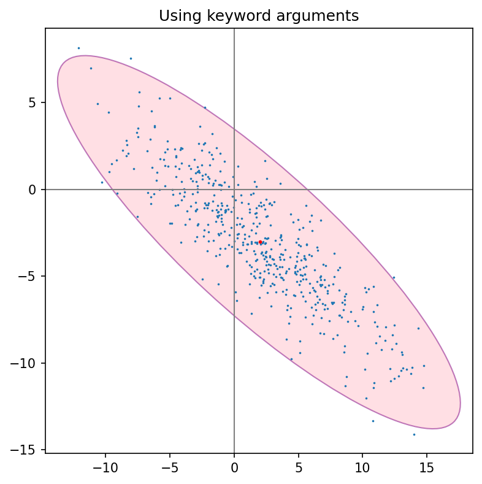
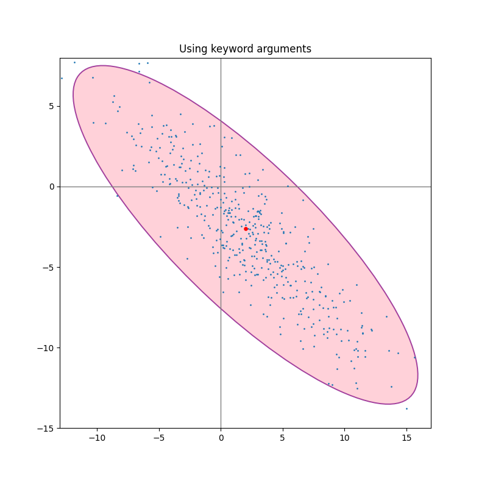
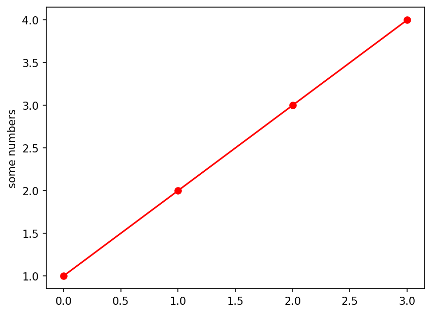
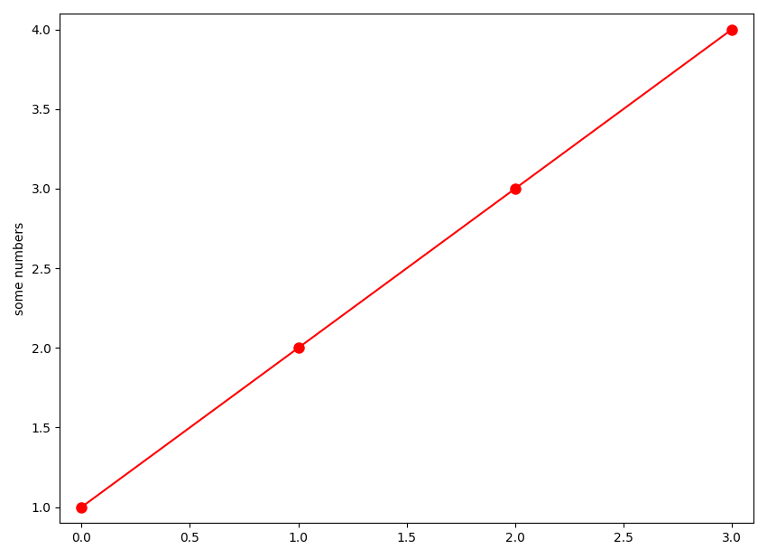
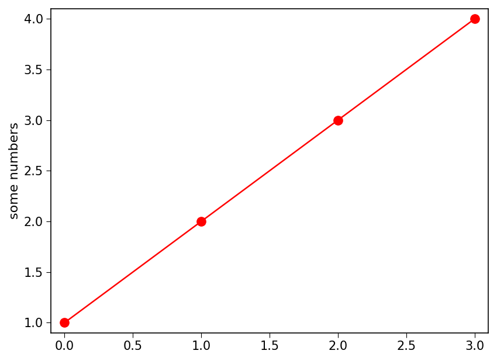
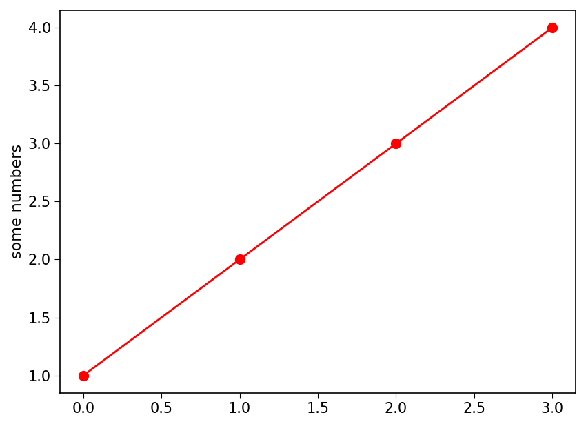

# Vision2Code

Vision2Code is a NeMo Gym environment for training models to understand images through
reconstruction. A policy studies a reference image and writes Python to recreate it.
The environment executes the code in an isolated renderer, compares the result with the
reference, and returns a configurable reward and optional feedback for revision.

Derived from the [Vision2Code benchmark](https://github.com/image2code/vision2code), it supports
judge-only and pixel-weighted rewards, semantic score caps, and feedback-driven revisions.
Use your own image manifest with a domain rubric or `generic`. NeMo Gym supplies rollouts
and rewards; your training framework handles policy updates and checkpointing.

## Rubrics

Choose a rubric for each reference image in your training or evaluation manifest. Domain
rubrics cover chemistry, physics, documents, charts, geometry, graphs, and spatial scenes;
`generic` provides an equal-weight rubric for other images. The judge compares the
reference and recreation using the following criteria:

| Rubric | What it judges |
| --- | --- |
| `ChartQA` | Chart values, structure, labels, and completeness. |
| `dvqa` | Chart values, layout, label accuracy, and legibility. |
| `figureqa` | Chart information, structure, text, and visual completeness. |
| `matplotlib` | Plot layout, plotted elements, ticks, annotations, and styling. |
| `ChemVQA-2K` | Molecular structure, chemical symbols, bonds, and readability. |
| `ChemVQA-2K-spacing-v1` | Chemical fidelity plus clearance between labels, bonds, charges, and subscripts. |
| `DocVQA` | Text content, document layout, legibility, and key visual elements. |
| `EEE-Bench` | Circuit connectivity, components, labels, directions, readability, and completeness. |
| `geometry3k` | Geometric construction, labels, markers, and their placement. |
| `GEOQA_8K_R1V` | Geometric precision and correct association of numbers, labels, and markers. |
| `Geoperception` | Geometric structure, annotations, spatial placement, and readability. |
| `Graph-Algorithms` | Graph connectivity, ordering, edge direction, and labels. |
| `GraphVQA-Swift` | Graph structure, labels, and mapping of visual attributes to nodes and edges. |
| `OlympiadBench` | Problem-diagram semantics, symbols, labels, and spatial precision. |
| `Physics` | Physical setup, vectors, labels, and consistent object geometry. |
| `spatialvlm_qa` | Object identity, spatial relations, depth, and scene appearance. |
| `generic` | Information, layout, annotations, and completeness, with equal weights. |

`ChemVQA-2K-spacing-v1` adds label-spacing checks. `DocVQA-v2` and `EEE-Bench-v2` retain
modified appearance-sensitive rubrics; select them explicitly in the manifest to preserve
that behavior. Exact criteria, weights, and caps are in [rubrics.py](rubrics.py) and
[generic_rubric.py](generic_rubric.py).

## Setup

Run commands from the Gym repository root:

```bash
uv venv --python 3.13.14
source .venv/bin/activate
uv sync --frozen --extra dev
uv sync --locked --project resources_servers/vision2code
source resources_servers/vision2code/.venv/bin/activate
```

The worker needs Enroot. Build the renderer image on a Docker host and place the resulting
`.sqsh` on the worker:

```bash
docker build -t vision2code-render:1 resources_servers/vision2code/container
enroot import -o /images/vision2code-render.sqsh dockerd://vision2code-render:1
```

The [container](container/) pins Python, rendering libraries, and fonts. Rebuild the
`.sqsh` when these change. [Enroot configuration](enroot/) gives each attempt a read-only
rootfs, private `/workspace`, and network/PID isolation. References and host credentials
are not mounted. The worker or scheduler must provide CPU/memory limits.

Programs receive `OUTPUT_PATH`, `TARGET_WIDTH`, and `TARGET_HEIGHT`. For Matplotlib,
[launcher.py](launcher.py) redirects saves to the output path at target size and 100 DPI,
overriding explicit cropping and padding. Global cropping settings and explicit output
formats remain effective. Other libraries must save at `OUTPUT_PATH` with target dimensions.
Recreate the background too: judge checks preserve alpha, while pixel metrics composite
transparency onto white.

## Prepare tasks

Create a JSONL manifest with one image and rubric per row. The included
[manifest.jsonl](data/manifest.jsonl) lists five Matplotlib reference images:

```json
{"id":"chem-001","image_path":"images/chem-001.png","rubric":"ChemVQA-2K"}
{"id":"chart-001","image_path":"images/chart-001.png","rubric":"ChartQA"}
{"id":"other-001","image_path":"images/other-001.png","rubric":"generic"}
```

```bash
python -m resources_servers.vision2code.prepare \
  resources_servers/vision2code/data/manifest.jsonl /data/tasks.jsonl
```

Preparation embeds the reference image and uses the short prompt
`Generate Python code to recreate this image. Return code only.` The system prompt requires
saving to `OUTPUT_PATH`. Optional flags add canvas dimensions (`--include-canvas-dimensions`),
rendering instructions (`--include-rendering-instructions`), or installed libraries
(`--include-library-instructions`). Regenerate prepared tasks when changing prompt options.

| Config | Passes | Reward | Revision feedback |
| --- | --- | --- | --- |
| [vision2code_evals.yaml](configs/vision2code_evals.yaml) | 1 | Pixel-weighted score | Single pass |
| [vision2code_feedback.yaml](configs/vision2code_feedback.yaml) | Up to 3, best reward | Pixel-weighted score | Render, judge rationale, judge and pixel scores |

Pass the same preset to preparation and `gym env start`:

```bash
export VISION2CODE_EVAL_TASKS=/data/tasks.jsonl
python -m resources_servers.vision2code.prepare \
  /data/manifest.jsonl "$VISION2CODE_EVAL_TASKS" \
  --config resources_servers/vision2code/configs/vision2code_evals.yaml
```

The feedback preset adds canvas dimensions. Explicit `--include-*` and `--no-include-*`
flags override preset preparation options. Both presets use an uncapped judge term and
stop at a perfect final judge rating; see [Rewards](#rewards) for the score formula.

Paths in the manifest are relative to the manifest file. Preparation sends the reference
as an embedded image in the policy input; its actual filesystem path is hidden from the
policy model and unavailable inside the rendering sandbox. The resource server keeps the
path, dimensions, and checksum in verifier metadata so it can check the reference and score
the output. Keep those source files accessible to the resource server. Prepared
[example tasks](data/example.jsonl) and [real rollouts](data/example_rollouts.jsonl) are included.

### Single-pass example

Kimi K3 recreation with GPT-6.1-Sol judging; pixel-weighted reward **0.67684**.

| Reference | Recreation |
| --- | --- |
|  |  |

[Saved rollouts](data/example_rollouts.jsonl) · [Selection and provenance](data/example-provenance.json) ·
[Matplotlib license](data/LICENSE.matplotlib).

## Connect models and collect rollouts

Provide two running OpenAI-compatible vision-model endpoints: a **policy** that writes Python
and a **judge** that compares the rendered image with the reference. These can be hosted APIs
or models you serve yourself. The commands below start Gym and connect it to those endpoints;
they do not launch the model inference servers.

```bash
export VISION2CODE_SQSH=/images/vision2code-render.sqsh
export VISION2CODE_ARTIFACTS=/results/vision2code/artifacts
export VISION2CODE_POLICY_URL=http://policy-host:8000/v1
export VISION2CODE_POLICY_MODEL=your-vision-model
export VISION2CODE_JUDGE_URL=http://judge-host:8000/v1
export VISION2CODE_JUDGE_MODEL=your-vision-judge
# Set VISION2CODE_POLICY_KEY and VISION2CODE_JUDGE_KEY if authentication is required.

gym env start --config resources_servers/vision2code/configs/vision2code.yaml
```

In another shell with the same environment activated:

```bash
gym eval run --no-serve --agent vision2code_simple_agent \
  --input /data/tasks.jsonl --output /results/vision2code/rollouts.jsonl \
  --num-repeats 1 --temperature 0.7 --max-output-tokens 8192
```

Start with `--limit 1` to inspect a rollout. For reasoning endpoints, set the model adapter's
`uses_reasoning_parser` and `uses_interleaved_reasoning` to match its response format.
Configure these on the policy and judge adapters independently.

## Multi-pass revisions

Use the [feedback preset](configs/vision2code_feedback.yaml) for up to three passes.
Each revision receives the previous render, code, and feedback and returns a complete
replacement program. Category scores below 5/5 supply judge rationale; render failures
supply execution errors. Each additional pass costs a policy call and render, plus a
judge call for a valid image. Token limits apply per call.

Agent settings control the pass budget, feedback, stopping, and selection:

```yaml
num_passes: 3
result_selection: best  # Highest reward; earliest pass wins ties. Also: last.
include_rendered_image: true
include_judge_scores: true
include_pixel_scores: true
stop_on: final_judge_score  # Also: judge_score (raw 5/5), reward (1.0).
minimum_scores: {}
require_same_dimensions: true
```

Numeric feedback is opt-in in the base config. Pixel feedback can be computed with any
reward mode without changing the reward. Optional `minimum_scores` thresholds must all
pass; supported keys are `overall_rubric_score` (0–5), `foreground_tolerant_f1`,
`edge_tolerant_f1`, and `rgb_overlap` (0–1). A perfect score selected by `stop_on` can
stop independently. `--num-repeats` collects independent rollouts, not revision passes.

The returned response, reward, and artifacts belong to the selected pass. The rollout's
`attempts` records each pass's reward, feedback, and artifacts; `selected_pass` identifies
the chosen attempt. See the [agent implementation](../../responses_api_agents/vision2code_agent/app.py)
for failure routing and selection details.

### Example: passes 1–3

Qwen3.8-27B recreation with GPT-6.1-Sol judging and pixel-weighted rewards:

| Reference | Pass 1 · 0.66074 | Pass 2 · 0.84636 | Pass 3 · 0.90380 |
| --- | --- | --- | --- |
|  |  |  |  |

Feedback improved typography, margins, and marker sizes. This is one illustrative improving
rollout; revisions can also regress. [Complete rollout](results/revision-example/rollout.jsonl) ·
[Feedback and provenance](results/revision-example/provenance.json) ·
[Matplotlib license](results/revision-example/LICENSE.matplotlib).

## Rewards

All rewards lie in `[0, 1]`. Let `R` be the final judge rating (0–5, with rubric caps and
rounding), `L` the raw weighted judge score, and `C` that raw score after rubric caps.

| Mode | Configuration | Reward |
| --- | --- | --- |
| Linear judge | `reward_power=1` | `R / 5` |
| Squared judge (default) | `reward_power=2` | `(R / 5)²` |
| Pixel-weighted | `use_blended_reward=true` | `0.1 × foreground RGB similarity + 0.2 × foreground F1 + 0.2 × edge F1 + 0.5 × (L / 5)` |
| Pixel-weighted, capped judge | Also `blended_reward_apply_judge_caps=true` | Same pixel terms, with `C / 5` replacing `L / 5` |

Pixel metrics supply half the reward; the judge supplies the other half. They use a maximum
analysis dimension of 1024 pixels and a 2-pixel F1 tolerance, without automatic alignment.
Only the judge term receives rubric caps, which penalize semantic mistakes such as wrong
molecular structure or circuit wiring. Pixel-weighted modes bypass `reward_power`.
See [image_metrics.py](image_metrics.py) for the implementation.

For training, pixel-weighted rewards with a capped judge term are a candidate worth
studying: they combine visual similarity with semantic penalties. Reward choice remains
an area for research; these evaluation runs do not establish training effectiveness.
Enable both flags above on the resources server and supply a separate training dataset.
The optional `spatial_uncapped_judge_squared=true` instead uses `(L / 5)²` without pixel
terms for `spatialvlm_qa`. Keep the judge, prompts, and evaluation settings fixed when
comparing trained policies.

## Benchmark results

**Qwen3.8-27B**, judged by **GPT-6.1-Sol**, on the same **539 test-mini tasks across 15 rubrics**.
Both runs use temperature 0, up to 32,768 output tokens per policy call, one rollout per
task, and the pixel-weighted reward with an uncapped judge term.

| Maximum passes | Tasks scored | Successful selected renders | Pixel-weighted | Linear judge (offline) | Squared judge (offline) |
| --- | --- | --- | --- | --- | --- |
| 1 | 539 | 513 | 0.5894 | 0.7766 | 0.6646 |
| 3 | 539 | 538 | 0.7456 | 0.9124 | 0.8494 |

Means weight each task equally, including zero for code/render failures; neither run has
masked or missing samples. Judge-only columns transform the same selected attempts offline.
The three-pass setup also adds canvas dimensions and render/judge/pixel feedback, selects
the best reward, and stops at a perfect final judge rating. This is a comparison of those
setups, not an isolated test of pass count. [Recorded settings and score provenance](results/qwen-results.json).

## Failures and artifacts

Code errors, execution timeouts, and missing/invalid images receive zero reward. Infrastructure,
reference-image, and judge failures are masked and excluded from scored aggregates.
Each attempt saves the Python code, reference, generated image, execution diagnostics,
judge output, and result in its own artifact directory.

Invalid judgments receive up to two additional unchanged evaluations by default
(`judge_repair_attempts`, `judge_repair_mode: retry`). Modes `repair` and `rejudge` support
correcting a reply or requesting schema-constrained output. Transport failures receive
up to three attempts (`judge_transport_attempts`); exhausted recovery masks the sample.

Outputs must be regular, readable, nonanimated images of at most 32 MiB and 25 million pixels.
TIFF and BMP artifacts are encoded as PNG for model image inputs; saved artifacts retain
their original format.
Dimension mismatches are recorded without resizing. Rendering defaults to a 60-second
timeout and concurrency of eight. Inspect render/judge timings before raising concurrency.

## Validation

```bash
python -m pytest resources_servers/vision2code/tests responses_api_agents/vision2code_agent/tests

# Real renderer tests on an Enroot worker:
VISION2CODE_TEST_SQSH=/images/vision2code-render.sqsh \
  python -m pytest resources_servers/vision2code/tests/test_enroot_integration.py
```

The Enroot tests check rendering, output validation, cleanup, and worker isolation.
Live judge quality requires model rollouts. The environment remains
experimental and `verified: false` pending broader baselining.

Adapted code is Apache-2.0; see [NOTICE](NOTICE), [LICENSE.upstream](LICENSE.upstream), and
[source provenance](tests/fixtures/provenance.json). Dataset licenses are separate.
