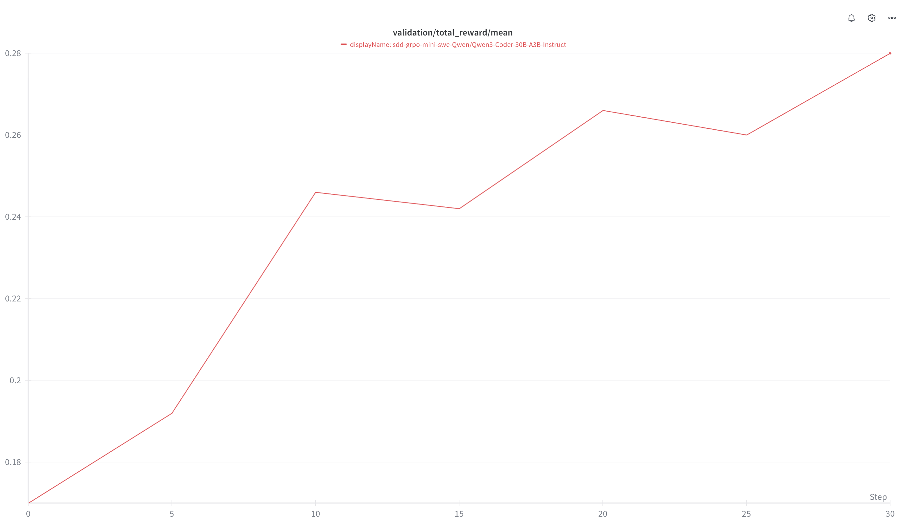

# Mini-SWE-Agent Environment

A NeMo Gym responses API agent that integrates the [Mini-SWE-Agent](https://github.com/SWE-agent/mini-swe-agent) harness for evaluating language models on software engineering tasks using the SWE-Bench dataset.

The agent has two independent paths:

- **Agent sessions** run mini-SWE 2.4.6 inside a benchmark's task sandbox through an Environment Server. See
  [Agent sessions](#agent-sessions).
- **`/run`** runs the SWE-Gym pipeline of an NVIDIA mini-swe-agent fork on this server, in Docker or Singularity, and
  grades the result itself. The rest of this README after [Agent sessions](#agent-sessions) describes it.

## Table of Content
- [Mini-SWE-Agent Environment](#mini-swe-agent-environment)
  - [Table of Content](#table-of-content)
  - [Agent sessions](#agent-sessions)
  - [Overview](#overview)
  - [Reward Profiling](#reward-profiling)
    - [Model - Qwen/Qwen3-Coder-30B-A3B-Instruct](#model---qwenqwen3-coder-30b-a3b-instruct)
  - [Dataset Information](#dataset-information)
  - [Configuration](#configuration)
    - [Agent Configuration](#agent-configuration)
  - [Usage](#usage)
    - [Download SWE-Gym Images](#download-swe-gym-images)
    - [Server](#server)
    - [Training Setup and Results](#training-setup-and-results)
  - [Contributing](#contributing)
  - [Licensing Information](#licensing-information)
    - [Dependencies](#dependencies)

## Agent sessions

[`configs/mini_swe_agent_sandboxed.yaml`](configs/mini_swe_agent_sandboxed.yaml) runs pinned
[mini-SWE 2.4.6](https://github.com/SWE-agent/mini-swe-agent/tree/v2.4.6) through Gym's agent sessions: its
`DefaultAgent` with the package's `mini.yaml` prompts, its local environment, and its `litellm_response` model, which
calls Gym's Model Server with the Responses API. An Environment Server seeds the session, sends the task as one
`/v1/responses` call behind the session cookie, closes the session, and then verifies. Pair it with a benchmark by
configuration alone, for example a Harbor task folder:

```bash
gym eval run terminal_bench_4 --agent mini_swe_agent/mini_swe_agent_sandboxed --sandbox docker \
  --model-type vllm_model --model <model> --model-url <url>
```

The config starts [`sessions_app.py`](sessions_app.py), which serves agent sessions without Ray and refuses `/run`.
`app.py` serves both paths and declares `ray_enabled` for `/run`, so Gym starts Ray for it and the environment that
runs `gym` needs the `ray` extra (`pip install "nemo-gym[ray]"`).

The step limit (500) and command timeout (30 seconds) in that config follow the Terminal Bench 4 profile. The
template's `step_limit` and `step_timeout` set mini-SWE's `agent.step_limit` and the environment's command timeout;
`/run` reads the same two fields.

**Capability level:** Evaluation. The close bundle already carries Observability evidence (one invocation with model
calls and conversation, a timed observation for every bash call, the agent sandbox's outcome), but Harness
Conformance cannot end a mini-SWE run until its scripted provider recognizes the submission command
([#5376](https://github.com/NVIDIA-NeMo/Gym/pull/5376)); Observability will be claimed once `mini_swe` is registered
and passes.

Evaluation only: token IDs and logprobs are not wired up, and training has not been validated. MCP calls in the
response output are rebuilt from the CLI's records; the model emitted only the bash calls.

### mini-SWE adapters

[`miniswe_sandboxed_agent`](../miniswe_sandboxed_agent/README.md) is deprecated but remains available. It also runs mini-SWE 2.4.6 through agent sessions, and
the deprecated `terminal_bench_4/miniswe_legacy_agent` and `terminal_bench_science/miniswe_legacy_agent` presets use it.
Both benchmarks' default `miniswe` presets run `mini_swe_agent` through the Harbor environment server.
The older adapter installs mini-SWE in the sandbox at setup, as the
task user, from PyPI, so the sandbox needs PyPI access, and it reports `miniswe_termination`. This adapter installs a
runtime built on the agent server at seed, so the sandbox needs no network; it runs mini-SWE under Gym's process
supervisor, can start its own sandbox, serves `mcp` tool grants, and reports `mini_swe_termination`. Use this adapter
for new integrations that satisfy the limits below. Existing legacy `/run` presets and tasks with `[agent].user`
must keep the older adapter until they have a supported migration path.

### Pairings and limits

- Terminal Bench 4 Harbor task folders (after `gym dataset pull terminal_bench_4`), in the sandbox the Harbor
  environment server lends.
- Terminal-Bench-Science v0.1 Harbor task folders (after `gym dataset pull terminal_bench_science`), in the sandbox
  the Harbor environment server lends. Its two tasks whose working directory is `/` are refused (see that
  benchmark's README). Preparation also skips three unsupported Compose tasks.
- `example_single_tool_call` behind `single_agent_turn_legacy` with `resources_tool_transports: [mcp]`, in a sandbox
  the agent starts.

No Resources Server lists `mini_swe_agent` in `allowed_agents`, and it has not been evaluated on Terminal Bench 2.1.
Tasks that set a `SandboxAccess.user` (Harbor tasks with `[agent].user`) or whose workdir is `/` or `/tmp` are
refused. The sandbox needs glibc 2.28 or newer, or musl, and about 450 MB under `/tmp` (see
[Installation](#installation)).

### Where it runs

| Seed | Where mini-SWE runs | Cleanup |
| --- | --- | --- |
| With `sandbox_access` from the Resources or Environment Server | The lent task sandbox, in its `workdir`. | Close stops mini-SWE and removes the session directory; the owner destroys the sandbox. |
| Without `sandbox_access`, with `sandbox_provider` set | A sandbox the agent starts from `sandbox_config` (default `workdir` `/app`, TTL = install + run timeouts + 600 s). `network_access` limits its egress: `model_only` to the Model Server's host, `model_and_tools` also to each MCP grant's host; `inherit` (the default) keeps the provider's network. | Close stops the sandbox. |
| Neither | Nowhere: the seed is refused with HTTP 422. | |

There is no host path: `/v1/responses` without an agent session answers HTTP 422. The seed is refused with HTTP 422
for a required `direct_http` grant, a `SandboxAccess.user` (mini-SWE runs as the sandbox's default user), a relative
`workdir` or one that is not disjoint from the session directory (such as `/` or `/tmp`), a loopback Model Server URL
that a remote sandbox cannot reach, a task context that is not a JSON object or declares an MCP server without a
name, a sandbox with glibc older than 2.28 (no attempt can change the image), and a `network_access` other than
`inherit` for a borrowed sandbox, whose network belongs to its owner. `SandboxAccess.env` is applied to every bash
command.

### Installation

The runtime is installed at seed, before the activation, with
[`SandboxPythonRuntime`](../../nemo_gym/agents/utils/sandbox_python.py):

- The agent server builds it from [`runtime/requirements.in`](runtime/requirements.in) (mini-SWE 2.4.6, LiteLLM
  1.106.0 with its MCP extra, MCP 2.2.0), constrained to the full lock in
  [`runtime/requirements.txt`](runtime/requirements.txt), and uploads it with a pinned CPython 3.13. The sandbox needs
  no network, no `uv` and no Python of its own: x86_64 or aarch64 Linux with glibc 2.28 or newer (LiteLLM's wheels) or
  musl, `bash`, `tar` with gzip, and about 450 MB under `/tmp` (the runtime is about 410 MB).
- The lock replaces this server's own environment as the runtime's constraints: `/run` keeps the SWE-Gym fork in this
  server's environment, and LiteLLM 1.106.0 needs MCP 2, which Gym's MCP 1 clients cannot share. After changing
  `requirements.in`, regenerate the lock with the command in its header.
- [`runtime/overrides.txt`](runtime/overrides.txt) leaves out `datasets`, which mini-SWE declares for its batch
  benchmark runners. Agent sessions never import it; without it the runtime is about half the size.
- A runtime already in the sandbox (`/tmp/nemo-gym-mini-swe-runtime-<key>`, keyed by every pin) is reused only after
  it imports mini-SWE at version 2.4.6 and its LiteLLM and MCP clients. A new one is checked the same way before it is
  published by an atomic rename, so concurrent or interrupted seeds never expose a partial runtime.

The runner ([`sandbox_runner.py`](sandbox_runner.py)) runs with the runtime's interpreter and `-E -s`, so the task's
`PYTHON*` settings and user site-packages never reach mini-SWE, while its bash commands keep the task's environment,
`HOME` and `XDG_*` directories. The interpreter is linked into the session directory as `bin/mini-swe`, and the
runner and its MCP CLI run under that name: no command line in the supervised tree says `python`, so a task's
`pkill python`, `pkill -9 -f python` or `killall python3` reaches neither them nor Gym's supervisor. mini-SWE's own
configuration directory is in the session directory (`/tmp/nemo-gym-mini-swe-sessions/<id>`), outside the task
repository and `HOME`. Gym's process supervisor runs the runner and stops it, its commands and its MCP CLI at the
deadline and on close. The MCP CLI closes its server sessions when it is stopped, which also stops the stdio servers a
task declares.

### Model calls

Every model call goes to the rollout-prefixed Model Server URL as `openai/<model>`, with `x-session-id` set to the
episode's capture key, which is also the reported invocation ID. LiteLLM's and mini-SWE's own retries are off; the
Model Server keeps its retry policy. Request fields are handled as follows:

- Forwarded to every model call: `instructions`, `temperature`, `top_p`, `max_output_tokens`, `reasoning`, `parallel_tool_calls`, and
  `tool_choice` when it is `auto` or `required`. Any other `tool_choice` is refused with HTTP 422: the model is offered
  only the bash tool, so it can neither name another tool nor call none. LiteLLM drops a field that an OpenAI model in
  its cost map does not support (`mini.yaml` sets `drop_params`).
- Read by the adapter: the text of every `input` message in order is the task; `metadata.agent_timeout_sec` and the
  seed's `agent_timeout_sec` can only shorten `sandbox_runner_timeout_seconds`; `model` must match the configured
  model. `tools` is not forwarded: mini-SWE offers the model only its bash tool, and granted tools are reached through it.
  A request with `tools` and no MCP server to reach them is refused with HTTP 422; set `resources_tool_transports: [mcp]`.
- Any other field with a non-default value is refused with HTTP 422.

Agent sessions apply `max_output_tokens` separately to every model call, consistent with other session harnesses.
It is not a shared token budget for the whole episode. The exact cap, including values below 16, reaches the Model
Server through LiteLLM's `extra_body`; omitting it leaves the Model Server's configured default in effect.

The legacy SWE-Gym `/run` still rejects request-level `max_output_tokens` with HTTP 422 before starting work because
that fork cannot forward it. For legacy runs, omit `responses_create_params.max_output_tokens` and configure the
per-call limit on the Model Server (`policy_model.responses_api_models.vllm_model.extra_body.max_tokens` for the
Chat Completions vLLM adapter, or `extra_body.max_output_tokens` for a Responses-native adapter). If `policy_base_url`
bypasses the Gym Model Server, configure the limit at that endpoint.

### Tools

mini-SWE's bash tool runs each command in a new shell in the task's working directory. A command that leaves a
background process holding its output open returns at the command timeout (`step_timeout`), and its process group, the
background job included, is killed; start task services with output redirected, for example `nohup cmd > log 2>&1 &`.

MCP servers reach the bash tool through a task-local CLI ([`mcp_cli.py`](mcp_cli.py)), which keeps every server's
session open for the run: the task's prompt lists their tools as JSON schemas and the command that calls them. The
servers are:

- The episode's `mcp` tool grants (`resources_tool_transports: [mcp]`), with their URL and headers.
- The task's own MCP servers from the Harbor task context (`/tmp/.nemo-gym/task.json`), with its `skills_dir`
  named in the prompt. The adapter declares `supports_task_tool_context`. A server the Harbor environment server
  also grants is connected once.

A required server, and every server a task declares, must connect before the first model call; otherwise the
activation fails without inference, and its error names each server with the reason it did not connect. An optional
server that does not connect is left out of the prompt and reported as an `mcp_server_unavailable` gap. Each MCP
call is placed in the response after the bash call that made it, as `mcp__<server>__<tool>` with its result, so
verifiers that read tool calls see it. It is not a tool-call observation of its own: the model requested the bash call.
The CLI's call records are written inside the sandbox by the user that runs the agent's commands, so a model command
can append records too. A line that is not a call record is left out and declared as an `mcp_call_record_invalid`
gap, and a run without MCP servers reports no MCP call. A call to a server the run was not granted is reported as the
failed call the CLI recorded. Each call keeps at most 64 KiB of its output in the response, and a record file over
16 MiB is not read (an `mcp_call_records_unavailable` gap). The rest of the session directory, mini-SWE's trajectory
included, is writable by that user too, so a model command can also alter the run Gym reports; the verifier reads the
task's own state, not these files.
mini-SWE saves no observation for its submission command; the runner keeps that command's output, which ends the
response and the reported conversation.

### Outcomes

| mini-SWE ended with | Response | Verified |
| --- | --- | --- |
| `Submitted` | `completed` | Yes |
| `LimitsExceeded`, `TimeExceeded`, a context-window error (including the empty reply that Gym's vLLM Model Server marks `nemo_gym_context_window_exceeded`, which mini-SWE rejects until `RepeatedFormatError`), Gym's deadline after a model call returned, or a rollout stop | `incomplete`; `mini_swe_termination` names it | Yes |
| Gym's deadline before any model call returned | `failed`, `AgentDeadline`, with `ng_agent_outcome` `unknown`; no model transport cause is inferred | By the outcome policy, which retries it by default |
| No exit status: the run was killed mid-step, by its own command or an OOM kill. The runner saves before each step's commands run, so the step's model call is kept. | `incomplete`, `killed` | Yes |
| No exit status: close stopped the run | `incomplete`, `cancelled` | No: a closed episode is not verified |
| A model call that failed (LiteLLM's error, such as `RateLimitError`) or `RepeatedFormatError` | `failed` with `ng_agent_outcome`: `model_request_error` with the HTTP status of the answer that ended the call (LiteLLM's exception class alone does not say it: a 403 and a 413 are both `APIError`), `model_transport_error` when no answer came, `agent_invalid_output` for the format error | By the Environment Server's outcome policy |
| No trajectory (the runner died before its first model call returned), a required MCP server that did not connect, or another exception | HTTP 500, retryable | No |

Each model call may take the whole run's budget, so a first call slower than the whole budget is retried rather than
graded. Usage is reported only when every model call, including responses mini-SWE rejected for their format, has a
usage record. A rejected response stays in the output without its function calls, which never ran. LiteLLM's
response-ID envelope is decoded so model-call references join Gym's captured calls.

## Overview

The Mini-SWE-Agent environment provides an interface for training models on solving real-world software engineering problems. 
It leverages the SWE-Gym dataset of GitHub issues and uses containerized environments (Docker/Singularity) to execute code modifications and validate solutions.

## Reward Profiling

### Model - Qwen/Qwen3-Coder-30B-A3B-Instruct
```md
Accuracy: 0.10
Resolved: 276
Total Instances: 2401
Average Turns: 88
```
## Dataset Information

- Training data - [SWE-Gym/SWE-Gym](https://huggingface.co/datasets/SWE-Gym/SWE-Gym) contains 2438 instances sourced from 11 Python repos, following SWE-Bench data collection procedure.
- Validation data - [princeton-nlp/SWE-bench_Verified](https://huggingface.co/datasets/princeton-nlp/SWE-bench_Verified) SWE-bench Verified is a subset of 500 samples from the SWE-bench test set, which have been human-validated for quality. SWE-bench is a dataset that tests systems’ ability to solve GitHub issues automatically. See this post for more details on the human-validation process.

## Configuration

### Agent Configuration 

Path - `resources_servers/mini_swe_agent/configs/mini_swe_agent.yaml
```yaml
mini_swe_agent_resources_server:
  resources_servers:
    mini_swe_agent:
      entrypoint: app.py
      domain: coding
mini_swe_simple_agent:
  responses_api_agents:
    mini_swe_agent:
      entrypoint: app.py
      resources_server:
        type: resources_servers
        name: mini_swe_agent_resources_server
      model_server:
        type: responses_api_models
        name: openai_model
      datasets:
      - name: train
        type: train
        jsonl_fpath: resources_servers/mini_swe_agent/data/train.jsonl
        gitlab_identifier:
          dataset_name: mini_swe_agent
          version: 0.0.1
          artifact_fpath: train.jsonl
        license: MIT
      - name: validation
        type: validation
        jsonl_fpath: resources_servers/mini_swe_agent/data/validation.jsonl
        gitlab_identifier:
          dataset_name: mini_swe_agent
          version: 0.0.1
          artifact_fpath: validation.jsonl
        license: MIT
      - name: example
        type: example
        jsonl_fpath: resources_servers/mini_swe_agent/data/example.jsonl
      concurrency: 16 # number of instances to run concurrently
      env: singularity 
      cache_dir_template: ??? # The cache dir path where singularity images are stored
      run_golden: False # If set to true, run the golden patch
      step_timeout: 600 # Timeout for each agent step
      eval_timeout: 1800 # Timeout for running the evaluation (unit tests)
      skip_if_exists: False # If set to true, skip all instances already processed for the model
      collapse_limit: 3 # Warn the agent if the same command if repeated collapse_limit times
```


## Usage

### Download SWE-Gym Images

For how to download images and convert to .sif, you can refer to https://github.com/NVIDIA/NeMo-Skills/blob/main/nemo_skills/dataset/swe-bench/dump_images.py

### Server

```bash
# Download swe-gym data
gym dataset download --storage gitlab \
            --name mini_swe_agent \
            --revision 0.0.1 \
            --artifact train.jsonl \
            --output data/train.jsonl

# Start server
gym env start \
        --resources-server mini_swe_agent \
        --model-type openai_model & \
        '+mini_swe_simple_agent.responses_api_agents.mini_swe_agent.cache_dir_template=/path/to/images/xingyaoww_sweb.eval.x86_64.\{instance_id\}.sif' \
        +mini_swe_simple_agent.responses_api_agents.mini_swe_agent.run_golden=False \
        +mini_swe_simple_agent.responses_api_agents.mini_swe_agent.skip_if_exists=True \
        +mini_swe_simple_agent.responses_api_agents.mini_swe_agent.concurrency=16 \
        +mini_swe_simple_agent.responses_api_agents.mini_swe_agent.step_timeout=300 \
        +mini_swe_simple_agent.responses_api_agents.mini_swe_agent.eval_timeout=900

# Collect rollouts
gym eval run --no-serve \
            --agent mini_swe_simple_agent \
            --input data/train.jsonl \
            --output results/mini_swe_agent_swe_gym.jsonl
```

### Training Setup and Results

**Model:** Qwen/Qwen3-Coder-30B-A3B-Instruct  
**Framework:** [NemoRL](https://github.com/NVIDIA-NeMo/RL) \
**Num nodes:** 16  
**Num prompts per step:** 32  
**Num rollouts per step:** 16 \
**Validation** - SWEBench Verified on Mini-SWE-Agent



**Note - NemoRL changes for installing Singularity on all nodes.**

```bash
read -r -d '' SETUP_COMMAND <<EOF
apt-get update && apt-get install -y git build-essential gcc
apt install -y wget && \
cd /tmp && \
wget https://github.com/apptainer/apptainer/releases/download/v1.3.1/apptainer_1.3.1_amd64.deb && \
apt install -y ./apptainer_1.3.1_amd64.deb && \
ln -sf /usr/bin/apptainer /usr/bin/singularity
cd ${REPO_LOCATION}
EOF

export SETUP_COMMAND
```

```diff
diff --git a/ray.sub b/ray.sub
index 9b4feb11..f765a609 100644
--- a/ray.sub
+++ b/ray.sub
@@ -50,6 +50,7 @@ maybe_gres_arg() {
 CONTAINER=$CONTAINER
 MOUNTS=$MOUNTS
 COMMAND=${COMMAND:-}  # This is a script relative to the SLURM_SUBMIT_DIR. If left empty, it will leave the cluster idle after it's brought up.
+SETUP_COMMAND=${SETUP_COMMAND:-}  # Setup commands to run on all nodes before starting Ray
 ########################################################
 # Ports for all nodes (should be odd numbers since we place head/worker[0] on the same node) so all workers get the odd ports, but the head will get +1 the ports
 NODE_MANAGER_PORT=${NODE_MANAGER_PORT:-53001}
@@ -293,6 +294,7 @@ chmod +x /launch-head.sh
 
 count=0
 while [[ \$count -lt $num_retries ]]; do
+  $SETUP_COMMAND
   bash /launch-head.sh
   count=\$((count+1))
   echo "Head node failed \$count/$num_retries times, restarting in 5 seconds..."
@@ -305,6 +307,7 @@ EOF
 srun $COMMON_SRUN_ARGS --container-name=ray-head --nodes=1 --ntasks=1 --cpus-per-task=$CPUS_PER_WORKER -w "$head_node" -o $LOG_DIR/ray-head.log bash -x -c "$head_cmd" &
 SRUN_PIDS["ray-head"]=$!
 
+sleep 100s
 NUM_ACTORS=$((GPUS_PER_NODE * SLURM_JOB_NUM_NODES))
 
 # Start Ray worker nodes
@@ -392,6 +395,7 @@ EOFINNER
 
 count=0
 while [[ \$count -lt $num_retries ]]; do
+  $SETUP_COMMAND
   bash /launch-worker.sh
   count=\$((count+1))
   echo "Worker failed \$count/$num_retries times, restarting in 5 seconds..."

```

## Contributing

Please refer to the main NeMo Gym documentation for contributing guidelines.

## Licensing Information

- **Code**: Apache 2.0
- **SWE-GYM**: MIT

### Dependencies
- **nemo_gym**: Apache 2.0
- **mini-swe-agent**: MIT
- **SWE-Bench-Package**: MIT
